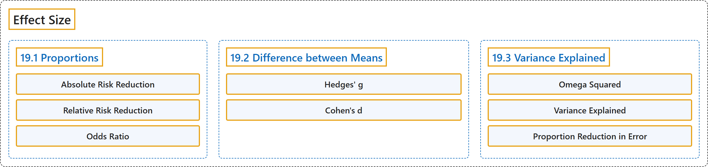

# 19 Effect Size

## Classification

## Glossary

| Term | Definition | 中文翻译 | Source |
|---|---|---|---|
| **19 Effect Size** 效应量 | (No definition) | （无定义） | [Online Statistics Education, n.d., chapter 19](https://onlinestatbook.com/2/effect_size/contents.html) |
| **19.1 Proportions** 比例 | (No definition) | （无定义） | [Online Statistics Education, n.d., section 19.1](https://onlinestatbook.com/2/effect_size/proportions.html) |
| **Absolute Risk Reduction** 绝对风险降低 | "This measure of the benefit is called the **Absolute Risk Reduction** (ARR)." | 这种获益的度量称为**绝对风险降低**（ARR）。 | [Online Statistics Education, n.d., section 19.1](https://onlinestatbook.com/2/effect_size/proportions.html) |
| **Relative Risk Reduction** 相对风险降低 | "This measure of the benefit is called the **Relative Risk Reduction** (RRR)." | 这种获益的度量称为**相对风险降低**（RRR）。 | [Online Statistics Education, n.d., section 19.1](https://onlinestatbook.com/2/effect_size/proportions.html) |
| **Odds Ratio** 比值比 | "Note that the **odds ratio** is the **ratio of the odds** and not the ratio of the probabilities." | 注意，**比值比**是**比值（odds）之比**，而不是概率之比。 | [Online Statistics Education, n.d., section 19.1](https://onlinestatbook.com/2/effect_size/proportions.html) |
| **19.2 Difference between Means** 均值之差 | (No definition) | （无定义） | [Online Statistics Education, n.d., section 19.2](https://onlinestatbook.com/2/effect_size/two_means.html) |
| **Hedges' g** 赫奇斯 g | "They differ only in that **Hedges' g** uses the version of the standard deviation formula in which you **divide by** $N-1$, whereas Cohen's d uses the version in which you divide by $N$." | 二者的区别仅在于：**赫奇斯 g** 使用**除以** $N-1$ 的标准差公式，而科恩 d 使用除以 $N$ 的公式。 | [Online Statistics Education, n.d., section 19.2](https://onlinestatbook.com/2/effect_size/two_means.html) |
| **Cohen's d** 科恩 d | "They differ only in that Hedges' g uses the version of the standard deviation formula in which you divide by $N-1$, whereas **Cohen's d** uses the version in which you **divide by** $N$." | 二者的区别仅在于：赫奇斯 g 使用除以 $N-1$ 的标准差公式，而**科恩 d** 使用**除以** $N$ 的公式。 | [Online Statistics Education, n.d., section 19.2](https://onlinestatbook.com/2/effect_size/two_means.html) |
| **19.3 Variance Explained** 方差解释量 | (No definition) | （无定义） | [Online Statistics Education, n.d., section 19.3](https://onlinestatbook.com/2/effect_size/variance_explained.html) |
| **Omega Squared** ω 平方 | "An alternative measure, $\omega^2$ (**omega squared**), is **unbiased** and can be computed from … where MSE is the mean square error and $k$ is the number of conditions." | 另一种度量 $\omega^2$（**ω 平方**）是**无偏**的，可以由 … 计算，其中 MSE 是均方误差，$k$ 是条件数。 | [Online Statistics Education, n.d., section 19.3](https://onlinestatbook.com/2/effect_size/variance_explained.html) |
| **Variance Explained** 方差解释比例 | "Effect sizes are often measured in terms of the **proportion of variance explained** by a variable." | 效应量常用一个变量所**解释的方差比例**来度量。 | [Online Statistics Education, n.d., section 19.3](https://onlinestatbook.com/2/effect_size/variance_explained.html) |
| **Proportion Reduction in Error** 误差减少比例 | "An alternative way to look at the variance explained is as the **proportion reduction in error**." | 看待方差解释比例的另一种方式是把它视为**误差减少比例**。 | [Online Statistics Education, n.d., section 19.3](https://onlinestatbook.com/2/effect_size/variance_explained.html) |

## References

*Online statistics education: An interactive multimedia course of study*. (n.d.). Rice University, University of Houston Clear Lake, and Tufts University. Retrieved October 29, 2026, from <https://onlinestatbook.com/2/>
