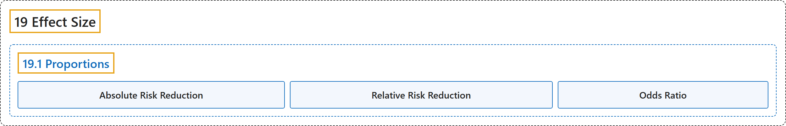

# 19.1 Proportions

## Classification

## Glossary

| Term | Definition | 中文翻译 | Source |
|---|---|---|---|
| **19.1 Proportions** 比例 | (No definition) | （无定义） | [Online Statistics Education, n.d., section 19.1](https://onlinestatbook.com/2/effect_size/proportions.html) |
| **Absolute Risk Reduction** 绝对风险降低 | "This measure of the benefit is called the **Absolute Risk Reduction** (ARR)." | 这种获益的度量称为**绝对风险降低**（ARR）。 | [Online Statistics Education, n.d., section 19.1](https://onlinestatbook.com/2/effect_size/proportions.html) |
| **Relative Risk Reduction** 相对风险降低 | "This measure of the benefit is called the **Relative Risk Reduction** (RRR)." | 这种获益的度量称为**相对风险降低**（RRR）。 | [Online Statistics Education, n.d., section 19.1](https://onlinestatbook.com/2/effect_size/proportions.html) |
| **Odds Ratio** 比值比 | "Note that the **odds ratio** is the **ratio of the odds** and not the ratio of the probabilities." | 注意，**比值比**是**比值（odds）之比**，而不是概率之比。 | [Online Statistics Education, n.d., section 19.1](https://onlinestatbook.com/2/effect_size/proportions.html) |

## References

*Online statistics education: An interactive multimedia course of study*. (n.d.). Rice University, University of Houston Clear Lake, and Tufts University. Retrieved October 29, 2026, from <https://onlinestatbook.com/2/>
