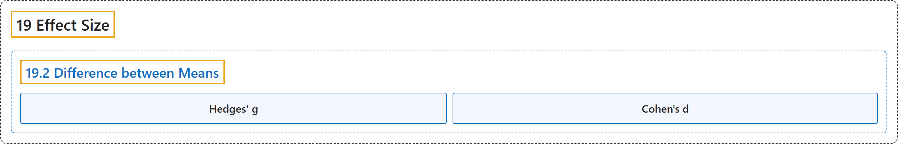

# 19.2 Difference between Means

## Classification

## Glossary

| Term | Definition | 中文翻译 | Source |
|---|---|---|---|
| **19.2 Difference between Means** 均值之差 | (No definition) | （无定义） | [Online Statistics Education, n.d., section 19.2](https://onlinestatbook.com/2/effect_size/two_means.html) |
| **Hedges' g** 赫奇斯 g | "They differ only in that **Hedges' g** uses the version of the standard deviation formula in which you **divide by** $N-1$, whereas Cohen's d uses the version in which you divide by $N$." | 二者的区别仅在于：**赫奇斯 g** 使用**除以** $N-1$ 的标准差公式，而科恩 d 使用除以 $N$ 的公式。 | [Online Statistics Education, n.d., section 19.2](https://onlinestatbook.com/2/effect_size/two_means.html) |
| **Cohen's d** 科恩 d | "They differ only in that Hedges' g uses the version of the standard deviation formula in which you divide by $N-1$, whereas **Cohen's d** uses the version in which you **divide by** $N$." | 二者的区别仅在于：赫奇斯 g 使用除以 $N-1$ 的标准差公式，而**科恩 d** 使用**除以** $N$ 的公式。 | [Online Statistics Education, n.d., section 19.2](https://onlinestatbook.com/2/effect_size/two_means.html) |

## References

*Online statistics education: An interactive multimedia course of study*. (n.d.). Rice University, University of Houston Clear Lake, and Tufts University. Retrieved October 29, 2026, from <https://onlinestatbook.com/2/>
