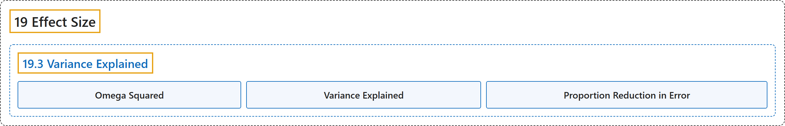

# 19.3 Variance Explained

## Classification

## Glossary

| Term | Definition | 中文翻译 | Source |
|---|---|---|---|
| **19.3 Variance Explained** 方差解释量 | (No definition) | （无定义） | [Online Statistics Education, n.d., section 19.3](https://onlinestatbook.com/2/effect_size/variance_explained.html) |
| **Omega Squared** ω 平方 | "An alternative measure, $\omega^2$ (**omega squared**), is **unbiased** and can be computed from … where MSE is the mean square error and $k$ is the number of conditions." | 另一种度量 $\omega^2$（**ω 平方**）是**无偏**的，可以由 … 计算，其中 MSE 是均方误差，$k$ 是条件数。 | [Online Statistics Education, n.d., section 19.3](https://onlinestatbook.com/2/effect_size/variance_explained.html) |
| **Variance Explained** 方差解释比例 | "Effect sizes are often measured in terms of the **proportion of variance explained** by a variable." | 效应量常用一个变量所**解释的方差比例**来度量。 | [Online Statistics Education, n.d., section 19.3](https://onlinestatbook.com/2/effect_size/variance_explained.html) |
| **Proportion Reduction in Error** 误差减少比例 | "An alternative way to look at the variance explained is as the **proportion reduction in error**." | 看待方差解释比例的另一种方式是把它视为**误差减少比例**。 | [Online Statistics Education, n.d., section 19.3](https://onlinestatbook.com/2/effect_size/variance_explained.html) |

## References

*Online statistics education: An interactive multimedia course of study*. (n.d.). Rice University, University of Houston Clear Lake, and Tufts University. Retrieved October 29, 2026, from <https://onlinestatbook.com/2/>
