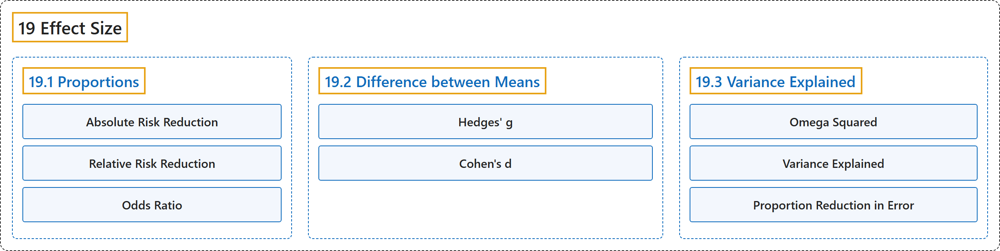

# 19 Effect Size

## Classification

## Glossary

| Term | Definition | 中文翻译 | Source |
|---|---|---|---|
| **19 Effect Size** 效应量 | (No definition) | （无定义） | [Online Statistics Education, n.d., chapter 19](https://onlinestatbook.com/2/effect_size/contents.html) |
| **[19.1 Proportions](19-1-proportions.md)** 比例 | (No definition) | （无定义） | [Online Statistics Education, n.d., section 19.1](https://onlinestatbook.com/2/effect_size/proportions.html) |
| **[19.2 Difference between Means](19-2-difference-between-means.md)** 均值之差 | (No definition) | （无定义） | [Online Statistics Education, n.d., section 19.2](https://onlinestatbook.com/2/effect_size/two_means.html) |
| **[19.3 Variance Explained](19-3-variance-explained.md)** 方差解释量 | (No definition) | （无定义） | [Online Statistics Education, n.d., section 19.3](https://onlinestatbook.com/2/effect_size/variance_explained.html) |

## References

*Online statistics education: An interactive multimedia course of study*. (n.d.). Rice University, University of Houston Clear Lake, and Tufts University. Retrieved October 29, 2026, from <https://onlinestatbook.com/2/>
