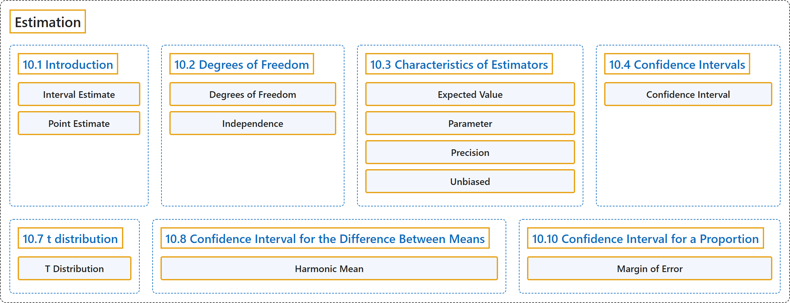

# 10 Estimation

## Classification

## Glossary

| Term | Definition | 中文翻译 | Source |
|---|---|---|---|
| **10 Estimation** 估计 | (No definition) | （无定义） | [Online Statistics Education, n.d., chapter 10](https://onlinestatbook.com/2/estimation/estimation.html) |
| **10.1 Introduction** 引言 | (No definition) | （无定义） | [Online Statistics Education, n.d., section 10.1](https://onlinestatbook.com/2/estimation/intro.html) |
| **Interval Estimate** 区间估计 | "An **interval estimate** is a **range of scores likely to contain the estimated parameter**. See confidence intervals." | **区间估计**是**可能包含被估计参数的一个分数范围**。参见置信区间。 | [Online Statistics Education, n.d., glossary](https://onlinestatbook.com/2/glossary/interval_estimate.html) |
| **Point Estimate** 点估计 | "When a parameter is being estimated, the estimate can be either a single number or it can be a range of numbers such as in a confidence interval. When the estimate is a single number, the estimate is called a "**point estimate**."" | 估计参数时，估计值可以是单个数，也可以是一个数的范围，例如置信区间。当估计值是单个数时，该估计称为“**点估计**”。 | [Online Statistics Education, n.d., glossary](https://onlinestatbook.com/2/glossary/point_estimate.html) |
| **10.2 Degrees of Freedom** 自由度 | (No definition) | （无定义） | [Online Statistics Education, n.d., section 10.2](https://onlinestatbook.com/2/estimation/df.html) |
| **Degrees of Freedom** 自由度 | "The **degrees of freedom** of an estimate is the number of independent pieces of information that go into the estimate. In general, the degrees of freedom for an estimate is equal to the number of values minus the number of parameters estimated en route to the estimate in question. For example, to estimate the population variance, one must first estimate the population mean. Therefore, if the estimate of variance is based on $N$ observations, there are $N - 1$ degrees of freedom." | 估计量的**自由度**是构成该估计的独立信息的个数。一般而言，估计量的自由度等于值的个数减去在得到所讨论的估计过程中所估计的参数个数。例如，要估计总体方差，必须先估计总体均值。因此，如果方差的估计基于 $N$ 个观测，则有 $N - 1$ 个自由度。 | [Online Statistics Education, n.d., glossary](https://onlinestatbook.com/2/glossary/df.html) |
| **Independence** 独立性 | "Two variables are said to be **independent** if the value of one variable provides no information about the value of the other variable. These two variables would be uncorrelated so that Pearson's $r$ would be 0. Two events are independent if the probability the second event occurring is the same regardless of whether or not the first event occurred." | 如果一个变量的值不能提供关于另一个变量的值的任何信息，则称这两个变量**独立**。这两个变量是不相关的，因此皮尔逊 $r$ 为 0。如果无论第一个事件是否发生，第二个事件发生的概率都相同，则这两个事件独立。 | [Online Statistics Education, n.d., glossary](https://onlinestatbook.com/2/glossary/independence.html) |
| **10.3 Characteristics of Estimators** 估计量的特性 | (No definition) | （无定义） | [Online Statistics Education, n.d., section 10.3](https://onlinestatbook.com/2/estimation/characteristics.html) |
| **Expected Value** 期望值 | "The **expected value** of a statistic is **the mean of the sampling distribution of the statistic**. It can be loosely thought of as the long-run average value of the statistic." | 统计量的**期望值**是**该统计量抽样分布的均值**。可以粗略地将其看作该统计量的长期平均值。 | [Online Statistics Education, n.d., glossary](https://onlinestatbook.com/2/glossary/expected_value.html) |
| **Parameter** 参数 | "A **value calculated in a population**. For example, the mean of the numbers in a population is a parameter. Compare with a statistic, which is a value computed in a sample to estimate a parameter." | **在总体中计算得出的值**。例如，总体中各数的均值就是一个参数。与统计量相对照，统计量是在样本中计算出的用于估计参数的值。 | [Online Statistics Education, n.d., glossary](https://onlinestatbook.com/2/glossary/parameter.html) |
| **Precision** 精度 | "A statistic's **precision** concerns to how close it is expected to be to the parameter it is estimating. Precise statistics are vary less from sample to sample. The precision of a statistic is usually defined in terms of it standard error." | 统计量的**精度**涉及它预期与其所估计的参数有多接近。精确的统计量在不同样本之间变化较小。统计量的精度通常用它的标准误来定义。 | [Online Statistics Education, n.d., glossary](https://onlinestatbook.com/2/glossary/precision.html) |
| **Unbiased** 无偏 | "A sample is said to be **unbiased** when every individual has an equal chance of being chosen from the population. An estimator is unbiased if it **does not systematically overestimate or underestimate the parameter it is estimating**. In other words, it is unbiased if the mean of the sampling distribution of the statistic is the parameter it is estimating, The sample mean is an unbiased estimate of the population mean. See: bias" | 当总体中每个个体被抽中的机会均等时，称样本是**无偏**的。如果一个估计量**不会系统性地高估或低估它所估计的参数**，则它是无偏的。换句话说，如果统计量抽样分布的均值就是它所估计的参数，则它是无偏的。样本均值是总体均值的无偏估计。参见：偏倚 | [Online Statistics Education, n.d., glossary](https://onlinestatbook.com/2/glossary/unbiased.html) |
| **10.4 Confidence Intervals** 置信区间 | (No definition) | （无定义） | [Online Statistics Education, n.d., section 10.4](https://onlinestatbook.com/2/estimation/confidence_ov.html) |
| **Confidence Interval** 置信区间 | "A **confidence interval** is a range of scores likely to contain the parameter being estimated. Intervals can be constructed to be more or less likely to contain the parameter: 95% of 95% confidence intervals contain the estimated parameter whereas 99% of 99% confidence intervals contain the estimated parameter. The wider the confidence interval, the more uncertainty there is about the value of the parameter." | **置信区间**是可能包含被估计参数的一段取值范围。可以构造包含参数的可能性或大或小的区间：95% 置信区间中有 95% 包含被估计的参数，而 99% 置信区间中有 99% 包含被估计的参数。置信区间越宽，参数值的不确定性就越大。 | [Online Statistics Education, n.d., glossary](https://onlinestatbook.com/2/glossary/confidence_interval.html) |
| **10.7 t distribution** t 分布 | (No definition) | （无定义） | [Online Statistics Education, n.d., section 10.7](https://onlinestatbook.com/2/estimation/t_distribution.html) |
| **T Distribution** t 分布 | "The $t$ distribution is **the distribution of a value sampled from a normal distribution divided by an estimate of the distribution's standard deviation**. In practice the value is typically a statistic such as the mean or the difference between means and the standard deviation is an estimate of the standard error of the statistic. The $t$ distribution in leptokurtic." | $t$ 分布是**从正态分布中抽取的值除以该分布标准差的估计值所得的分布**。在实际中，该值通常是均值或均值之差等统计量，而标准差是该统计量标准误的估计值。$t$ 分布是尖峰态的。 | [Online Statistics Education, n.d., glossary](https://onlinestatbook.com/2/glossary/t_distribution.html) |
| **10.8 Confidence Interval for the Difference Between Means** 均值之差的置信区间 | (No definition) | （无定义） | [Online Statistics Education, n.d., section 10.8](https://onlinestatbook.com/2/estimation/difference_means.html) |
| **Harmonic Mean** 调和平均数 | "The **harmonic mean** of $n$ numbers ($X_1$ to $X_n$) is computed using the following formula: … Often the harmonic mean of sample sizes is computed." | $n$ 个数（$X_1$ 到 $X_n$）的**调和平均数**用下面的公式计算：… 通常计算的是样本量的调和平均数。 | [Online Statistics Education, n.d., glossary](https://onlinestatbook.com/2/glossary/harmonic_mean.html) |
| **10.10 Confidence Interval for a Proportion** 比例的置信区间 | (No definition) | （无定义） | [Online Statistics Education, n.d., section 10.10](https://onlinestatbook.com/2/estimation/proportion_ci.html) |
| **Margin of Error** 误差限 | "When a statistic is used to estimate a parameter, it is common to compute a confidence interval. The **margin of error** is the **difference between the statistic and the endpoints of the interval**. For example, if the statistic were 0.6 and the confidence interval ranged from 0.4 to 0.8, then the margin of error would be 0.20. Unless otherwise specified, the 95% confidence interval is used." | 当用统计量估计参数时，通常要计算置信区间。**误差限**是**统计量与区间端点之差**。例如，如果统计量为 0.6，置信区间为 0.4 到 0.8，则误差限为 0.20。除非另有说明，一般使用 95% 置信区间。 | [Online Statistics Education, n.d., glossary](https://onlinestatbook.com/2/glossary/margin_error.html) |

## References

*Online statistics education: An interactive multimedia course of study*. (n.d.). Rice University, University of Houston Clear Lake, and Tufts University. Retrieved October 29, 2026, from <https://onlinestatbook.com/2/>
