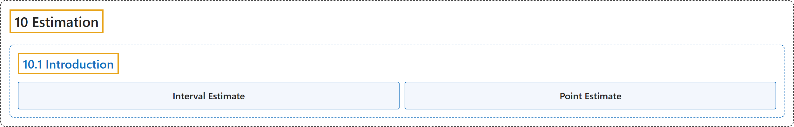

# 10.1 Introduction

## Classification

## Glossary

| Term | Definition | 中文翻译 | Source |
|---|---|---|---|
| **10.1 Introduction** 介绍 | (No definition) | （无定义） | [Online Statistics Education, n.d., section 10.1](https://onlinestatbook.com/2/estimation/intro.html) |
| **Interval Estimate** 区间估计 | "An **interval estimate** is a **range of scores likely to contain the estimated parameter**. See confidence intervals." | **区间估计**是**可能包含被估计参数的一个分数范围**。参见置信区间。 | [Online Statistics Education, n.d., glossary](https://onlinestatbook.com/2/glossary/interval_estimate.html) |
| **Point Estimate** 点估计 | "When a parameter is being estimated, the estimate can be either a single number or it can be a range of numbers such as in a confidence interval. When the estimate is a single number, the estimate is called a "**point estimate**."" | 估计参数时，估计值可以是单个数，也可以是一个数的范围，例如置信区间。当估计值是单个数时，该估计称为“**点估计**”。 | [Online Statistics Education, n.d., glossary](https://onlinestatbook.com/2/glossary/point_estimate.html) |

## References

*Online statistics education: An interactive multimedia course of study*. (n.d.). Rice University, University of Houston Clear Lake, and Tufts University. Retrieved October 29, 2026, from <https://onlinestatbook.com/2/>
