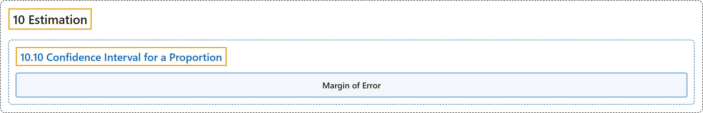

# 10.10 Confidence Interval for a Proportion

## Classification

## Glossary

| Term | Definition | 中文翻译 | Source |
|---|---|---|---|
| **10.10 Confidence Interval for a Proportion** 比例的置信区间 | (No definition) | （无定义） | [Online Statistics Education, n.d., section 10.10](https://onlinestatbook.com/2/estimation/proportion_ci.html) |
| **Margin of Error** 误差限 | "When a statistic is used to estimate a parameter, it is common to compute a confidence interval. The **margin of error** is the **difference between the statistic and the endpoints of the interval**. For example, if the statistic were 0.6 and the confidence interval ranged from 0.4 to 0.8, then the margin of error would be 0.20. Unless otherwise specified, the 95% confidence interval is used." | 当用统计量估计参数时，通常要计算置信区间。**误差限**是**统计量与区间端点之差**。例如，如果统计量为 0.6，置信区间为 0.4 到 0.8，则误差限为 0.20。除非另有说明，一般使用 95% 置信区间。 | [Online Statistics Education, n.d., glossary](https://onlinestatbook.com/2/glossary/margin_error.html) |

## References

*Online statistics education: An interactive multimedia course of study*. (n.d.). Rice University, University of Houston Clear Lake, and Tufts University. Retrieved October 29, 2026, from <https://onlinestatbook.com/2/>
