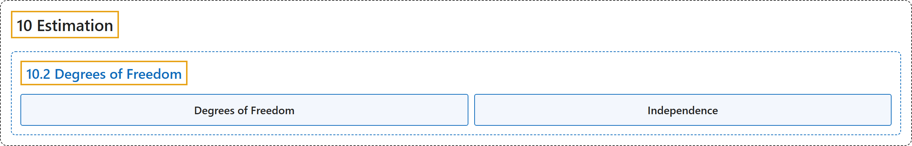

# 10.2 Degrees of Freedom

## Classification

## Glossary

| Term | Definition | 中文翻译 | Source |
|---|---|---|---|
| **10.2 Degrees of Freedom** 自由度 | (No definition) | （无定义） | [Online Statistics Education, n.d., section 10.2](https://onlinestatbook.com/2/estimation/df.html) |
| **Degrees of Freedom** 自由度 | "The **degrees of freedom** of an estimate is the number of independent pieces of information that go into the estimate. In general, the degrees of freedom for an estimate is equal to the number of values minus the number of parameters estimated en route to the estimate in question. For example, to estimate the population variance, one must first estimate the population mean. Therefore, if the estimate of variance is based on $N$ observations, there are $N - 1$ degrees of freedom." | 估计量的**自由度**是构成该估计的独立信息的个数。一般而言，估计量的自由度等于值的个数减去在得到所讨论的估计过程中所估计的参数个数。例如，要估计总体方差，必须先估计总体均值。因此，如果方差的估计基于 $N$ 个观测，则有 $N - 1$ 个自由度。 | [Online Statistics Education, n.d., glossary](https://onlinestatbook.com/2/glossary/df.html) |
| **Independence** 独立性 | "Two variables are said to be **independent** if the value of one variable provides no information about the value of the other variable. These two variables would be uncorrelated so that Pearson's $r$ would be 0. Two events are independent if the probability the second event occurring is the same regardless of whether or not the first event occurred." | 如果一个变量的值不能提供关于另一个变量的值的任何信息，则称这两个变量**独立**。这两个变量是不相关的，因此皮尔逊 $r$ 为 0。如果无论第一个事件是否发生，第二个事件发生的概率都相同，则这两个事件独立。 | [Online Statistics Education, n.d., glossary](https://onlinestatbook.com/2/glossary/independence.html) |

## References

*Online statistics education: An interactive multimedia course of study*. (n.d.). Rice University, University of Houston Clear Lake, and Tufts University. Retrieved October 29, 2026, from <https://onlinestatbook.com/2/>
