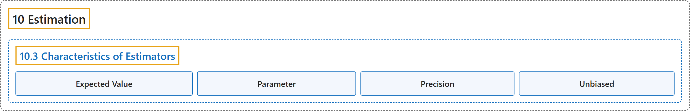

# 10.3 Characteristics of Estimators

## Classification

## Glossary

| Term | Definition | 中文翻译 | Source |
|---|---|---|---|
| **10.3 Characteristics of Estimators** 估计量的特性 | (No definition) | （无定义） | [Online Statistics Education, n.d., section 10.3](https://onlinestatbook.com/2/estimation/characteristics.html) |
| **Expected Value** 期望值 | "The **expected value** of a statistic is **the mean of the sampling distribution of the statistic**. It can be loosely thought of as the long-run average value of the statistic." | 统计量的**期望值**是**该统计量抽样分布的均值**。可以粗略地将其看作该统计量的长期平均值。 | [Online Statistics Education, n.d., glossary](https://onlinestatbook.com/2/glossary/expected_value.html) |
| **Parameter** 参数 | "A **value calculated in a population**. For example, the mean of the numbers in a population is a parameter. Compare with a statistic, which is a value computed in a sample to estimate a parameter." | **在总体中计算得出的值**。例如，总体中各数的均值就是一个参数。与统计量相对照，统计量是在样本中计算出的用于估计参数的值。 | [Online Statistics Education, n.d., glossary](https://onlinestatbook.com/2/glossary/parameter.html) |
| **Precision** 精度 | "A statistic's **precision** concerns to how close it is expected to be to the parameter it is estimating. Precise statistics are vary less from sample to sample. The precision of a statistic is usually defined in terms of it standard error." | 统计量的**精度**涉及它预期与其所估计的参数有多接近。精确的统计量在不同样本之间变化较小。统计量的精度通常用它的标准误来定义。 | [Online Statistics Education, n.d., glossary](https://onlinestatbook.com/2/glossary/precision.html) |
| **Unbiased** 无偏 | "A sample is said to be **unbiased** when every individual has an equal chance of being chosen from the population. An estimator is unbiased if it **does not systematically overestimate or underestimate the parameter it is estimating**. In other words, it is unbiased if the mean of the sampling distribution of the statistic is the parameter it is estimating, The sample mean is an unbiased estimate of the population mean. See: bias" | 当总体中每个个体被抽中的机会均等时，称样本是**无偏**的。如果一个估计量**不会系统性地高估或低估它所估计的参数**，则它是无偏的。换句话说，如果统计量抽样分布的均值就是它所估计的参数，则它是无偏的。样本均值是总体均值的无偏估计。参见：偏倚 | [Online Statistics Education, n.d., glossary](https://onlinestatbook.com/2/glossary/unbiased.html) |

## References

*Online statistics education: An interactive multimedia course of study*. (n.d.). Rice University, University of Houston Clear Lake, and Tufts University. Retrieved October 29, 2026, from <https://onlinestatbook.com/2/>
