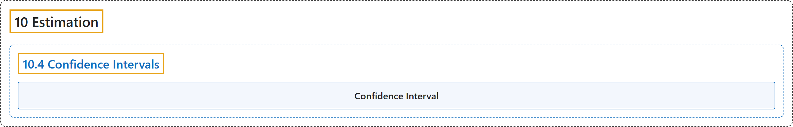

# 10.4 Confidence Intervals

## Classification

## Glossary

| Term | Definition | 中文翻译 | Source |
|---|---|---|---|
| **10.4 Confidence Intervals** 置信区间 | (No definition) | （无定义） | [Online Statistics Education, n.d., section 10.4](https://onlinestatbook.com/2/estimation/confidence_ov.html) |
| **Confidence Interval** 置信区间 | "A **confidence interval** is a range of scores likely to contain the parameter being estimated. Intervals can be constructed to be more or less likely to contain the parameter: 95% of 95% confidence intervals contain the estimated parameter whereas 99% of 99% confidence intervals contain the estimated parameter. The wider the confidence interval, the more uncertainty there is about the value of the parameter." | **置信区间**是可能包含被估计参数的一段取值范围。可以构造包含参数的可能性或大或小的区间：95% 置信区间中有 95% 包含被估计的参数，而 99% 置信区间中有 99% 包含被估计的参数。置信区间越宽，参数值的不确定性就越大。 | [Online Statistics Education, n.d., glossary](https://onlinestatbook.com/2/glossary/confidence_interval.html) |

## References

*Online statistics education: An interactive multimedia course of study*. (n.d.). Rice University, University of Houston Clear Lake, and Tufts University. Retrieved October 29, 2026, from <https://onlinestatbook.com/2/>
