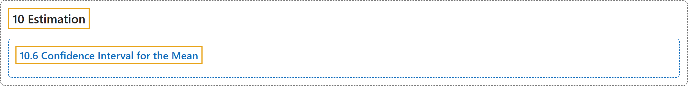

# 10.6 Confidence Interval for the Mean

## Classification

## Glossary

| Term | Definition | 中文翻译 | Source |
|---|---|---|---|
| **10.6 Confidence Interval for the Mean** 均值的置信区间 | (No definition) | （无定义） | [Online Statistics Education, n.d., section 10.6](https://onlinestatbook.com/2/estimation/mean.html) |

## References

*Online statistics education: An interactive multimedia course of study*. (n.d.). Rice University, University of Houston Clear Lake, and Tufts University. Retrieved October 29, 2026, from <https://onlinestatbook.com/2/>
