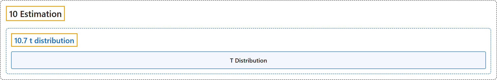

# 10.7 t distribution

## Classification

## Glossary

| Term | Definition | 中文翻译 | Source |
|---|---|---|---|
| **10.7 t distribution** t 分布 | (No definition) | （无定义） | [Online Statistics Education, n.d., section 10.7](https://onlinestatbook.com/2/estimation/t_distribution.html) |
| **T Distribution** t 分布 | "The $t$ distribution is **the distribution of a value sampled from a normal distribution divided by an estimate of the distribution's standard deviation**. In practice the value is typically a statistic such as the mean or the difference between means and the standard deviation is an estimate of the standard error of the statistic. The $t$ distribution in leptokurtic." | $t$ 分布是**从正态分布中抽取的值除以该分布标准差的估计值所得的分布**。在实际中，该值通常是均值或均值之差等统计量，而标准差是该统计量标准误的估计值。$t$ 分布是尖峰态的。 | [Online Statistics Education, n.d., glossary](https://onlinestatbook.com/2/glossary/t_distribution.html) |

## References

*Online statistics education: An interactive multimedia course of study*. (n.d.). Rice University, University of Houston Clear Lake, and Tufts University. Retrieved October 29, 2026, from <https://onlinestatbook.com/2/>
