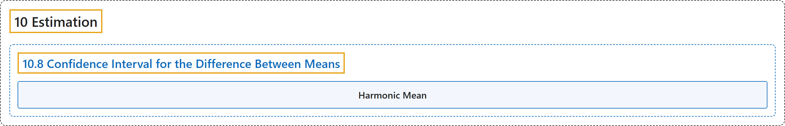

# 10.8 Confidence Interval for the Difference Between Means

## Classification

## Glossary

| Term | Definition | 中文翻译 | Source |
|---|---|---|---|
| **10.8 Confidence Interval for the Difference Between Means** 均值之差的置信区间 | (No definition) | （无定义） | [Online Statistics Education, n.d., section 10.8](https://onlinestatbook.com/2/estimation/difference_means.html) |
| **Harmonic Mean** 调和平均数 | "The **harmonic mean** of $n$ numbers ($X_1$ to $X_n$) is computed using the following formula: … Often the harmonic mean of sample sizes is computed." | $n$ 个数（$X_1$ 到 $X_n$）的**调和平均数**用下面的公式计算：… 通常计算的是样本量的调和平均数。 | [Online Statistics Education, n.d., glossary](https://onlinestatbook.com/2/glossary/harmonic_mean.html) |

## References

*Online statistics education: An interactive multimedia course of study*. (n.d.). Rice University, University of Houston Clear Lake, and Tufts University. Retrieved October 29, 2026, from <https://onlinestatbook.com/2/>
