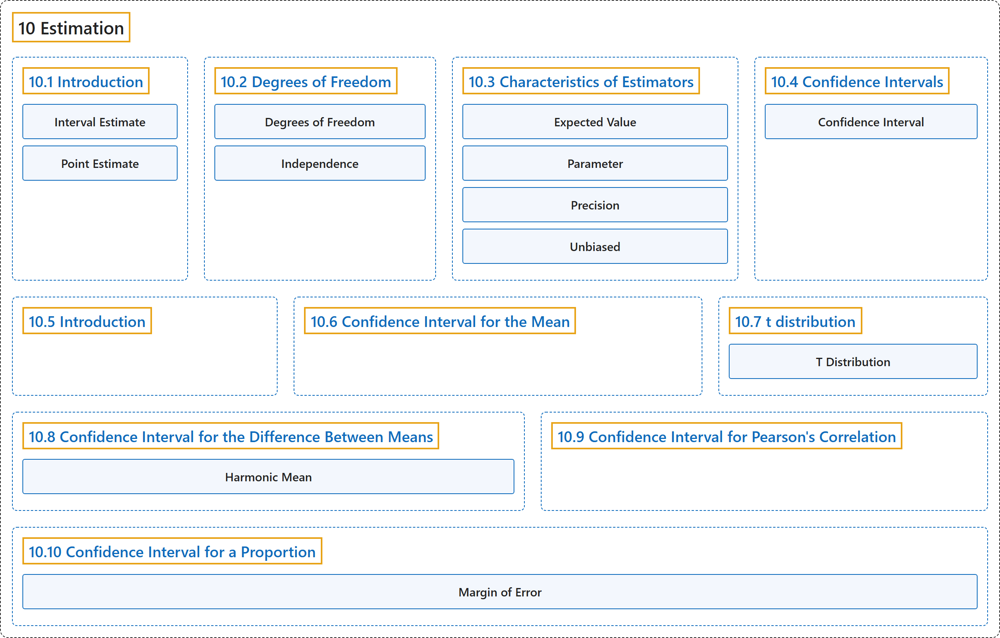

# 10 Estimation

## Classification

## Glossary

| Term | Definition | 中文翻译 | Source |
|---|---|---|---|
| **10 Estimation** 估计 | (No definition) | （无定义） | [Online Statistics Education, n.d., chapter 10](https://onlinestatbook.com/2/estimation/estimation.html) |
| **[10.1 Introduction](10-1-introduction.md)** 介绍 | (No definition) | （无定义） | [Online Statistics Education, n.d., section 10.1](https://onlinestatbook.com/2/estimation/intro.html) |
| **[10.2 Degrees of Freedom](10-2-degrees-of-freedom.md)** 自由度 | (No definition) | （无定义） | [Online Statistics Education, n.d., section 10.2](https://onlinestatbook.com/2/estimation/df.html) |
| **[10.3 Characteristics of Estimators](10-3-characteristics-of-estimators.md)** 估计量的特性 | (No definition) | （无定义） | [Online Statistics Education, n.d., section 10.3](https://onlinestatbook.com/2/estimation/characteristics.html) |
| **[10.4 Confidence Intervals](10-4-confidence-intervals.md)** 置信区间 | (No definition) | （无定义） | [Online Statistics Education, n.d., section 10.4](https://onlinestatbook.com/2/estimation/confidence_ov.html) |
| **[10.5 Introduction](10-5-introduction.md)** 介绍 | (No definition) | （无定义） | [Online Statistics Education, n.d., section 10.5](https://onlinestatbook.com/2/estimation/confidence.html) |
| **[10.6 Confidence Interval for the Mean](10-6-confidence-interval-for-the-mean.md)** 均值的置信区间 | (No definition) | （无定义） | [Online Statistics Education, n.d., section 10.6](https://onlinestatbook.com/2/estimation/mean.html) |
| **[10.7 t distribution](10-7-t-distribution.md)** t 分布 | (No definition) | （无定义） | [Online Statistics Education, n.d., section 10.7](https://onlinestatbook.com/2/estimation/t_distribution.html) |
| **[10.8 Confidence Interval for the Difference Between Means](10-8-confidence-interval-for-the-difference-between-means.md)** 均值之差的置信区间 | (No definition) | （无定义） | [Online Statistics Education, n.d., section 10.8](https://onlinestatbook.com/2/estimation/difference_means.html) |
| **[10.9 Confidence Interval for Pearson's Correlation](10-9-confidence-interval-for-pearson-s-correlation.md)** 皮尔逊相关系数的置信区间 | (No definition) | （无定义） | [Online Statistics Education, n.d., section 10.9](https://onlinestatbook.com/2/estimation/correlation_ci.html) |
| **[10.10 Confidence Interval for a Proportion](10-10-confidence-interval-for-a-proportion.md)** 比例的置信区间 | (No definition) | （无定义） | [Online Statistics Education, n.d., section 10.10](https://onlinestatbook.com/2/estimation/proportion_ci.html) |

## References

*Online statistics education: An interactive multimedia course of study*. (n.d.). Rice University, University of Houston Clear Lake, and Tufts University. Retrieved October 29, 2026, from <https://onlinestatbook.com/2/>
