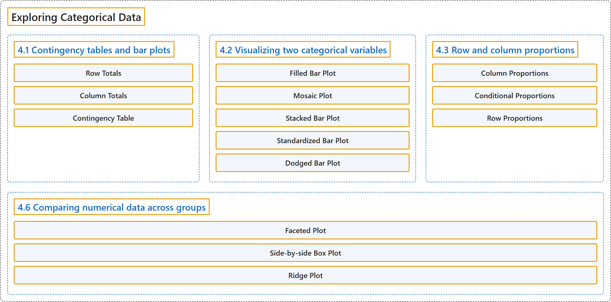

# 4 Exploring Categorical Data

## Classification

## Glossary

| Term | Definition | 中文翻译 | Source |
|---|---|---|---|
| **4 Exploring Categorical Data** 分类数据的探索 | (No definition) | （无定义） | [Çetinkaya-Rundel & Hardin, 2024, chapter 4](https://openintro-ims.netlify.app/explore-categorical.html) |
| **4.1 Contingency tables and bar plots** 列联表与条形图 | (No definition) | （无定义） | [Çetinkaya-Rundel & Hardin, 2024, section 4.1](https://openintro-ims.netlify.app/explore-categorical.html#contingency-tables-and-bar-plots) |
| **Row Totals** 行合计 | "The **row totals** provide the total counts across each row and the column totals down each column." | **行合计**给出每一行的总计数，列合计给出每一列的总计数。 | [Çetinkaya-Rundel & Hardin, 2024, section 4.1](https://openintro-ims.netlify.app/explore-categorical.html#:~:text=The%20row%20totals%20provide%20the%20total) |
| **Column Totals** 列合计 | "The row totals provide the total counts across each row and the **column totals** down each column." | 行合计给出每一行的总计数，**列合计**给出每一列的总计数。 | [Çetinkaya-Rundel & Hardin, 2024, section 4.1](https://openintro-ims.netlify.app/explore-categorical.html#:~:text=The%20row%20totals%20provide%20the%20total) |
| **Contingency Table** 列联表 | "A table that summarizes data for two categorical variables in this way is called a **contingency table**. Each value in the table represents the number of times a particular combination of variable outcomes occurred." | 以这种方式汇总两个分类变量数据的表称为**列联表**。表中的每个值表示变量结果的某一特定组合出现的次数。 | [Çetinkaya-Rundel & Hardin, 2024, section 4.1](https://openintro-ims.netlify.app/explore-categorical.html#:~:text=A%20table%20that%20summarizes%20data%20for) |
| **4.2 Visualizing two categorical variables** 两个分类变量的可视化 | (No definition) | （无定义） | [Çetinkaya-Rundel & Hardin, 2024, section 4.2](https://openintro-ims.netlify.app/explore-categorical.html#visualizing-two-categorical-variables) |
| **Filled Bar Plot** 填充条形图 | "Figure 4.2 (b) is a **standardized bar plot** (also known as **filled bar plot**). This type of visualization is helpful in understanding the fraction of individual or joint loan applications for borrowers in each level of homeownership." | 图 4.2 (b) 是**标准化条形图**（也称为**填充条形图**）。这种可视化有助于理解住房自有状况各水平的借款人中个人申请与联合申请的占比。 | [Çetinkaya-Rundel & Hardin, 2024, section 4.2](https://openintro-ims.netlify.app/explore-categorical.html#:~:text=Figure%204.2%20%28b%29%20is%20a%20standardized) |
| **Mosaic Plot** 马赛克图 | "A **mosaic plot** is a visualization technique suitable for contingency tables that resembles a standardized stacked bar plot with the benefit that we still see the relative group sizes of the primary variable as well." | **马赛克图**是适用于列联表的一种可视化技术，类似于标准化堆叠条形图，其好处是我们仍能看到主要变量各组的相对规模。 | [Çetinkaya-Rundel & Hardin, 2024, section 4.2](https://openintro-ims.netlify.app/explore-categorical.html#:~:text=A%20mosaic%20plot%20is%20a%20visualization) |
| **Stacked Bar Plot** 堆叠条形图 | "Figure 4.2 (a) is a **stacked bar plot**. This plot most clearly displays that loan applicants most commonly live in mortgaged homes." | 图 4.2 (a) 是**堆叠条形图**。这幅图最清楚地显示，贷款申请人最常见的是住在有抵押贷款的住房中。 | [Çetinkaya-Rundel & Hardin, 2024, section 4.2](https://openintro-ims.netlify.app/explore-categorical.html#:~:text=Figure%204.2%20%28a%29%20is%20a%20stacked) |
| **Standardized Bar Plot** 标准化条形图 | "Figure 4.2 (b) is a **standardized bar plot** (also known as **filled bar plot**). This type of visualization is helpful in understanding the fraction of individual or joint loan applications for borrowers in each level of homeownership." | 图 4.2 (b) 是**标准化条形图**（也称为**填充条形图**）。这种可视化有助于理解住房自有状况各水平的借款人中个人申请与联合申请的占比。 | [Çetinkaya-Rundel & Hardin, 2024, section 4.2](https://openintro-ims.netlify.app/explore-categorical.html#:~:text=Figure%204.2%20%28b%29%20is%20a%20standardized) |
| **Dodged Bar Plot** 并列条形图 | "Finally, Figure 4.2 (c) is a **dodged bar plot**. This plot most clearly displays that within each level of homeownership, individual applications are more common than joint applications." | 最后，图 4.2 (c) 是**并列条形图**。这幅图最清楚地显示，在住房自有状况的每个水平内，个人申请都比联合申请更常见。 | [Çetinkaya-Rundel & Hardin, 2024, section 4.2](https://openintro-ims.netlify.app/explore-categorical.html#:~:text=Finally%2C%20Figure%204.2%20%28c%29%20is%20a) |
| **4.3 Row and column proportions** 行比例与列比例 | (No definition) | （无定义） | [Çetinkaya-Rundel & Hardin, 2024, section 4.3](https://openintro-ims.netlify.app/explore-categorical.html#row-and-column-proportions) |
| **Column Proportions** 列比例 | "A contingency table of the **column proportions** is computed in a similar way, where each is computed as the count divided by the corresponding column total." | **列比例**的列联表以类似方式计算，其中每个值是计数除以相应的列合计。 | [Çetinkaya-Rundel & Hardin, 2024, section 4.3](https://openintro-ims.netlify.app/explore-categorical.html#:~:text=A%20contingency%20table%20of%20the%20column) |
| **Conditional Proportions** 条件比例 | "Row and column proportions can also be thought of as **conditional proportions** as they tell us about the proportion of observations in a given level of a categorical variable conditional on the level of another categorical variable." | 行比例和列比例也可以看作**条件比例**，因为它们告诉我们，在另一个分类变量取某一水平的条件下，某个分类变量的给定水平上的观测所占的比例。 | [Çetinkaya-Rundel & Hardin, 2024, section 4.3](https://openintro-ims.netlify.app/explore-categorical.html#:~:text=Row%20and%20column%20proportions%20can%20also) |
| **Row Proportions** 行比例 | "Table 4.3 shows **row proportions** for Table 4.1, which are computed as the counts divided by their row totals." | 表 4.3 给出表 4.1 的**行比例**，它们由计数除以各自的行合计得出。 | [Çetinkaya-Rundel & Hardin, 2024, section 4.3](https://openintro-ims.netlify.app/explore-categorical.html#:~:text=Table%204.3%20shows%20row%20proportions%20for) |
| **4.6 Comparing numerical data across groups** 跨组比较数值型数据 | (No definition) | （无定义） | [Çetinkaya-Rundel & Hardin, 2024, section 4.6](https://openintro-ims.netlify.app/explore-categorical.html#comparing-numerical-data-across-groups) |
| **Faceted Plot** 分面图 | "One last visualization technique we’ll highlight for comparing numerical data across groups is **faceting**. In this technique we split (**facet**) the graphical display of the data across plotting windows based on groups." | 我们要强调的最后一种用于比较各组数值数据的可视化技术是**分面**。在这种技术中，我们根据分组把数据的图形展示拆分（**分面**）到多个绘图窗口中。 | [Çetinkaya-Rundel & Hardin, 2024, section 4.6](https://openintro-ims.netlify.app/explore-categorical.html#:~:text=One%20last%20visualization%20technique%20we%E2%80%99ll%20highlight) |
| **Side-by-side Box Plot** 并排箱线图 | "The **side-by-side box plot** is another traditional tool for comparing across groups. An example is shown in Figure 4.8 (b), where there are two box plots (see Section 5.5 for an introduction to box plots), one for each group, placed into one plotting window and drawn on the same scale." | **并排箱线图**是比较各组的另一种传统工具。图 4.8 (b) 给出了一个例子，其中有两个箱线图，每组一个，放在同一个绘图窗口中并按相同的刻度绘制。 | [Çetinkaya-Rundel & Hardin, 2024, section 4.6](https://openintro-ims.netlify.app/explore-categorical.html#:~:text=The%20side-by-side%20box%20plot%20is%20another) |
| **Ridge Plot** 山脊图 | "Another useful visualization for comparing numerical data across groups is a **ridge plot**, which combines density plots (see Section 5.5 for an introduction to density plots) for various groups drawn on the same scale in a single plotting window." | 比较各组数值数据的另一种有用的可视化是**山脊图**，它把各组的密度图（有关密度图的介绍见第 5.5 节）按相同刻度合并在单个绘图窗口中。 | [Çetinkaya-Rundel & Hardin, 2024, section 4.6](https://openintro-ims.netlify.app/explore-categorical.html#:~:text=Another%20useful%20visualization%20for%20comparing%20numerical) |

## References

Çetinkaya-Rundel, M., & Hardin, J. (2024). *Introduction to modern statistics* (2nd ed.). OpenIntro. Retrieved October 28, 2026, from <https://openintro-ims.netlify.app/>
