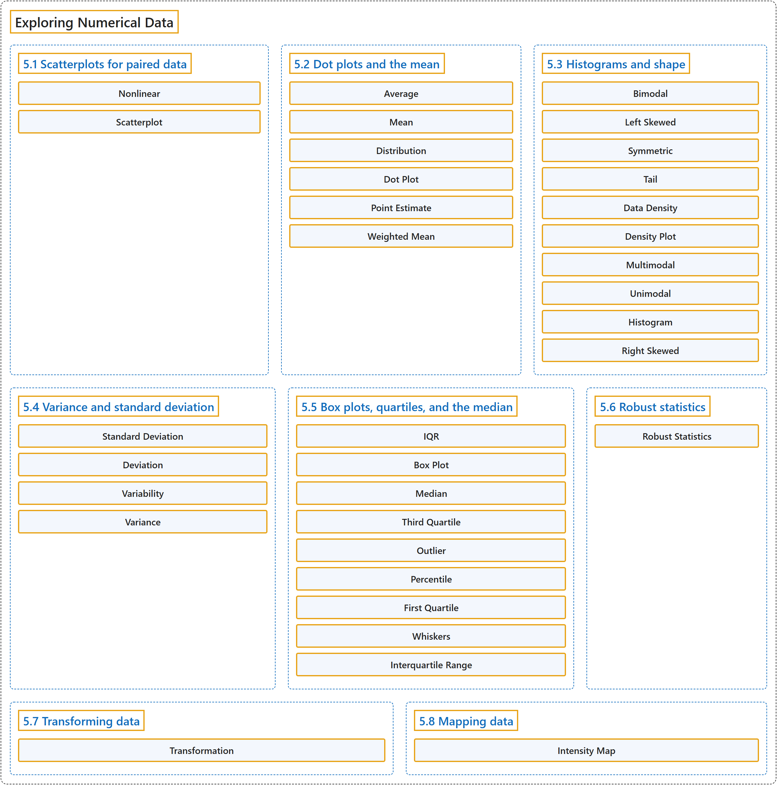

# 5 Exploring Numerical Data

## Classification

## Glossary

| Term | Definition | 中文翻译 | Source |
|---|---|---|---|
| **5 Exploring Numerical Data** 数值型数据的探索 | (No definition) | （无定义） | [Çetinkaya-Rundel & Hardin, 2024, chapter 5](https://openintro-ims.netlify.app/explore-numerical.html) |
| **5.1 Scatterplots for paired data** 配对数据的散点图 | (No definition) | （无定义） | [Çetinkaya-Rundel & Hardin, 2024, section 5.1](https://openintro-ims.netlify.app/explore-numerical.html#sec-scatterplots) |
| **Nonlinear** 非线性 | "The relationship is evidently **nonlinear**, as highlighted by the dashed line. This is different from previous scatterplots we have seen, which indicate very little, if any, curvature in the trend." | 这种关系显然是**非线性**的，如虚线所示。这与我们之前见过的散点图不同，那些散点图中的趋势几乎没有曲率。 | [Çetinkaya-Rundel & Hardin, 2024, section 5.1](https://openintro-ims.netlify.app/explore-numerical.html#:~:text=The%20relationship%20is%20evidently%20nonlinear%2C%20as) |
| **Scatterplot** 散点图 | "A **scatterplot** provides a **case-by-case view** of data for two numerical variables." | **散点图**为两个数值变量提供了数据的**逐个案例视图**。 | [Çetinkaya-Rundel & Hardin, 2024, section 5.1](https://openintro-ims.netlify.app/explore-numerical.html#:~:text=A%20scatterplot%20provides%20a%20case-by-case%20view) |
| **5.2 Dot plots and the mean** 点图与均值 | (No definition) | （无定义） | [Çetinkaya-Rundel & Hardin, 2024, section 5.2](https://openintro-ims.netlify.app/explore-numerical.html#sec-dotplots) |
| **Average** 平均数 | "The mean, often called the **average** is a common way to measure the center of a distribution of data." | 均值，常称为**平均数**，是度量数据分布中心的一种常用方法。 | [Çetinkaya-Rundel & Hardin, 2024, section 5.2](https://openintro-ims.netlify.app/explore-numerical.html#:~:text=The%20mean%2C%20often%20called%20the%20average) |
| **Mean** 均值 | "The **mean**, often called the average is a common way to measure the center of a distribution of data. To compute the mean interest rate, we add up all the interest rates and divide by the number of observations." | **均值**常称为平均数，是度量数据分布中心的一种常用方法。计算利率均值时，我们把所有利率相加，再除以观测的数量。 | [Çetinkaya-Rundel & Hardin, 2024, section 5.2](https://openintro-ims.netlify.app/explore-numerical.html#:~:text=The%20mean%2C%20often%20called%20the%20average) |
| **Distribution** 分布 | "The mean, often called the average is a common way to measure the center of a **distribution of data**." | 均值，常被称为平均数，是度量数据**分布**中心的一种常用方法。 | [Çetinkaya-Rundel & Hardin, 2024, section 5.2](https://openintro-ims.netlify.app/explore-numerical.html#:~:text=The%20mean%2C%20often%20called%20the%20average) |
| **Dot Plot** 点图 | "A **dot plot** is a **one-variable scatterplot**; an example using the interest rate of 50 loans is shown in Figure 5.3." | **点图**是**单变量散点图**；图5.3给出了一个使用50笔贷款利率的例子。 | [Çetinkaya-Rundel & Hardin, 2024, section 5.2](https://openintro-ims.netlify.app/explore-numerical.html#:~:text=A%20dot%20plot%20is%20a%20one-variable) |
| **Point Estimate** 点估计 | "The sample mean, 11.57, provides a rough estimate of $\mu_x.$ While it is not perfect, this is our single best guess **point estimate** of the average interest rate of all the loans in the population under study." | 样本均值11.57给出了 $\mu_x.$ 的粗略估计。虽然并不完美，但这是我们对所研究总体中所有贷款平均利率的唯一最佳猜测，即**点估计**。 | [Çetinkaya-Rundel & Hardin, 2024, section 5.2](https://openintro-ims.netlify.app/explore-numerical.html#:~:text=The%20sample%20mean%2C%2011.57%2C%20provides%20a) |
| **Weighted Mean** 加权平均 | "This example used what is called a **weighted mean**." | 这个例子使用的就是所谓的**加权平均**。 | [Çetinkaya-Rundel & Hardin, 2024, section 5.2](https://openintro-ims.netlify.app/explore-numerical.html#:~:text=This%20example%20used%20what%20is%20called) |
| **5.3 Histograms and shape** 直方图与分布形状 | (No definition) | （无定义） | [Çetinkaya-Rundel & Hardin, 2024, section 5.3](https://openintro-ims.netlify.app/explore-numerical.html#sec-histograms) |
| **Bimodal** 双峰 | "Figure 5.6 shows histograms that have one, two, or three prominent peaks. Such distributions are called unimodal, **bimodal**, and multimodal, respectively." | 图 5.6 给出了分别有一个、两个或三个明显峰的直方图。这类分布分别称为单峰、**双峰**和多峰分布。 | [Çetinkaya-Rundel & Hardin, 2024, section 5.3](https://openintro-ims.netlify.app/explore-numerical.html#:~:text=Figure%205.6%20shows%20histograms%20that%20have) |
| **Left Skewed** 左偏 | "Variables with the reverse characteristic – a long, thinner tail to the left – are said to be **left skewed**. We also say that such a distribution has a long left tail." | 具有相反特征的变量，即向左有一条长而细的尾部，称为**左偏**。我们也说这类分布有一条长的左尾。 | [Çetinkaya-Rundel & Hardin, 2024, section 5.3](https://openintro-ims.netlify.app/explore-numerical.html#:~:text=Variables%20with%20the%20reverse%20characteristic%20%E2%80%93) |
| **Symmetric** 对称 | "Variables that show roughly equal trailing off in both directions are called **symmetric**." | 向两个方向大致等量地逐渐减少的变量称为**对称**的。 | [Çetinkaya-Rundel & Hardin, 2024, section 5.3](https://openintro-ims.netlify.app/explore-numerical.html#:~:text=Variables%20that%20show%20roughly%20equal%20trailing) |
| **Tail** 尾部 | "When the distribution of a variable trails off to the right in this way and has a **longer right tail**, the shape is said to be right skewed." | 当变量的分布以这种方式向右逐渐减少并有一条较长的**右尾**时，其形状称为右偏。 | [Çetinkaya-Rundel & Hardin, 2024, section 5.3](https://openintro-ims.netlify.app/explore-numerical.html#:~:text=When%20the%20distribution%20of%20a%20variable) |
| **Data Density** 数据密度 | "Histograms provide a view of the **data density**. Higher bars represent where the data are relatively more common." | 直方图提供了**数据密度**的视图。条形越高，表示数据相对越常见。 | [Çetinkaya-Rundel & Hardin, 2024, section 5.3](https://openintro-ims.netlify.app/explore-numerical.html#:~:text=Histograms%20provide%20a%20view%20of%20the) |
| **Density Plot** 密度图 | "Figure 5.5 shows a **density plot** which is a **smoothed out histogram**." | 图5.5展示了**密度图**，它是**平滑后的直方图**。 | [Çetinkaya-Rundel & Hardin, 2024, section 5.3](https://openintro-ims.netlify.app/explore-numerical.html#:~:text=Figure%205.5%20shows%20a%20density%20plot) |
| **Multimodal** 多峰 | "Such distributions are called unimodal, bimodal, and **multimodal**, respectively. Any distribution with **more than two prominent peaks** is called multimodal." | 此类分布分别称为单峰、双峰和**多峰**分布。任何具有**两个以上明显峰**的分布称为多峰分布。 | [Çetinkaya-Rundel & Hardin, 2024, section 5.3](https://openintro-ims.netlify.app/explore-numerical.html#:~:text=Such%20distributions%20are%20called%20unimodal%2C%20bimodal%2C) |
| **Unimodal** 单峰 | "Such distributions are called **unimodal**, bimodal, and multimodal, respectively." | 此类分布分别称为**单峰**、双峰和多峰分布。 | [Çetinkaya-Rundel & Hardin, 2024, section 5.3](https://openintro-ims.netlify.app/explore-numerical.html#:~:text=Such%20distributions%20are%20called%20unimodal%2C%20bimodal%2C) |
| **Histogram** 直方图 | "The tabulation is shown in Table 5.2, and the binned counts are plotted as bars in Figure 5.4 into what is called a **histogram**." | 频数表见表5.2，各区间的计数在图5.4中画成条形，这就是所谓的**直方图**。 | [Çetinkaya-Rundel & Hardin, 2024, section 5.3](https://openintro-ims.netlify.app/explore-numerical.html#:~:text=The%20tabulation%20is%20shown%20in%20Table) |
| **Right Skewed** 右偏 | "When the distribution of a variable trails off to the right in this way and has a **longer right tail**, the shape is said to be **right skewed**." | 当变量的分布像这样向右拖尾、具有较长的**右尾**时，称其形状为**右偏**。 | [Çetinkaya-Rundel & Hardin, 2024, section 5.3](https://openintro-ims.netlify.app/explore-numerical.html#:~:text=When%20the%20distribution%20of%20a%20variable) |
| **5.4 Variance and standard deviation** 方差与标准差 | (No definition) | （无定义） | [Çetinkaya-Rundel & Hardin, 2024, section 5.4](https://openintro-ims.netlify.app/explore-numerical.html#sec-variance-sd) |
| **Standard Deviation** 标准差 | "The variance is the average squared distance from the mean. The **standard deviation** is the square root of the variance." | 方差是到均值的平方距离的平均值。**标准差**是方差的平方根。 | [Çetinkaya-Rundel & Hardin, 2024, section 5.4](https://openintro-ims.netlify.app/explore-numerical.html#:~:text=The%20variance%20is%20the%20average%20squared) |
| **Deviation** 离差 | "We call the **distance of an observation from its mean** its **deviation**." | 我们把一个观测值与其均值之间的**距离**称为它的**离差**。 | [Çetinkaya-Rundel & Hardin, 2024, section 5.4](https://openintro-ims.netlify.app/explore-numerical.html#:~:text=We%20call%20the%20distance%20of%20an) |
| **Variability** 变异性 | "The mean was introduced as a method to describe the center of a variable, and **variability in the data** is also important. Here, we introduce **two measures of variability**: the variance and the standard deviation." | 均值是作为描述变量中心的方法引入的，数据的**变异性**同样重要。这里我们介绍两种**变异性度量**：方差和标准差。 | [Çetinkaya-Rundel & Hardin, 2024, section 5.4](https://openintro-ims.netlify.app/explore-numerical.html#:~:text=The%20mean%20was%20introduced%20as%20a) |
| **Variance** 方差 | "If we square these deviations and then take an average, the result is equal to the **sample variance**, denoted by $s^2$:" | 如果将这些离差平方后再取平均，结果就等于**样本方差**，记作 $s^2$： | [Çetinkaya-Rundel & Hardin, 2024, section 5.4](https://openintro-ims.netlify.app/explore-numerical.html#:~:text=If%20we%20square%20these%20deviations%20and) |
| **5.5 Box plots, quartiles, and the median** 箱线图、四分位数与中位数 | (No definition) | （无定义） | [Çetinkaya-Rundel & Hardin, 2024, section 5.5](https://openintro-ims.netlify.app/explore-numerical.html#sec-boxplots) |
| **IQR** 四分位距 | "The length of the box is called the **interquartile range**, or **IQR** for short. It, like the standard deviation, is a measure of variability in data." | 箱的长度称为**四分位距**，简称 **IQR**。与标准差一样，它是数据变异性的一种度量。 | [Çetinkaya-Rundel & Hardin, 2024, section 5.5](https://openintro-ims.netlify.app/explore-numerical.html#:~:text=The%20length%20of%20the%20box%20is) |
| **Box Plot** 箱线图 | "A **box plot** summarizes a dataset using five statistics while also identifying unusual observations." | **箱线图**用五个统计量概括一个数据集，同时标出异常观测。 | [Çetinkaya-Rundel & Hardin, 2024, section 5.5](https://openintro-ims.netlify.app/explore-numerical.html#:~:text=A%20box%20plot%20summarizes%20a%20dataset) |
| **Median** 中位数 | "The dark line inside the box represents the **median**, which **splits the data in half**. 50% of the data fall below this value and 50% fall above it." | 箱内的深色线表示**中位数**，它将数据**一分为二**。50%的数据落在该值以下，50%的数据落在该值以上。 | [Çetinkaya-Rundel & Hardin, 2024, section 5.5](https://openintro-ims.netlify.app/explore-numerical.html#:~:text=The%20dark%20line%20inside%20the%20box) |
| **Third Quartile** 第三四分位数 | "The two boundaries of the box are called the first quartile (the $25^{th}$ percentile, i.e., 25% of the data fall below this value) and the **third quartile** (the $75^{th}$ percentile, i.e., 75% of the data fall below this value), and these are often labeled $Q_1$ and $Q_3,$ respectively." | 箱体的两条边界分别称为第一四分位数（$25^{th}$ 百分位数，即25%的数据落在该值以下）和**第三四分位数**（$75^{th}$ 百分位数，即75%的数据落在该值以下），通常分别记作 $Q_1$ 和 $Q_3,$。 | [Çetinkaya-Rundel & Hardin, 2024, section 5.5](https://openintro-ims.netlify.app/explore-numerical.html#:~:text=The%20two%20boundaries%20of%20the%20box) |
| **Outlier** 离群值 | "An **outlier** is an observation that appears **extreme relative to the rest of the data**." | **离群值**是相对于其余数据显得**极端**的观测值。 | [Çetinkaya-Rundel & Hardin, 2024, section 5.5](https://openintro-ims.netlify.app/explore-numerical.html#:~:text=An%20outlier%20is%20an%20observation%20that) |
| **Percentile** 百分位数 | "A $\alpha$ **percentile** is a number with $\alpha$ % of the observations below and $100-\alpha$ % of the observations above." | $\alpha$ **百分位数**是这样一个数：有 $\alpha$ % 的观测值低于它，$100-\alpha$ % 的观测值高于它。 | [Çetinkaya-Rundel & Hardin, 2024, section 5.5](https://openintro-ims.netlify.app/explore-numerical.html#:~:text=A%20percentile%20is%20a%20number%20with) |
| **First Quartile** 第一四分位数 | "The two boundaries of the box are called the **first quartile** (the $25^{th}$ percentile, i.e., 25% of the data fall below this value) and the third quartile (the $75^{th}$ percentile, i.e., 75% of the data fall below this value), and these are often labeled $Q_1$ and $Q_3,$ respectively." | 箱体的两条边界分别称为**第一四分位数**（$25^{th}$ 百分位数，即25%的数据落在该值以下）和第三四分位数（$75^{th}$ 百分位数，即75%的数据落在该值以下），通常分别记作 $Q_1$ 和 $Q_3,$。 | [Çetinkaya-Rundel & Hardin, 2024, section 5.5](https://openintro-ims.netlify.app/explore-numerical.html#:~:text=The%20two%20boundaries%20of%20the%20box) |
| **Whiskers** 须 | "Extending out from the box, the **whiskers** attempt to capture the data outside of the box. The whiskers of a box plot reach to the **minimum and the maximum values** in the data, unless there are points that are considered unusually high or unusually low, which are identified as potential outliers by the box plot." | 从箱体向外延伸的**须**试图覆盖箱体之外的数据。箱线图的须延伸到数据的**最小值和最大值**，除非有些点被认为异常高或异常低，这些点会被箱线图标识为潜在的离群值。 | [Çetinkaya-Rundel & Hardin, 2024, section 5.5](https://openintro-ims.netlify.app/explore-numerical.html#:~:text=Extending%20out%20from%20the%20box%2C%20the) |
| **Interquartile Range** 四分位距 | "The length of the box is called the **interquartile range**, or IQR for short. It, like the standard deviation, is a measure of variability in data." | 箱体的长度称为**四分位距**，简称 IQR。它与标准差一样，是数据变异性的一种度量。 | [Çetinkaya-Rundel & Hardin, 2024, section 5.5](https://openintro-ims.netlify.app/explore-numerical.html#:~:text=The%20length%20of%20the%20box%20is) |
| **5.6 Robust statistics** 稳健统计量 | (No definition) | （无定义） | [Çetinkaya-Rundel & Hardin, 2024, section 5.6](https://openintro-ims.netlify.app/explore-numerical.html#robust-statistics) |
| **Robust Statistics** 稳健统计量 | "The median and IQR are called **robust statistics** because **extreme observations have little effect** on their values: moving the most extreme value generally has little influence on these statistics." | 中位数和 IQR 被称为**稳健统计量**，因为**极端观测值对其取值影响很小**：移动最极端的值通常对这些统计量几乎没有影响。 | [Çetinkaya-Rundel & Hardin, 2024, section 5.6](https://openintro-ims.netlify.app/explore-numerical.html#:~:text=The%20median%20and%20IQR%20are%20called) |
| **5.7 Transforming data** 数据变换 | (No definition) | （无定义） | [Çetinkaya-Rundel & Hardin, 2024, section 5.7](https://openintro-ims.netlify.app/explore-numerical.html#sec-transforming-data) |
| **Transformation** 变换 | "A **transformation** is a **rescaling of the data using a function**." | **变换**是使用某个函数对数据进行的**重新标度**。 | [Çetinkaya-Rundel & Hardin, 2024, section 5.7](https://openintro-ims.netlify.app/explore-numerical.html#:~:text=A%20transformation%20is%20a%20rescaling%20of) |
| **5.8 Mapping data** 数据的地图展示 | (No definition) | （无定义） | [Çetinkaya-Rundel & Hardin, 2024, section 5.8](https://openintro-ims.netlify.app/explore-numerical.html#mapping-data) |
| **Intensity Map** 强度图 | "When we encounter geographic data, we should create an **intensity map**, where **colors are used to show higher and lower values** of a variable." | 遇到地理数据时，我们应当绘制**强度图**，即用**颜色表示**变量的较高值和较低值。 | [Çetinkaya-Rundel & Hardin, 2024, section 5.8](https://openintro-ims.netlify.app/explore-numerical.html#:~:text=When%20we%20encounter%20geographic%20data%2C%20we) |

## References

Çetinkaya-Rundel, M., & Hardin, J. (2024). *Introduction to modern statistics* (2nd ed.). OpenIntro. Retrieved October 28, 2026, from <https://openintro-ims.netlify.app/>
