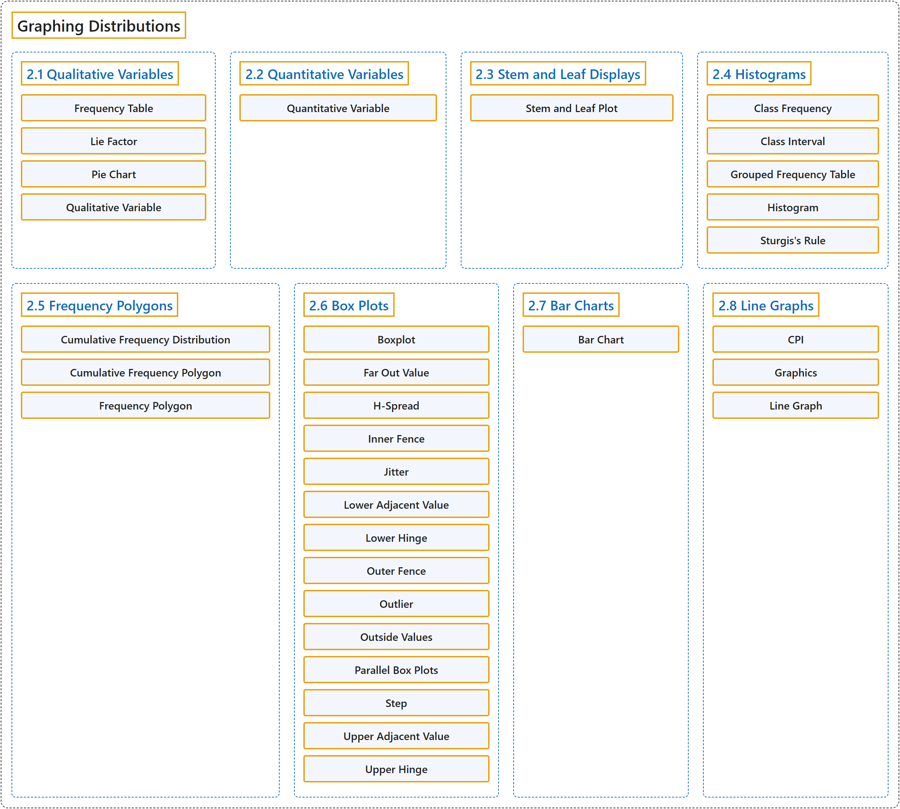

# 2 Graphing Distributions

## Classification

## Glossary

| Term | Definition | 中文翻译 | Source |
|---|---|---|---|
| **2 Graphing Distributions** 分布的图示 | (No definition) | （无定义） | [Online Statistics Education, n.d., chapter 2](https://onlinestatbook.com/2/graphing_distributions/graphing_distributions.html) |
| **2.1 Qualitative Variables** 定性变量 | (No definition) | （无定义） | [Online Statistics Education, n.d., section 2.1](https://onlinestatbook.com/2/graphing_distributions/graphing_qualitative.html) |
| **Frequency Table** 频数表 | "A **table containing the number of occurrences in each class of data** ; for example, the number of each color of M&Ms in a bag. Frequency tables often used to create histograms and frequency polygons. When a frequency table is created for a quantitative variable, a grouped frequency table is generally used." | 一种**包含每一类数据出现次数的表** ；例如一袋 M&M 豆中每种颜色的数量。频数表常用于绘制直方图和频数多边形。当为定量变量创建频数表时，通常使用分组频数表。 | [Online Statistics Education, n.d., glossary](https://onlinestatbook.com/2/glossary/frequency_table.html) |
| **Lie Factor** 失真系数 | "Many problems can arise when fancy graphs are used over plain ones. Distortions can occur when the heights of objects are used to indicate the value because most people will pay attention to the areas of the objects rather than their height. The **lie factor** is the **ratio of the effect apparent in the graph to actual effect in the data**; if it deviates by more than 0.05 from 1, the graph is generally unacceptable. The lie factor in the following graph is almost 6." | 当使用花哨的图形而不是朴素的图形时，可能出现许多问题。当用物体的高度表示数值时可能产生失真，因为大多数人会注意物体的面积而不是高度。**失真系数**是**图中显示的效应与数据中实际效应之比**；如果它与 1 的偏差超过 0.05，该图通常是不可接受的。下图的失真系数接近 6。 | [Online Statistics Education, n.d., glossary](https://onlinestatbook.com/2/glossary/lie_factor.html) |
| **Pie Chart** 饼图 | "A graphical representation of data, the **pie chart** shows relative frequencies of classes of data. It is a circle cut into a number of wedges, one for each class, with the area of each wedge proportional to its relative frequency. Pie charts are only effective for a small number of classes, and are one of the less effective graphical representations." | 作为数据的一种图形表示，**饼图**显示各类数据的相对频数。它是被切成若干扇形的圆，每类对应一个扇形，每个扇形的面积与其相对频数成正比。饼图仅对类别数较少时有效，是效果较差的图形表示之一。 | [Online Statistics Education, n.d., glossary](https://onlinestatbook.com/2/glossary/pie_chart.html) |
| **Qualitative Variable** 定性变量 | "Also known as categorical variables, **qualitative variables** are variables with **no natural sense of ordering**. They are therefore measured on a nominal scale. For instance, hair color (Black, Brown, Gray, Red, Yellow) is a qualitative variable, as is name (Adam, Becky, Christina, Dave...). Qualitative variables can be coded to appear numeric but their numbers are meaningless, as in male=1, female=2. Variables that are not qualitative are known as quantitative variables." | **定性变量**也称分类变量，是**没有自然顺序意义**的变量。因此它们在名义量表上测量。例如，头发颜色（黑色、棕色、灰色、红色、黄色）是定性变量，姓名（亚当、贝基、克里斯蒂娜、戴夫……）也是。定性变量可以被编码成看似数值的形式，但这些数字没有意义，如男性=1，女性=2。不是定性的变量称为定量变量。 | [Online Statistics Education, n.d., glossary](https://onlinestatbook.com/2/glossary/qualitative_variable.html) |
| **2.2 Quantitative Variables** 定量变量 | (No definition) | （无定义） | [Online Statistics Education, n.d., section 2.2](https://onlinestatbook.com/2/graphing_distributions/quantitative.html) |
| **Quantitative Variable** 定量变量 | "Variables that are **measured on a numeric or quantitative scale**. Ordinal, interval and ratio scales are quantitative. A country’s population, a person’s shoe size, or a car’s speed are all quantitative variables. Variables that are not quantitative are known as **qualitative variables**." | **以数值或定量量表测量**的变量。定序、定距和定比量表都是定量的。一个国家的人口、一个人的鞋码或一辆汽车的速度都是定量变量。不是定量的变量称为**定性变量**。 | [Online Statistics Education, n.d., glossary](https://onlinestatbook.com/2/glossary/quantitative_variable.html) |
| **2.3 Stem and Leaf Displays** 茎叶图 | (No definition) | （无定义） | [Online Statistics Education, n.d., section 2.3](https://onlinestatbook.com/2/graphing_distributions/stem.html) |
| **Stem and Leaf Plot** 茎叶图 | "A **quasi-graphical representation of numerical data**. Generally, all but the final digit of each value is a **stem**, the final digit is the leaf. The stems are placed in a vertical list, with each matched leaf on one side. They can be very useful for visualizing small data sets with no more than two significant digits. An example is shown below. In this example, you multiply the stems by 10 and add the value of the leaf to obtain the numeric value. Thus the maximum number of touchdown passes is $3 \times 10 + 7 = 37$." | **数值数据的准图形表示**。通常，每个值除最后一位数字外的部分为**茎**，最后一位数字为叶。茎排成一个垂直的列表，每个对应的叶放在一侧。它们对于可视化不超过两位有效数字的小数据集非常有用。下面显示了一个示例。在这个例子中，将茎乘以 10 再加上叶的值，即可得到数值。因此，达阵传球次数的最大值为 $3 \times 10 + 7 = 37$。 | [Online Statistics Education, n.d., glossary](https://onlinestatbook.com/2/glossary/stem_and_leaf_plot.html) |
| **2.4 Histograms** 直方图 | (No definition) | （无定义） | [Online Statistics Education, n.d., section 2.4](https://onlinestatbook.com/2/graphing_distributions/histograms.html) |
| **Class Frequency** 组频数 | "One of the components of a histogram, the **class frequency** is the number of observations in each class interval. See also: relative frequency." | 作为直方图的组成部分之一，**组频数**是每个组距中的观测数。另见：相对频数。 | [Online Statistics Education, n.d., glossary](https://onlinestatbook.com/2/glossary/class_frequency.html) |
| **Class Interval** 组距 | "Also known as bin width, the **class interval** is a **division of data for use in a histogram**. For instance, it is possible to partition scores on a 100 point test into class intervals of 1-25, 26-49, 50-74 and 75-100." | 又称箱宽，**组距**是**为绘制直方图而对数据所做的划分**。例如，可以将一次满分 100 分的测验的分数划分为 1-25、26-49、50-74 和 75-100 的组距。 | [Online Statistics Education, n.d., glossary](https://onlinestatbook.com/2/glossary/class_interval.html) |
| **Grouped Frequency Table** 分组频数表 | "A **grouped frequency table** shows the number of values for various ranges of scores. Below is shown a grouped frequency table for response times (in milliseconds) for a simple motor task." | **分组频数表**显示各个得分范围内值的个数。下面给出了一项简单运动任务的反应时间（以毫秒计）的分组频数表。 | [Online Statistics Education, n.d., glossary](https://onlinestatbook.com/2/glossary/frequency_table_grouped.html) |
| **Histogram** 直方图 | "A **histogram** is a graphical representation of a distribution. It partitions the variable on the $x$-axis into various contiguous class intervals of (usually) equal widths. The heights of the bars represent the class frequencies. …" | **直方图**是分布的一种图形表示。它把 $x$ 轴上的变量划分为若干（通常）等宽的相邻组距。各条形的高度表示各组的频数。… | [Online Statistics Education, n.d., glossary](https://onlinestatbook.com/2/glossary/histogram.html) |
| **Sturgis's Rule** 斯特吉斯规则 | "One method of determining the number of classes for a histogram, **Sturgis’ Rule** is to take $1 + \log_2 (N)$ classes, rounded to the nearest integer." | **斯特吉斯规则**是确定直方图组数的一种方法，即取 $1 + \log_2 (N)$ 个组，四舍五入到最接近的整数。 | [Online Statistics Education, n.d., glossary](https://onlinestatbook.com/2/glossary/sturgiss_rule.html) |
| **2.5 Frequency Polygons** 频数多边形图 | (No definition) | （无定义） | [Online Statistics Education, n.d., section 2.5](https://onlinestatbook.com/2/graphing_distributions/freq_poly.html) |
| **Cumulative Frequency Distribution** 累积频数分布 | "A distribution showing the **number of observations less than or equal to values** on the $X$-axis. The following graph shows a cumulative distribution for scores on a test." | 显示**小于或等于** $X$ 轴上各个值的**观测数**的分布。下图显示了某次测验得分的累积分布。 | [Online Statistics Education, n.d., glossary](https://onlinestatbook.com/2/glossary/cumulative.html) |
| **Cumulative Frequency Polygon** 累积频数多边形 | "A frequency polygon whose **vertices represent the sum of all previous class frequencies of the data**. For example, if a frequency polygon had vertices of 5, 8, 3, 7, and 10, the cumulative frequency polygon on the same data would have vertices of 5, 13, 16, 23, and 33. As another example, a cumulative frequency distribution for scores on a psychology test is shown below. …" | 一种频数多边形，其**顶点表示数据此前各组频数之和**。例如，若一个频数多边形的顶点为 5、8、3、7 和 10，则同一数据的累积频数多边形的顶点为 5、13、16、23 和 33。再举一例，下面显示了一次心理学测验分数的累积频数分布。… | [Online Statistics Education, n.d., glossary](https://onlinestatbook.com/2/glossary/cumulative_frequency_poly.html) |
| **Frequency Polygon** 频数多边形 | "A **frequency polygon** is a graphical representation of a distribution. It partitions the variable on the $x$-axis into various contiguous class intervals of (usually) equal widths. The heights of the polygon's points represent the class frequencies. …" | **频数多边形**是分布的一种图形表示。它把 $x$ 轴上的变量划分为若干（通常）等宽的相邻组距。多边形各点的高度表示各组的频数。… | [Online Statistics Education, n.d., glossary](https://onlinestatbook.com/2/glossary/freq_polygon.html) |
| **2.6 Box Plots** 箱线图 | (No definition) | （无定义） | [Online Statistics Education, n.d., section 2.6](https://onlinestatbook.com/2/graphing_distributions/boxplots.html) |
| **Boxplot** 箱线图 | "One of the more effective graphical summaries of a data set, the **box plot** generally shows mean, median, 25th and 75th percentiles, and outliers. A standard box plot is composed of the median, upper hinge, lower hinge, upper adjacent value, lower adjacent value, outside values, and far out values. An example is shown below. Parallel box plots are very useful for comparing distributions. See also: step, H-spread." | 作为对数据集较为有效的图形概括之一，**箱线图**通常显示均值、中位数、第 25 和第 75 百分位数以及离群值。标准箱线图由中位数、上铰链、下铰链、上邻值、下邻值、外部值和远外值组成。示例如下。平行箱线图对于比较分布非常有用。另见：步长、H 散布。 | [Online Statistics Education, n.d., glossary](https://onlinestatbook.com/2/glossary/boxplot.html) |
| **Far Out Value** 极端离群值 | "One of the components of a box plot, **far out values** are those that are **more than 2 steps from the nearest hinge**. They are beyond the outer fences." | 作为箱线图的组成部分之一，**极端离群值**是**距最近的铰链超过 2 个步长**的值。它们位于外围栏之外。 | [Online Statistics Education, n.d., glossary](https://onlinestatbook.com/2/glossary/far_out_value.html) |
| **H-Spread** H 散布 | "One of the components of a box plot, the **H-spread** is the **difference between the upper hinge and the lower hinge**." | 作为箱线图的组成部分之一，**H 散布**是**上铰链与下铰链之差**。 | [Online Statistics Education, n.d., glossary](https://onlinestatbook.com/2/glossary/hspread.html) |
| **Inner Fence** 内栅栏 | "In a box plot, the **lower inner fence** is one step below the lower hinge while the **upper inner fence** is one step above the upper hinge." | 在箱线图中，**下内栅栏**位于下铰链之下一个步长处，而**上内栅栏**位于上铰链之上一个步长处。 | [Online Statistics Education, n.d., glossary](https://onlinestatbook.com/2/glossary/inner_fence.html) |
| **Jitter** 抖动 | "When points in a graph are **jittered**, the are moved horizontally so that all the points can be seen and none are hidden due to overlapping values. An example is shown below: …" | 当图中的点被**抖动**时，它们会被水平移动，使所有的点都能被看到，没有点因取值重叠而被遮挡。示例如下：… | [Online Statistics Education, n.d., glossary](https://onlinestatbook.com/2/glossary/jitter.html) |
| **Lower Adjacent Value** 下邻值 | "A component of a box plot, the **lower adjacent value** is **smallest value in the data above the inner lower fence**." | 作为箱线图的组成部分，**下邻值**是**数据中位于下内栅栏之上的最小值**。 | [Online Statistics Education, n.d., glossary](https://onlinestatbook.com/2/glossary/lower_adjacent_value.html) |
| **Lower Hinge** 下铰链 | "A component of a box plot, the **lower hinge** is the 25th percentile. The upper hinge is the 75th percentile." | 作为箱线图的组成部分，**下铰链**是第 25 百分位数。上铰链是第 75 百分位数。 | [Online Statistics Education, n.d., glossary](https://onlinestatbook.com/2/glossary/lower_hinge.html) |
| **Outer Fence** 外围栅栏 | "In a box plot, the **lower outer fence** is 2 steps below the lower hinge whereas the upper inner fence is 2 steps above the upper hinge." | 在箱线图中，**下外围栅栏**位于下铰链之下 2 个步长处，而上内围栅栏位于上铰链之上 2 个步长处。 | [Online Statistics Education, n.d., glossary](https://onlinestatbook.com/2/glossary/outer_fence.html) |
| **Outlier** 离群值 | "**Outliers** are **atypical, infrequent observations**; values that have an extreme deviation from the center of the distribution. There is no universally-agreed on criterion for defining an outlier, and outliers should only be discarded with extreme caution. However, one should always assess the effects of outliers on the statistical conclusions." | **离群值**是**非典型的、罕见的观测值**；即与分布中心有极端偏离的值。对于如何定义离群值，没有普遍认可的标准，而且只应极为谨慎地舍弃离群值。然而，人们应始终评估离群值对统计结论的影响。 | [Online Statistics Education, n.d., glossary](https://onlinestatbook.com/2/glossary/outlier.html) |
| **Outside Values** 外部值 | "A component of a box plot, **outside values** are more than 1 step beyond the nearest hinge. They are beyond an inner fence but not beyond an outer fence. See also: Far out value." | 作为箱线图的组成部分，**外部值**是超出最近铰链 1 个步长以上的值。它们超出内围栅栏但未超出外围栅栏。另见：远外值。 | [Online Statistics Education, n.d., glossary](https://onlinestatbook.com/2/glossary/outside_values.html) |
| **Parallel Box Plots** 平行箱线图 | "Two or more box plots drawn on the same $Y$-axis. These are often useful in comparing features of distributions. An example portraying the times it took samples of women and men to do a task is shown below." | **在同一个 $Y$ 轴上绘制的两个或多个箱线图**。它们常用于比较分布的特征。下面给出了一个示例，描绘了女性样本和男性样本完成一项任务所用的时间。 | [Online Statistics Education, n.d., glossary](https://onlinestatbook.com/2/glossary/parallel_box_plots.html) |
| **Step** 步长 | "One of the components of a box plot, the **step** is **1.5 times the difference between the upper hinge and the lower hinge**. See also: H-spread." | 作为箱线图的组成部分之一，**步长**是**上铰链与下铰链之差的 1.5 倍**。另见：H 散布。 | [Online Statistics Education, n.d., glossary](https://onlinestatbook.com/2/glossary/step.html) |
| **Upper Adjacent Value** 上邻值 | "One of the components of a box plot, the **higher adjacent value** is the **largest value in the data below the 75th percentile**." | 作为箱线图的组成部分之一，**上邻值**是**数据中低于第 75 百分位数的最大值**。 | [Online Statistics Education, n.d., glossary](https://onlinestatbook.com/2/glossary/upper_adjacent_value.html) |
| **Upper Hinge** 上铰链 | "The **upper hinge** is one of the components of a box plot ; it is the 75th percentile." | **上铰链**是箱线图的组成部分之一；它是第 75 百分位数。 | [Online Statistics Education, n.d., glossary](https://onlinestatbook.com/2/glossary/upper_hinge.html) |
| **2.7 Bar Charts** 条形图 | (No definition) | （无定义） | [Online Statistics Education, n.d., section 2.7](https://onlinestatbook.com/2/graphing_distributions/bar_chart.html) |
| **Bar Chart** 条形图 | "A **graphical method of presenting data**. A bar is drawn for each level of a variable. The height of each bar contains the value of the variable. **Bar charts** are useful for displaying things such as frequency counts and percent increases. They are not recommended for displaying means (despite the widespread practice) since box plots present more information in the same amount of space. An example bar chart is shown below." | 一种**呈现数据的图形方法**。为变量的每个水平绘制一根条形。每根条形的高度表示该变量的值。**条形图**适用于展示频数和百分比增长等内容。不建议用它来展示均值（尽管这种做法很普遍），因为箱线图在同样大小的空间中能呈现更多信息。下面显示了一个条形图示例。 | [Online Statistics Education, n.d., glossary](https://onlinestatbook.com/2/glossary/bar_chart.html) |
| **2.8 Line Graphs** 折线图 | (No definition) | （无定义） | [Online Statistics Education, n.d., section 2.8](https://onlinestatbook.com/2/graphing_distributions/line_graphs.html) |
| **CPI** 消费者价格指数 | "Also known as the cost of living index, the **CPI** is a financial statistic that **measures the change in price of a representative group of goods over time**." | 又称生活费用指数，**CPI** 是一种金融统计量，用于**衡量一组有代表性的商品价格随时间的变化**。 | [Online Statistics Education, n.d., glossary](https://onlinestatbook.com/2/glossary/CPI.html) |
| **Graphics** 统计图 | "**Graphs** are often the most effective way to describe distributions and relationships among variables. Among the most common graphs are histograms, box plots, bar charts, and scatterplots." | **图形**往往是描述分布以及变量之间关系的最有效方式。最常见的图形有直方图、箱线图、条形图和散点图。 | [Online Statistics Education, n.d., glossary](https://onlinestatbook.com/2/glossary/graphics.html) |
| **Line Graph** 折线图 | "Essentially a bar graph in which **the height of each par is represented by a single point, with each of these points connected by a line**. Line graphs are best used to show change over time, and should never be used if your $X$-axis is not an ordered variable. An example is shown below." | 本质上是一种条形图，其中**每根条形的高度由一个点表示，这些点之间用线连接**。折线图最适合用来显示随时间的变化，如果你的 $X$ 轴不是有序变量，则绝不应使用。下面显示了一个示例。 | [Online Statistics Education, n.d., glossary](https://onlinestatbook.com/2/glossary/line_graph.html) |

## References

*Online statistics education: An interactive multimedia course of study*. (n.d.). Rice University, University of Houston Clear Lake, and Tufts University. Retrieved October 29, 2026, from <https://onlinestatbook.com/2/>
