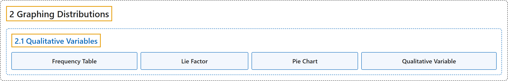

# 2.1 Qualitative Variables

## Classification

## Glossary

| Term | Definition | 中文翻译 | Source |
|---|---|---|---|
| **2.1 Qualitative Variables** 定性变量 | (No definition) | （无定义） | [Online Statistics Education, n.d., section 2.1](https://onlinestatbook.com/2/graphing_distributions/graphing_qualitative.html) |
| **Frequency Table** 频数表 | "A **table containing the number of occurrences in each class of data** ; for example, the number of each color of M&Ms in a bag. Frequency tables often used to create histograms and frequency polygons. When a frequency table is created for a quantitative variable, a grouped frequency table is generally used." | 一种**包含每一类数据出现次数的表** ；例如一袋 M&M 豆中每种颜色的数量。频数表常用于绘制直方图和频数多边形。当为定量变量创建频数表时，通常使用分组频数表。 | [Online Statistics Education, n.d., glossary](https://onlinestatbook.com/2/glossary/frequency_table.html) |
| **Lie Factor** 失真系数 | "Many problems can arise when fancy graphs are used over plain ones. Distortions can occur when the heights of objects are used to indicate the value because most people will pay attention to the areas of the objects rather than their height. The **lie factor** is the **ratio of the effect apparent in the graph to actual effect in the data**; if it deviates by more than 0.05 from 1, the graph is generally unacceptable. The lie factor in the following graph is almost 6." | 当使用花哨的图形而不是朴素的图形时，可能出现许多问题。当用物体的高度表示数值时可能产生失真，因为大多数人会注意物体的面积而不是高度。**失真系数**是**图中显示的效应与数据中实际效应之比**；如果它与 1 的偏差超过 0.05，该图通常是不可接受的。下图的失真系数接近 6。 | [Online Statistics Education, n.d., glossary](https://onlinestatbook.com/2/glossary/lie_factor.html) |
| **Pie Chart** 饼图 | "A graphical representation of data, the **pie chart** shows relative frequencies of classes of data. It is a circle cut into a number of wedges, one for each class, with the area of each wedge proportional to its relative frequency. Pie charts are only effective for a small number of classes, and are one of the less effective graphical representations." | 作为数据的一种图形表示，**饼图**显示各类数据的相对频数。它是被切成若干扇形的圆，每类对应一个扇形，每个扇形的面积与其相对频数成正比。饼图仅对类别数较少时有效，是效果较差的图形表示之一。 | [Online Statistics Education, n.d., glossary](https://onlinestatbook.com/2/glossary/pie_chart.html) |
| **Qualitative Variable** 定性变量 | "Also known as categorical variables, **qualitative variables** are variables with **no natural sense of ordering**. They are therefore measured on a nominal scale. For instance, hair color (Black, Brown, Gray, Red, Yellow) is a qualitative variable, as is name (Adam, Becky, Christina, Dave...). Qualitative variables can be coded to appear numeric but their numbers are meaningless, as in male=1, female=2. Variables that are not qualitative are known as quantitative variables." | **定性变量**也称分类变量，是**没有自然顺序意义**的变量。因此它们在名义量表上测量。例如，头发颜色（黑色、棕色、灰色、红色、黄色）是定性变量，姓名（亚当、贝基、克里斯蒂娜、戴夫……）也是。定性变量可以被编码成看似数值的形式，但这些数字没有意义，如男性=1，女性=2。不是定性的变量称为定量变量。 | [Online Statistics Education, n.d., glossary](https://onlinestatbook.com/2/glossary/qualitative_variable.html) |

## References

*Online statistics education: An interactive multimedia course of study*. (n.d.). Rice University, University of Houston Clear Lake, and Tufts University. Retrieved October 29, 2026, from <https://onlinestatbook.com/2/>
