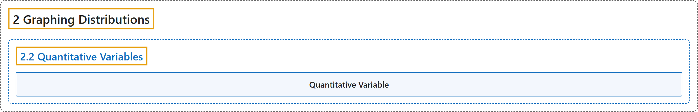

# 2.2 Quantitative Variables

## Classification

## Glossary

| Term | Definition | 中文翻译 | Source |
|---|---|---|---|
| **2.2 Quantitative Variables** 定量变量 | (No definition) | （无定义） | [Online Statistics Education, n.d., section 2.2](https://onlinestatbook.com/2/graphing_distributions/quantitative.html) |
| **Quantitative Variable** 定量变量 | "Variables that are **measured on a numeric or quantitative scale**. Ordinal, interval and ratio scales are quantitative. A country’s population, a person’s shoe size, or a car’s speed are all quantitative variables. Variables that are not quantitative are known as **qualitative variables**." | **以数值或定量量表测量**的变量。定序、定距和定比量表都是定量的。一个国家的人口、一个人的鞋码或一辆汽车的速度都是定量变量。不是定量的变量称为**定性变量**。 | [Online Statistics Education, n.d., glossary](https://onlinestatbook.com/2/glossary/quantitative_variable.html) |

## References

*Online statistics education: An interactive multimedia course of study*. (n.d.). Rice University, University of Houston Clear Lake, and Tufts University. Retrieved October 29, 2026, from <https://onlinestatbook.com/2/>
