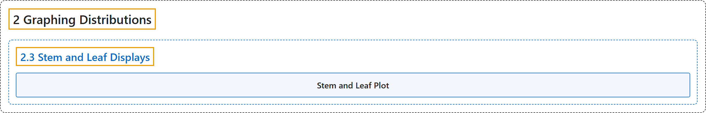

# 2.3 Stem and Leaf Displays

## Classification

## Glossary

| Term | Definition | 中文翻译 | Source |
|---|---|---|---|
| **2.3 Stem and Leaf Displays** 茎叶图 | (No definition) | （无定义） | [Online Statistics Education, n.d., section 2.3](https://onlinestatbook.com/2/graphing_distributions/stem.html) |
| **Stem and Leaf Plot** 茎叶图 | "A **quasi-graphical representation of numerical data**. Generally, all but the final digit of each value is a **stem**, the final digit is the leaf. The stems are placed in a vertical list, with each matched leaf on one side. They can be very useful for visualizing small data sets with no more than two significant digits. An example is shown below. In this example, you multiply the stems by 10 and add the value of the leaf to obtain the numeric value. Thus the maximum number of touchdown passes is $3 \times 10 + 7 = 37$." | **数值数据的准图形表示**。通常，每个值除最后一位数字外的部分为**茎**，最后一位数字为叶。茎排成一个垂直的列表，每个对应的叶放在一侧。它们对于可视化不超过两位有效数字的小数据集非常有用。下面显示了一个示例。在这个例子中，将茎乘以 10 再加上叶的值，即可得到数值。因此，达阵传球次数的最大值为 $3 \times 10 + 7 = 37$。 | [Online Statistics Education, n.d., glossary](https://onlinestatbook.com/2/glossary/stem_and_leaf_plot.html) |

## References

*Online statistics education: An interactive multimedia course of study*. (n.d.). Rice University, University of Houston Clear Lake, and Tufts University. Retrieved October 29, 2026, from <https://onlinestatbook.com/2/>
