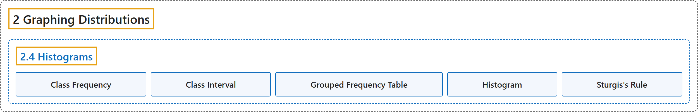

# 2.4 Histograms

## Classification

## Glossary

| Term | Definition | 中文翻译 | Source |
|---|---|---|---|
| **2.4 Histograms** 直方图 | (No definition) | （无定义） | [Online Statistics Education, n.d., section 2.4](https://onlinestatbook.com/2/graphing_distributions/histograms.html) |
| **Class Frequency** 组频数 | "One of the components of a histogram, the **class frequency** is the number of observations in each class interval. See also: relative frequency." | 作为直方图的组成部分之一，**组频数**是每个组距中的观测数。另见：相对频数。 | [Online Statistics Education, n.d., glossary](https://onlinestatbook.com/2/glossary/class_frequency.html) |
| **Class Interval** 组距 | "Also known as bin width, the **class interval** is a **division of data for use in a histogram**. For instance, it is possible to partition scores on a 100 point test into class intervals of 1-25, 26-49, 50-74 and 75-100." | 又称箱宽，**组距**是**为绘制直方图而对数据所做的划分**。例如，可以将一次满分 100 分的测验的分数划分为 1-25、26-49、50-74 和 75-100 的组距。 | [Online Statistics Education, n.d., glossary](https://onlinestatbook.com/2/glossary/class_interval.html) |
| **Grouped Frequency Table** 分组频数表 | "A **grouped frequency table** shows the number of values for various ranges of scores. Below is shown a grouped frequency table for response times (in milliseconds) for a simple motor task." | **分组频数表**显示各个得分范围内值的个数。下面给出了一项简单运动任务的反应时间（以毫秒计）的分组频数表。 | [Online Statistics Education, n.d., glossary](https://onlinestatbook.com/2/glossary/frequency_table_grouped.html) |
| **Histogram** 直方图 | "A **histogram** is a graphical representation of a distribution. It partitions the variable on the $x$-axis into various contiguous class intervals of (usually) equal widths. The heights of the bars represent the class frequencies. …" | **直方图**是分布的一种图形表示。它把 $x$ 轴上的变量划分为若干（通常）等宽的相邻组距。各条形的高度表示各组的频数。… | [Online Statistics Education, n.d., glossary](https://onlinestatbook.com/2/glossary/histogram.html) |
| **Sturgis's Rule** 斯特吉斯规则 | "One method of determining the number of classes for a histogram, **Sturgis’ Rule** is to take $1 + \log_2 (N)$ classes, rounded to the nearest integer." | **斯特吉斯规则**是确定直方图组数的一种方法，即取 $1 + \log_2 (N)$ 个组，四舍五入到最接近的整数。 | [Online Statistics Education, n.d., glossary](https://onlinestatbook.com/2/glossary/sturgiss_rule.html) |

## References

*Online statistics education: An interactive multimedia course of study*. (n.d.). Rice University, University of Houston Clear Lake, and Tufts University. Retrieved October 29, 2026, from <https://onlinestatbook.com/2/>
