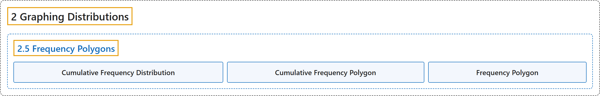

# 2.5 Frequency Polygons

## Classification

## Glossary

| Term | Definition | 中文翻译 | Source |
|---|---|---|---|
| **2.5 Frequency Polygons** 频数多边形图 | (No definition) | （无定义） | [Online Statistics Education, n.d., section 2.5](https://onlinestatbook.com/2/graphing_distributions/freq_poly.html) |
| **Cumulative Frequency Distribution** 累积频数分布 | "A distribution showing the **number of observations less than or equal to values** on the $X$-axis. The following graph shows a cumulative distribution for scores on a test." | 显示**小于或等于** $X$ 轴上各个值的**观测数**的分布。下图显示了某次测验得分的累积分布。 | [Online Statistics Education, n.d., glossary](https://onlinestatbook.com/2/glossary/cumulative.html) |
| **Cumulative Frequency Polygon** 累积频数多边形 | "A frequency polygon whose **vertices represent the sum of all previous class frequencies of the data**. For example, if a frequency polygon had vertices of 5, 8, 3, 7, and 10, the cumulative frequency polygon on the same data would have vertices of 5, 13, 16, 23, and 33. As another example, a cumulative frequency distribution for scores on a psychology test is shown below. …" | 一种频数多边形，其**顶点表示数据此前各组频数之和**。例如，若一个频数多边形的顶点为 5、8、3、7 和 10，则同一数据的累积频数多边形的顶点为 5、13、16、23 和 33。再举一例，下面显示了一次心理学测验分数的累积频数分布。… | [Online Statistics Education, n.d., glossary](https://onlinestatbook.com/2/glossary/cumulative_frequency_poly.html) |
| **Frequency Polygon** 频数多边形 | "A **frequency polygon** is a graphical representation of a distribution. It partitions the variable on the $x$-axis into various contiguous class intervals of (usually) equal widths. The heights of the polygon's points represent the class frequencies. …" | **频数多边形**是分布的一种图形表示。它把 $x$ 轴上的变量划分为若干（通常）等宽的相邻组距。多边形各点的高度表示各组的频数。… | [Online Statistics Education, n.d., glossary](https://onlinestatbook.com/2/glossary/freq_polygon.html) |

## References

*Online statistics education: An interactive multimedia course of study*. (n.d.). Rice University, University of Houston Clear Lake, and Tufts University. Retrieved October 29, 2026, from <https://onlinestatbook.com/2/>
