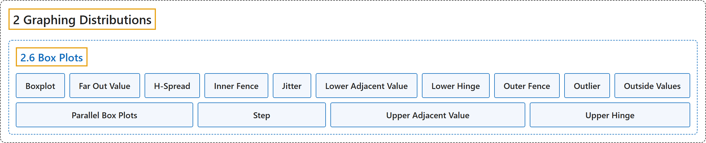

# 2.6 Box Plots

## Classification

## Glossary

| Term | Definition | 中文翻译 | Source |
|---|---|---|---|
| **2.6 Box Plots** 箱线图 | (No definition) | （无定义） | [Online Statistics Education, n.d., section 2.6](https://onlinestatbook.com/2/graphing_distributions/boxplots.html) |
| **Boxplot** 箱线图 | "One of the more effective graphical summaries of a data set, the **box plot** generally shows mean, median, 25th and 75th percentiles, and outliers. A standard box plot is composed of the median, upper hinge, lower hinge, upper adjacent value, lower adjacent value, outside values, and far out values. An example is shown below. Parallel box plots are very useful for comparing distributions. See also: step, H-spread." | 作为对数据集较为有效的图形概括之一，**箱线图**通常显示均值、中位数、第 25 和第 75 百分位数以及离群值。标准箱线图由中位数、上铰链、下铰链、上邻值、下邻值、外部值和远外值组成。示例如下。平行箱线图对于比较分布非常有用。另见：步长、H 散布。 | [Online Statistics Education, n.d., glossary](https://onlinestatbook.com/2/glossary/boxplot.html) |
| **Far Out Value** 极端离群值 | "One of the components of a box plot, **far out values** are those that are **more than 2 steps from the nearest hinge**. They are beyond the outer fences." | 作为箱线图的组成部分之一，**极端离群值**是**距最近的铰链超过 2 个步长**的值。它们位于外围栏之外。 | [Online Statistics Education, n.d., glossary](https://onlinestatbook.com/2/glossary/far_out_value.html) |
| **H-Spread** H 散布 | "One of the components of a box plot, the **H-spread** is the **difference between the upper hinge and the lower hinge**." | 作为箱线图的组成部分之一，**H 散布**是**上铰链与下铰链之差**。 | [Online Statistics Education, n.d., glossary](https://onlinestatbook.com/2/glossary/hspread.html) |
| **Inner Fence** 内栅栏 | "In a box plot, the **lower inner fence** is one step below the lower hinge while the **upper inner fence** is one step above the upper hinge." | 在箱线图中，**下内栅栏**位于下铰链之下一个步长处，而**上内栅栏**位于上铰链之上一个步长处。 | [Online Statistics Education, n.d., glossary](https://onlinestatbook.com/2/glossary/inner_fence.html) |
| **Jitter** 抖动 | "When points in a graph are **jittered**, the are moved horizontally so that all the points can be seen and none are hidden due to overlapping values. An example is shown below: …" | 当图中的点被**抖动**时，它们会被水平移动，使所有的点都能被看到，没有点因取值重叠而被遮挡。示例如下：… | [Online Statistics Education, n.d., glossary](https://onlinestatbook.com/2/glossary/jitter.html) |
| **Lower Adjacent Value** 下邻值 | "A component of a box plot, the **lower adjacent value** is **smallest value in the data above the inner lower fence**." | 作为箱线图的组成部分，**下邻值**是**数据中位于下内栅栏之上的最小值**。 | [Online Statistics Education, n.d., glossary](https://onlinestatbook.com/2/glossary/lower_adjacent_value.html) |
| **Lower Hinge** 下铰链 | "A component of a box plot, the **lower hinge** is the 25th percentile. The upper hinge is the 75th percentile." | 作为箱线图的组成部分，**下铰链**是第 25 百分位数。上铰链是第 75 百分位数。 | [Online Statistics Education, n.d., glossary](https://onlinestatbook.com/2/glossary/lower_hinge.html) |
| **Outer Fence** 外围栅栏 | "In a box plot, the **lower outer fence** is 2 steps below the lower hinge whereas the upper inner fence is 2 steps above the upper hinge." | 在箱线图中，**下外围栅栏**位于下铰链之下 2 个步长处，而上内围栅栏位于上铰链之上 2 个步长处。 | [Online Statistics Education, n.d., glossary](https://onlinestatbook.com/2/glossary/outer_fence.html) |
| **Outlier** 离群值 | "**Outliers** are **atypical, infrequent observations**; values that have an extreme deviation from the center of the distribution. There is no universally-agreed on criterion for defining an outlier, and outliers should only be discarded with extreme caution. However, one should always assess the effects of outliers on the statistical conclusions." | **离群值**是**非典型的、罕见的观测值**；即与分布中心有极端偏离的值。对于如何定义离群值，没有普遍认可的标准，而且只应极为谨慎地舍弃离群值。然而，人们应始终评估离群值对统计结论的影响。 | [Online Statistics Education, n.d., glossary](https://onlinestatbook.com/2/glossary/outlier.html) |
| **Outside Values** 外部值 | "A component of a box plot, **outside values** are more than 1 step beyond the nearest hinge. They are beyond an inner fence but not beyond an outer fence. See also: Far out value." | 作为箱线图的组成部分，**外部值**是超出最近铰链 1 个步长以上的值。它们超出内围栅栏但未超出外围栅栏。另见：远外值。 | [Online Statistics Education, n.d., glossary](https://onlinestatbook.com/2/glossary/outside_values.html) |
| **Parallel Box Plots** 平行箱线图 | "Two or more box plots drawn on the same $Y$-axis. These are often useful in comparing features of distributions. An example portraying the times it took samples of women and men to do a task is shown below." | **在同一个 $Y$ 轴上绘制的两个或多个箱线图**。它们常用于比较分布的特征。下面给出了一个示例，描绘了女性样本和男性样本完成一项任务所用的时间。 | [Online Statistics Education, n.d., glossary](https://onlinestatbook.com/2/glossary/parallel_box_plots.html) |
| **Step** 步长 | "One of the components of a box plot, the **step** is **1.5 times the difference between the upper hinge and the lower hinge**. See also: H-spread." | 作为箱线图的组成部分之一，**步长**是**上铰链与下铰链之差的 1.5 倍**。另见：H 散布。 | [Online Statistics Education, n.d., glossary](https://onlinestatbook.com/2/glossary/step.html) |
| **Upper Adjacent Value** 上邻值 | "One of the components of a box plot, the **higher adjacent value** is the **largest value in the data below the 75th percentile**." | 作为箱线图的组成部分之一，**上邻值**是**数据中低于第 75 百分位数的最大值**。 | [Online Statistics Education, n.d., glossary](https://onlinestatbook.com/2/glossary/upper_adjacent_value.html) |
| **Upper Hinge** 上铰链 | "The **upper hinge** is one of the components of a box plot ; it is the 75th percentile." | **上铰链**是箱线图的组成部分之一；它是第 75 百分位数。 | [Online Statistics Education, n.d., glossary](https://onlinestatbook.com/2/glossary/upper_hinge.html) |

## References

*Online statistics education: An interactive multimedia course of study*. (n.d.). Rice University, University of Houston Clear Lake, and Tufts University. Retrieved October 29, 2026, from <https://onlinestatbook.com/2/>
