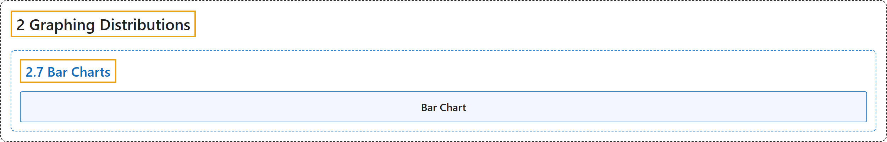

# 2.7 Bar Charts

## Classification

## Glossary

| Term | Definition | 中文翻译 | Source |
|---|---|---|---|
| **2.7 Bar Charts** 条形图 | (No definition) | （无定义） | [Online Statistics Education, n.d., section 2.7](https://onlinestatbook.com/2/graphing_distributions/bar_chart.html) |
| **Bar Chart** 条形图 | "A **graphical method of presenting data**. A bar is drawn for each level of a variable. The height of each bar contains the value of the variable. **Bar charts** are useful for displaying things such as frequency counts and percent increases. They are not recommended for displaying means (despite the widespread practice) since box plots present more information in the same amount of space. An example bar chart is shown below." | 一种**呈现数据的图形方法**。为变量的每个水平绘制一根条形。每根条形的高度表示该变量的值。**条形图**适用于展示频数和百分比增长等内容。不建议用它来展示均值（尽管这种做法很普遍），因为箱线图在同样大小的空间中能呈现更多信息。下面显示了一个条形图示例。 | [Online Statistics Education, n.d., glossary](https://onlinestatbook.com/2/glossary/bar_chart.html) |

## References

*Online statistics education: An interactive multimedia course of study*. (n.d.). Rice University, University of Houston Clear Lake, and Tufts University. Retrieved October 29, 2026, from <https://onlinestatbook.com/2/>
