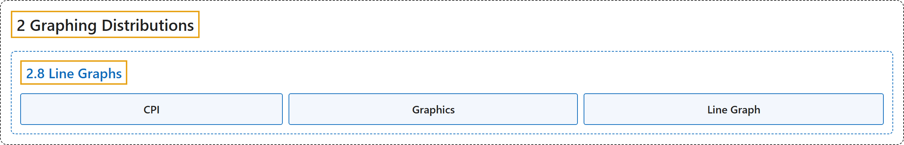

# 2.8 Line Graphs

## Classification

## Glossary

| Term | Definition | 中文翻译 | Source |
|---|---|---|---|
| **2.8 Line Graphs** 折线图 | (No definition) | （无定义） | [Online Statistics Education, n.d., section 2.8](https://onlinestatbook.com/2/graphing_distributions/line_graphs.html) |
| **CPI** 消费者价格指数 | "Also known as the cost of living index, the **CPI** is a financial statistic that **measures the change in price of a representative group of goods over time**." | 又称生活费用指数，**CPI** 是一种金融统计量，用于**衡量一组有代表性的商品价格随时间的变化**。 | [Online Statistics Education, n.d., glossary](https://onlinestatbook.com/2/glossary/CPI.html) |
| **Graphics** 统计图 | "**Graphs** are often the most effective way to describe distributions and relationships among variables. Among the most common graphs are histograms, box plots, bar charts, and scatterplots." | **图形**往往是描述分布以及变量之间关系的最有效方式。最常见的图形有直方图、箱线图、条形图和散点图。 | [Online Statistics Education, n.d., glossary](https://onlinestatbook.com/2/glossary/graphics.html) |
| **Line Graph** 折线图 | "Essentially a bar graph in which **the height of each par is represented by a single point, with each of these points connected by a line**. Line graphs are best used to show change over time, and should never be used if your $X$-axis is not an ordered variable. An example is shown below." | 本质上是一种条形图，其中**每根条形的高度由一个点表示，这些点之间用线连接**。折线图最适合用来显示随时间的变化，如果你的 $X$ 轴不是有序变量，则绝不应使用。下面显示了一个示例。 | [Online Statistics Education, n.d., glossary](https://onlinestatbook.com/2/glossary/line_graph.html) |

## References

*Online statistics education: An interactive multimedia course of study*. (n.d.). Rice University, University of Houston Clear Lake, and Tufts University. Retrieved October 29, 2026, from <https://onlinestatbook.com/2/>
