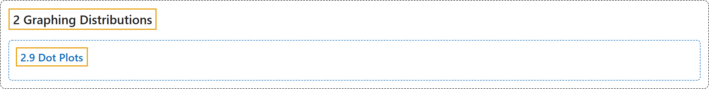

# 2.9 Dot Plots

## Classification

## Glossary

| Term | Definition | 中文翻译 | Source |
|---|---|---|---|
| **2.9 Dot Plots** 点图 | (No definition) | （无定义） | [Online Statistics Education, n.d., section 2.9](https://onlinestatbook.com/2/graphing_distributions/dotplots.html) |

## References

*Online statistics education: An interactive multimedia course of study*. (n.d.). Rice University, University of Houston Clear Lake, and Tufts University. Retrieved October 29, 2026, from <https://onlinestatbook.com/2/>
