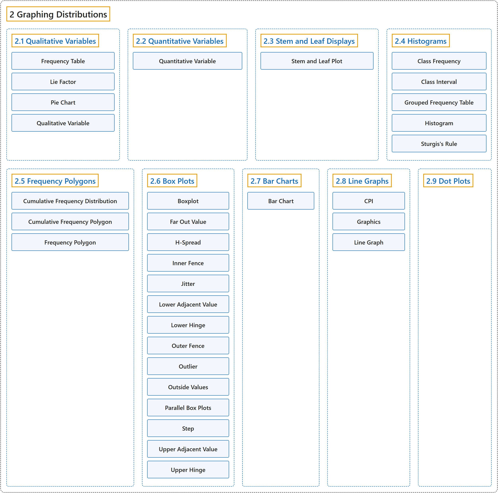

# 2 Graphing Distributions

## Classification

## Glossary

| Term | Definition | 中文翻译 | Source |
|---|---|---|---|
| **2 Graphing Distributions** 分布的图示 | (No definition) | （无定义） | [Online Statistics Education, n.d., chapter 2](https://onlinestatbook.com/2/graphing_distributions/graphing_distributions.html) |
| **[2.1 Qualitative Variables](2-1-qualitative-variables.md)** 定性变量 | (No definition) | （无定义） | [Online Statistics Education, n.d., section 2.1](https://onlinestatbook.com/2/graphing_distributions/graphing_qualitative.html) |
| **[2.2 Quantitative Variables](2-2-quantitative-variables.md)** 定量变量 | (No definition) | （无定义） | [Online Statistics Education, n.d., section 2.2](https://onlinestatbook.com/2/graphing_distributions/quantitative.html) |
| **[2.3 Stem and Leaf Displays](2-3-stem-and-leaf-displays.md)** 茎叶图 | (No definition) | （无定义） | [Online Statistics Education, n.d., section 2.3](https://onlinestatbook.com/2/graphing_distributions/stem.html) |
| **[2.4 Histograms](2-4-histograms.md)** 直方图 | (No definition) | （无定义） | [Online Statistics Education, n.d., section 2.4](https://onlinestatbook.com/2/graphing_distributions/histograms.html) |
| **[2.5 Frequency Polygons](2-5-frequency-polygons.md)** 频数多边形图 | (No definition) | （无定义） | [Online Statistics Education, n.d., section 2.5](https://onlinestatbook.com/2/graphing_distributions/freq_poly.html) |
| **[2.6 Box Plots](2-6-box-plots.md)** 箱线图 | (No definition) | （无定义） | [Online Statistics Education, n.d., section 2.6](https://onlinestatbook.com/2/graphing_distributions/boxplots.html) |
| **[2.7 Bar Charts](2-7-bar-charts.md)** 条形图 | (No definition) | （无定义） | [Online Statistics Education, n.d., section 2.7](https://onlinestatbook.com/2/graphing_distributions/bar_chart.html) |
| **[2.8 Line Graphs](2-8-line-graphs.md)** 折线图 | (No definition) | （无定义） | [Online Statistics Education, n.d., section 2.8](https://onlinestatbook.com/2/graphing_distributions/line_graphs.html) |
| **[2.9 Dot Plots](2-9-dot-plots.md)** 点图 | (No definition) | （无定义） | [Online Statistics Education, n.d., section 2.9](https://onlinestatbook.com/2/graphing_distributions/dotplots.html) |

## References

*Online statistics education: An interactive multimedia course of study*. (n.d.). Rice University, University of Houston Clear Lake, and Tufts University. Retrieved October 29, 2026, from <https://onlinestatbook.com/2/>
