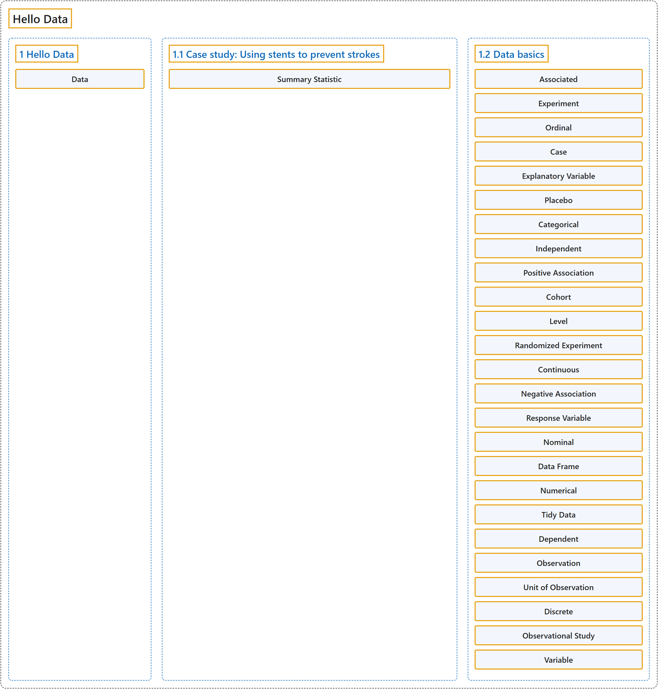

# 1 Hello Data

## Classification

## Glossary

| Term | Definition | 中文翻译 | Source |
|---|---|---|---|
| **1 Hello Data** 数据入门 | (No definition) | （无定义） | [Çetinkaya-Rundel & Hardin, 2024, chapter 1](https://openintro-ims.netlify.app/data-hello.html) |
| **Data** 数据 | "These observations – collected from the likes of field notes, surveys, and experiments – form the backbone of a statistical investigation and are called **data**." | 这些观测，来自实地笔记、调查和实验等，构成统计研究的支柱，称为**数据**。 | [Çetinkaya-Rundel & Hardin, 2024, chapter 1 introduction](https://openintro-ims.netlify.app/data-hello.html#:~:text=These%20observations%20%E2%80%93%20collected%20from%20the) |
| **1.1 Case study: Using stents to prevent strokes** 案例研究：使用支架预防中风 | (No definition) | （无定义） | [Çetinkaya-Rundel & Hardin, 2024, section 1.1](https://openintro-ims.netlify.app/data-hello.html#sec-case-study-stents-strokes) |
| **Summary Statistic** 汇总统计量 | "A **summary statistic** is a single number summarizing data from a sample." | **汇总统计量**是概括样本数据的单个数字。 | [Çetinkaya-Rundel & Hardin, 2024, section 1.1](https://openintro-ims.netlify.app/data-hello.html#:~:text=A%20summary%20statistic%20is%20a%20single) |
| **1.2 Data basics** 数据基础 | (No definition) | （无定义） | [Çetinkaya-Rundel & Hardin, 2024, section 1.2](https://openintro-ims.netlify.app/data-hello.html#sec-data-basics) |
| **Associated** 关联变量 | "When two variables show some connection with one another, they are called **associated variables**." | 当两个变量表现出某种相互联系时，它们被称为**关联变量**。 | [Çetinkaya-Rundel & Hardin, 2024, section 1.2](https://openintro-ims.netlify.app/data-hello.html#:~:text=When%20two%20variables%20show%20some%20connection) |
| **Experiment** 实验 | "When researchers want to evaluate the effect of particular traits, treatments, or conditions, they conduct **an experiment**." | 当研究者想要评估特定特征、处理或条件的效应时，他们会开展**实验**。 | [Çetinkaya-Rundel & Hardin, 2024, section 1.2](https://openintro-ims.netlify.app/data-hello.html#:~:text=When%20researchers%20want%20to%20evaluate%20the) |
| **Ordinal** 有序变量 | "A variable with these properties is called an **ordinal variable**, while a regular categorical variable without this type of special ordering is called a **nominal variable**." | 具有这些性质的变量称为**有序变量**，而没有这种特殊顺序的普通分类变量称为**名义变量**。 | [Çetinkaya-Rundel & Hardin, 2024, section 1.2](https://openintro-ims.netlify.app/data-hello.html#:~:text=A%20variable%20with%20these%20properties%20is) |
| **Case** 个案 | "The formal name for a row is a **case** or observation or unit of observation." | 行的正式名称是**个案**、观测或观测单元。 | [Çetinkaya-Rundel & Hardin, 2024, section 1.2](https://openintro-ims.netlify.app/data-hello.html#:~:text=The%20formal%20name%20for%20a%20row) |
| **Explanatory Variable** 解释变量 | "If this is our underlying belief, then median household income is the **explanatory variable**, and the population change is the **response variable** in the hypothesized relationship." | 如果这是我们的基本看法，那么家庭收入中位数是**解释变量**，人口变化是假设关系中的**响应变量**。 | [Çetinkaya-Rundel & Hardin, 2024, section 1.2](https://openintro-ims.netlify.app/data-hello.html#:~:text=If%20this%20is%20our%20underlying%20belief%2C) |
| **Placebo** 安慰剂 | "For example, each runner in the experiment could be randomly assigned, perhaps by flipping a coin, into one of two groups: the first group receives a **placebo** (fake treatment, in this case a no-calorie drink) and the second group receives the high-calorie energy drink." | 例如，实验中的每名跑者可以被随机分配（也许通过抛硬币）到两组之一：第一组服用**安慰剂**（假处理，此处为无热量饮料），第二组服用高热量能量饮料。 | [Çetinkaya-Rundel & Hardin, 2024, section 1.2](https://openintro-ims.netlify.app/data-hello.html#:~:text=For%20example%2C%20each%20runner%20in%20the) |
| **Categorical** 分类变量 | "Because the responses themselves are categories, state is called a **categorical variable**, and the possible values (states) are called the variable’s **levels** (e.g., District of Columbia, Alabama, Alaska, etc.)." | 由于响应本身是类别，state 称为**分类变量**，其可能取值（各个州）称为该变量的**水平**（例如哥伦比亚特区、阿拉巴马州、阿拉斯加州等）。 | [Çetinkaya-Rundel & Hardin, 2024, section 1.2](https://openintro-ims.netlify.app/data-hello.html#:~:text=Because%20the%20responses%20themselves%20are%20categories%2C) |
| **Independent** 独立 | "If two variables are not associated, then they are said to be **independent**. That is, two variables are **independent** if there is no evident relationship between the two." | 如果两个变量不相关联，则称它们是**独立**的。也就是说，如果两个变量之间没有明显的关系，则它们是**独立**的。 | [Çetinkaya-Rundel & Hardin, 2024, section 1.2](https://openintro-ims.netlify.app/data-hello.html#:~:text=If%20two%20variables%20are%20not%20associated%2C) |
| **Positive Association** 正关联 | "A **positive association** is shown in the relationship between the median_hh_income and pop_change variables in Figure 1.3, where counties with higher median household income tend to have higher rates of population growth." | 中位家庭收入 median_hh_income 与人口变化 pop_change 这两个变量之间呈现出**正关联**，家庭收入中位数较高的县，人口增长率往往也较高。 | [Çetinkaya-Rundel & Hardin, 2024, section 1.2](https://openintro-ims.netlify.app/data-hello.html#:~:text=A%20positive%20association%20is%20shown%20in) |
| **Cohort** 队列 | "For instance, researchers may collect information via surveys, review medical or company records, or follow a **cohort** of many similar individuals to form hypotheses about why certain diseases might develop." | 例如，研究者可以通过调查收集信息，查阅医疗或公司记录，或跟踪由许多相似个体组成的**队列**，以便就某些疾病为何发生提出假设。 | [Çetinkaya-Rundel & Hardin, 2024, section 1.2](https://openintro-ims.netlify.app/data-hello.html#:~:text=For%20instance%2C%20researchers%20may%20collect%20information) |
| **Level** 水平 | "Because the responses themselves are categories, state is called a categorical variable, and the possible values (states) are called the variable’s **levels** (e.g., District of Columbia, Alabama, Alaska, etc.)." | 由于响应本身是类别，state 称为分类变量，其可能取值（各个州）称为该变量的**水平**（例如哥伦比亚特区、阿拉巴马州、阿拉斯加州等）。 | [Çetinkaya-Rundel & Hardin, 2024, section 1.2](https://openintro-ims.netlify.app/data-hello.html#:~:text=Because%20the%20responses%20themselves%20are%20categories%2C) |
| **Randomized Experiment** 随机化实验 | "When individuals are randomly assigned to a group, the experiment is called a **randomized experiment**. **Random assignment** organizes the participants in a study into groups that are roughly equal on all aspects, thus allowing us to control for any confounding variables that might affect the outcome (e.g., fitness level, racing experience, etc.)." | 当个体被随机分配到各组时，该实验称为**随机化实验**。**随机分配**把研究参与者组织成在各方面大致相当的组，从而使我们能够控制可能影响结果的任何混杂变量（例如体能水平、比赛经验等）。 | [Çetinkaya-Rundel & Hardin, 2024, section 1.2](https://openintro-ims.netlify.app/data-hello.html#:~:text=When%20individuals%20are%20randomly%20assigned%20to) |
| **Continuous** 连续变量 | "For this reason, the population variable is said to be **discrete** since it can only take numerical values with jumps. On the other hand, the unemployment rate variable is said to be **continuous**." | 因此，人口变量称为**离散**变量，因为它只能取有跳跃的数值。另一方面，失业率变量称为**连续**变量。 | [Çetinkaya-Rundel & Hardin, 2024, section 1.2](https://openintro-ims.netlify.app/data-hello.html#:~:text=For%20this%20reason%2C%20the%20population%20variable) |
| **Negative Association** 负关联 | "Because there is a downward trend in Figure 1.2 – counties with more housing units that are in multi-unit structures are associated with lower homeownership – these variables are said to be **negatively associated**." | 由于图 1.2 中有下降趋势，即多单元结构住房占比较高的县，其住房自有率较低，这些变量称为**负关联**。 | [Çetinkaya-Rundel & Hardin, 2024, section 1.2](https://openintro-ims.netlify.app/data-hello.html#:~:text=Because%20there%20is%20a%20downward%20trend) |
| **Response Variable** 响应变量 | "If this is our underlying belief, then median household income is the **explanatory variable**, and the population change is the **response variable** in the hypothesized relationship." | 如果这是我们的基本看法，那么家庭收入中位数是**解释变量**，人口变化是假设关系中的**响应变量**。 | [Çetinkaya-Rundel & Hardin, 2024, section 1.2](https://openintro-ims.netlify.app/data-hello.html#:~:text=If%20this%20is%20our%20underlying%20belief%2C) |
| **Nominal** 名义变量 | "A variable with these properties is called an **ordinal variable**, while a regular categorical variable without this type of special ordering is called a **nominal variable**." | 具有这些性质的变量称为**有序变量**，而没有这种特殊顺序的普通分类变量称为**名义变量**。 | [Çetinkaya-Rundel & Hardin, 2024, section 1.2](https://openintro-ims.netlify.app/data-hello.html#:~:text=A%20variable%20with%20these%20properties%20is) |
| **Data Frame** 数据框 | "The data in Table 1.3 represent a **data frame**, which is a convenient and common way to organize data, especially if collecting data in a spreadsheet." | 表 1.3 中的数据构成一个**数据框**，它是组织数据的一种方便而常用的方式，在用电子表格收集数据时尤其如此。 | [Çetinkaya-Rundel & Hardin, 2024, section 1.2](https://openintro-ims.netlify.app/data-hello.html#:~:text=The%20data%20in%20Table%201.3%20represent) |
| **Numerical** 数值变量 | "First consider unemployment_rate, which is said to be a **numerical variable** since it can take a wide range of numerical values, and it is sensible to add, subtract, or take averages with those values." | 首先看 unemployment_rate，它称为**数值变量**，因为它可以取很大范围内的数值，并且对这些值求和、求差或求平均是有意义的。 | [Çetinkaya-Rundel & Hardin, 2024, section 1.2](https://openintro-ims.netlify.app/data-hello.html#:~:text=First%20consider%20unemployment_rate%2C%20which%20is%20said) |
| **Tidy Data** 整洁数据 | "A data frame where each row is a unique case (observational unit), each column is a variable, and each cell is a single value is commonly referred to as **tidy data** (Wickham 2014)." | 每一行是一个唯一的个案（观测单元）、每一列是一个变量、每个单元格是单个值的数据框，通常称为**整洁数据**（Wickham 2014）。 | [Çetinkaya-Rundel & Hardin, 2024, section 1.2](https://openintro-ims.netlify.app/data-hello.html#:~:text=A%20data%20frame%20where%20each%20row) |
| **Dependent** 相依 | "If two variables are not associated, then they are said to be **independent**. That is, two variables are independent if there is no evident relationship between the two." | 如果两个变量不相关联，则称它们是**独立**的。也就是说，如果两个变量之间没有明显的关系，则它们是独立的。 | [Çetinkaya-Rundel & Hardin, 2024, section 1.2](https://openintro-ims.netlify.app/data-hello.html#:~:text=If%20two%20variables%20are%20not%20associated%2C) |
| **Observation** 观测 | "The formal name for a row is a case or **observation** or unit of observation." | 行的正式名称是个案、**观测**或观测单元。 | [Çetinkaya-Rundel & Hardin, 2024, section 1.2](https://openintro-ims.netlify.app/data-hello.html#:~:text=The%20formal%20name%20for%20a%20row) |
| **Unit of Observation** 观测单元 | "The formal name for a row is a case or observation or **unit of observation**." | 行的正式名称是个案、观测或**观测单元**。 | [Çetinkaya-Rundel & Hardin, 2024, section 1.2](https://openintro-ims.netlify.app/data-hello.html#:~:text=The%20formal%20name%20for%20a%20row) |
| **Discrete** 离散变量 | "For this reason, the population variable is said to be **discrete** since it can only take numerical values with jumps. On the other hand, the unemployment rate variable is said to be **continuous**." | 因此，人口变量称为**离散**变量，因为它只能取有跳跃的数值。另一方面，失业率变量称为**连续**变量。 | [Çetinkaya-Rundel & Hardin, 2024, section 1.2](https://openintro-ims.netlify.app/data-hello.html#:~:text=For%20this%20reason%2C%20the%20population%20variable) |
| **Observational Study** 观察性研究 | "Researchers perform an **observational study** when they collect data in a way that does not directly interfere with how the data arise." | 当研究者以不直接干预数据产生方式的方法收集数据时，就是在进行**观察性研究**。 | [Çetinkaya-Rundel & Hardin, 2024, section 1.2](https://openintro-ims.netlify.app/data-hello.html#:~:text=Researchers%20perform%20an%20observational%20study%20when) |
| **Variable** 变量 | "The columns represent characteristics of each loan, where each column is referred to as a **variable**." | 各列表示每笔贷款的特征，每一列称为一个**变量**。 | [Çetinkaya-Rundel & Hardin, 2024, section 1.2](https://openintro-ims.netlify.app/data-hello.html#:~:text=The%20columns%20represent%20characteristics%20of%20each) |

## References

Çetinkaya-Rundel, M., & Hardin, J. (2024). *Introduction to modern statistics* (2nd ed.). OpenIntro. Retrieved October 28, 2026, from <https://openintro-ims.netlify.app/>
