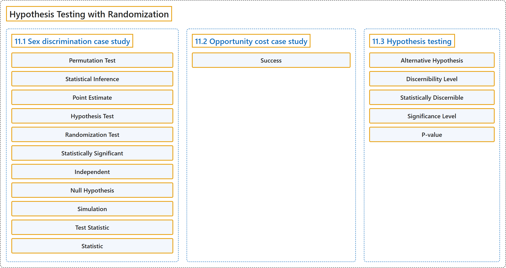

# 11 Hypothesis Testing with Randomization

## Classification

## Glossary

| Term | Definition | 中文翻译 | Source |
|---|---|---|---|
| **11 Hypothesis Testing with Randomization** 基于随机化的假设检验 | (No definition) | （无定义） | [Çetinkaya-Rundel & Hardin, 2024, chapter 11](https://openintro-ims.netlify.app/foundations-randomization.html) |
| **11.1 Sex discrimination case study** 案例研究：性别歧视 | (No definition) | （无定义） | [Çetinkaya-Rundel & Hardin, 2024, section 11.1](https://openintro-ims.netlify.app/foundations-randomization.html#sec-caseStudySexDiscrimination) |
| **Permutation Test** 置换检验 | "The test procedure we employ in this section is sometimes referred to as a randomization test. If the explanatory variable had not been randomly assigned, as in an observational study, the procedure would be referred to as a **permutation test**." | 本节采用的检验程序有时被称为随机化检验。如果解释变量不是随机分配的，如在观察性研究中，则该程序被称为**置换检验**。 | [Çetinkaya-Rundel & Hardin, 2024, section 11.1](https://openintro-ims.netlify.app/foundations-randomization.html#:~:text=The%20test%20procedure%20we%20employ%20in) |
| **Statistical Inference** 统计推断 | "**Statistical inference** is the practice of **making decisions and conclusions from data** in the context of uncertainty." | **统计推断**是指在不确定性的背景下根据数据**做出决策和结论**的实践。 | [Çetinkaya-Rundel & Hardin, 2024, section 11.1](https://openintro-ims.netlify.app/foundations-randomization.html#:~:text=Statistical%20inference%20is%20the%20practice%20of) |
| **Point Estimate** 点估计 | "This observed difference is what we call a **point estimate** of the true difference." | 这个观察到的差异就是我们所说的真实差异的**点估计**。 | [Çetinkaya-Rundel & Hardin, 2024, section 11.1](https://openintro-ims.netlify.app/foundations-randomization.html#:~:text=This%20observed%20difference%20is%20what%20we) |
| **Hypothesis Test** 假设检验 | "A **hypothesis test** is a statistical technique used to **evaluate competing claims using data**." | **假设检验**是一种利用数据**评估相互竞争的主张**的统计技术。 | [Çetinkaya-Rundel & Hardin, 2024, section 11.1](https://openintro-ims.netlify.app/foundations-randomization.html#:~:text=A%20hypothesis%20test%20is%20a%20statistical) |
| **Randomization Test** 随机化检验 | "The test procedure we employ in this section is sometimes referred to as a **randomization test**. If the explanatory variable had not been randomly assigned, as in an observational study, the procedure would be referred to as a permutation test." | 本节采用的检验程序有时被称为**随机化检验**。如果解释变量不是随机分配的，如在观察性研究中，则该程序被称为置换检验。 | [Çetinkaya-Rundel & Hardin, 2024, section 11.1](https://openintro-ims.netlify.app/foundations-randomization.html#:~:text=The%20test%20procedure%20we%20employ%20in) |
| **Statistically Significant** 统计显著 | "Many texts use the phrase “**statistically significant**” instead of “statistically discernible”." | 许多教材使用“**统计显著**”一词来代替“统计上可辨别”。 | [Çetinkaya-Rundel & Hardin, 2024, section 11.1](https://openintro-ims.netlify.app/foundations-randomization.html#:~:text=Many%20texts%20use%20the%20phrase%20%E2%80%9Cstatistically) |
| **Independent** 独立 | "We would be assuming that these two variables are **independent**." | 我们将假定这两个变量是**独立**的。 | [Çetinkaya-Rundel & Hardin, 2024, section 11.1](https://openintro-ims.netlify.app/foundations-randomization.html#:~:text=We%20would%20be%20assuming%20that%20these) |
| **Null Hypothesis** 原假设 | "Often times, the **null hypothesis** takes a **stance of no difference or no effect**. This hypothesis assumes that any differences observed are due to the variability inherent in the population and could have occurred by random chance." | **原假设**往往采取**无差异或无效应**的立场。该假设认为观察到的任何差异都源于总体固有的变异性，也可能是随机机会造成的。 | [Çetinkaya-Rundel & Hardin, 2024, section 11.1](https://openintro-ims.netlify.app/foundations-randomization.html#:~:text=Often%20times%2C%20the%20null%20hypothesis%20takes) |
| **Simulation** 模拟 | "In the **simulation**, we thoroughly **shuffle** the 48 personnel files, 35 labelled promoted and 13 labelled not promoted, together and we deal files into two new stacks." | 在**模拟**中，我们把48份人事档案（35份标记为晋升，13份标记为未晋升）彻底**洗牌**，然后把档案分成两个新的堆。 | [Çetinkaya-Rundel & Hardin, 2024, section 11.1](https://openintro-ims.netlify.app/foundations-randomization.html#:~:text=In%20the%20simulation%2C%20we%20thoroughly%20shuffle) |
| **Test Statistic** 检验统计量 | "We call the summary value the **statistic of interest** (or often the **test statistic**)." | 我们把这个汇总值称为所关注的**统计量**（也常称为**检验统计量**）。 | [Çetinkaya-Rundel & Hardin, 2024, section 11.1](https://openintro-ims.netlify.app/foundations-randomization.html#:~:text=We%20call%20the%20summary%20value%20the) |
| **Statistic** 统计量 | "We call the summary value the **statistic of interest** (or often the test statistic). When we encounter different data structures, the statistic is likely to change (e.g., we might calculate an average instead of a proportion), but we will always want to understand how **the statistic varies from sample to sample**." | 我们把这个汇总值称为所关注的**统计量**（也常称为检验统计量）。当遇到不同的数据结构时，统计量可能会改变（例如，我们可能计算平均数而不是比例），但我们总是希望了解**统计量如何随样本而变化**。 | [Çetinkaya-Rundel & Hardin, 2024, section 11.1](https://openintro-ims.netlify.app/foundations-randomization.html#:~:text=We%20call%20the%20summary%20value%20the) |
| **11.2 Opportunity cost case study** 案例研究：机会成本 | (No definition) | （无定义） | [Çetinkaya-Rundel & Hardin, 2024, section 11.2](https://openintro-ims.netlify.app/foundations-randomization.html#sec-caseStudyOpportunityCost) |
| **Success** 成功 | "**Success** is often defined in a study as the **outcome of interest**, and a “success” may or may not actually be a positive outcome." | **成功**在研究中通常被定义为**所关注的结果**，而“成功”不一定真的是一个正面的结果。 | [Çetinkaya-Rundel & Hardin, 2024, section 11.2](https://openintro-ims.netlify.app/foundations-randomization.html#:~:text=Success%20is%20often%20defined%20in%20a) |
| **11.3 Hypothesis testing** 假设检验 | (No definition) | （无定义） | [Çetinkaya-Rundel & Hardin, 2024, section 11.3](https://openintro-ims.netlify.app/foundations-randomization.html#sec-HypothesisTesting) |
| **Alternative Hypothesis** 备择假设 | "We also laid out an **alternative hypothesis**, which represented a new perspective such as the possibility of a relationship between two variables or a treatment effect in an experiment. The alternative hypothesis is usually the reason the scientists set out to do the research in the first place." | 我们还提出了**备择假设**，它代表一种新的观点，例如两个变量之间可能存在关系，或实验中存在处理效应。备择假设通常是科学家着手研究的原因。 | [Çetinkaya-Rundel & Hardin, 2024, section 11.3](https://openintro-ims.netlify.app/foundations-randomization.html#:~:text=We%20also%20laid%20out%20an%20alternative) |
| **Discernibility Level** 可辨别水平 | "The threshold is called the **discernibility level** and often represented by $\alpha$ (the Greek letter alpha)." | 这个阈值称为**可辨别水平**，常用 $\alpha$（希腊字母 alpha）表示。 | [Çetinkaya-Rundel & Hardin, 2024, section 11.3](https://openintro-ims.netlify.app/foundations-randomization.html#:~:text=The%20threshold%20is%20called%20the%20discernibility) |
| **Statistically Discernible** 统计上可辨别 | "When the p-value is small, i.e., less than a previously set threshold, we say the results are **statistically discernible**. This means the data provide such strong evidence against $H_0$ that we **reject the null hypothesis** in favor of the alternative hypothesis." | 当 p 值很小，即小于事先设定的阈值时，我们称结果**统计上可辨别**。这意味着数据提供了很强的证据反对 $H_0,$ 因此我们**拒绝原假设**而支持备择假设。 | [Çetinkaya-Rundel & Hardin, 2024, section 11.3](https://openintro-ims.netlify.app/foundations-randomization.html#:~:text=When%20the%20p-value%20is%20small%2C%20i.e.%2C) |
| **Significance Level** 显著性水平 | "Here, too, we have chosen “discernibility level” instead of “**significance level**” which you will see in some texts." | 这里同样，我们选用了“可辨别水平”，而不是你在一些教材中会看到的“**显著性水平**”。 | [Çetinkaya-Rundel & Hardin, 2024, section 11.3](https://openintro-ims.netlify.app/foundations-randomization.html#:~:text=Here%2C%20too%2C%20we%20have%20chosen%20%E2%80%9Cdiscernibility) |
| **P-value** p值 | "The 2-in-100 chance is what we call a **p-value**, which is a probability quantifying the **strength of the evidence against the null hypothesis**, given the observed data." | 百分之二的机会就是我们所说的 **p 值**，它是一个概率，用来量化在给定观测数据的情况下**反对原假设的证据强度**。 | [Çetinkaya-Rundel & Hardin, 2024, section 11.3](https://openintro-ims.netlify.app/foundations-randomization.html#:~:text=The%202-in-100%20chance%20is%20what%20we) |

## References

Çetinkaya-Rundel, M., & Hardin, J. (2024). *Introduction to modern statistics* (2nd ed.). OpenIntro. Retrieved October 28, 2026, from <https://openintro-ims.netlify.app/>
