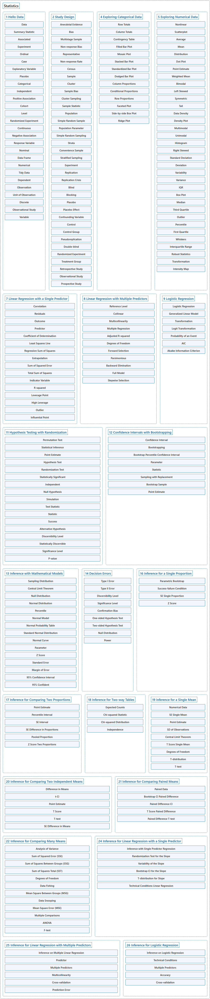

# 3. Statistics

## Classification

## Glossary

| Term | Definition | 中文翻译 | Source |
|---|---|---|---|
| **Statistics** 统计 | "The mathematical study of the **likelihood and probability of events** occurring based on known information and inferred by **taking a limited number of samples**." | 对事件发生的**可能性和概率**所作的数学研究，依据已知信息，并通过**抽取有限数量的样本**来推断。 | [Weisstein, n.d., "Statistics" entry, para. 1](https://mathworld.wolfram.com/Statistics.html#:~:text=The%20mathematical%20study%20of%20the%20likelihood%20and%20probability%20of%20events) |
| **[1 Hello Data](hello-data.md)** 数据入门 | (No definition) | （无定义） | [Çetinkaya-Rundel & Hardin, 2024, chapter 1](https://openintro-ims.netlify.app/data-hello.html) |
| **[2 Study Design](study-design.md)** 研究设计 | (No definition) | （无定义） | [Çetinkaya-Rundel & Hardin, 2024, chapter 2](https://openintro-ims.netlify.app/data-design.html) |
| **[4 Exploring Categorical Data](exploring-categorical-data.md)** 分类数据的探索 | (No definition) | （无定义） | [Çetinkaya-Rundel & Hardin, 2024, chapter 4](https://openintro-ims.netlify.app/explore-categorical.html) |
| **[5 Exploring Numerical Data](exploring-numerical-data.md)** 数值型数据的探索 | (No definition) | （无定义） | [Çetinkaya-Rundel & Hardin, 2024, chapter 5](https://openintro-ims.netlify.app/explore-numerical.html) |
| **[7 Linear Regression with a Single Predictor](linear-regression-with-a-single-predictor.md)** 单预测变量线性回归 | (No definition) | （无定义） | [Çetinkaya-Rundel & Hardin, 2024, chapter 7](https://openintro-ims.netlify.app/model-slr.html) |
| **[8 Linear Regression with Multiple Predictors](linear-regression-with-multiple-predictors.md)** 多预测变量线性回归 | (No definition) | （无定义） | [Çetinkaya-Rundel & Hardin, 2024, chapter 8](https://openintro-ims.netlify.app/model-mlr.html) |
| **[9 Logistic Regression](logistic-regression.md)** 逻辑斯谛回归 | (No definition) | （无定义） | [Çetinkaya-Rundel & Hardin, 2024, chapter 9](https://openintro-ims.netlify.app/model-logistic.html) |
| **[11 Hypothesis Testing with Randomization](hypothesis-testing-with-randomization.md)** 基于随机化的假设检验 | (No definition) | （无定义） | [Çetinkaya-Rundel & Hardin, 2024, chapter 11](https://openintro-ims.netlify.app/foundations-randomization.html) |
| **[12 Confidence Intervals with Bootstrapping](confidence-intervals-with-bootstrapping.md)** 基于自助法的置信区间 | (No definition) | （无定义） | [Çetinkaya-Rundel & Hardin, 2024, chapter 12](https://openintro-ims.netlify.app/foundations-bootstrapping.html) |
| **[13 Inference with Mathematical Models](inference-with-mathematical-models.md)** 基于数学模型的推断 | (No definition) | （无定义） | [Çetinkaya-Rundel & Hardin, 2024, chapter 13](https://openintro-ims.netlify.app/foundations-mathematical.html) |
| **[14 Decision Errors](decision-errors.md)** 决策错误 | (No definition) | （无定义） | [Çetinkaya-Rundel & Hardin, 2024, chapter 14](https://openintro-ims.netlify.app/foundations-errors.html) |
| **[16 Inference for a Single Proportion](inference-for-a-single-proportion.md)** 单个比例的推断 | (No definition) | （无定义） | [Çetinkaya-Rundel & Hardin, 2024, chapter 16](https://openintro-ims.netlify.app/inference-one-prop.html) |
| **[17 Inference for Comparing Two Proportions](inference-for-comparing-two-proportions.md)** 两个比例比较的推断 | (No definition) | （无定义） | [Çetinkaya-Rundel & Hardin, 2024, chapter 17](https://openintro-ims.netlify.app/inference-two-props.html) |
| **[18 Inference for Two-way Tables](inference-for-two-way-tables.md)** 双向表的推断 | (No definition) | （无定义） | [Çetinkaya-Rundel & Hardin, 2024, chapter 18](https://openintro-ims.netlify.app/inference-tables.html) |
| **[19 Inference for a Single Mean](inference-for-a-single-mean.md)** 单个均值的推断 | (No definition) | （无定义） | [Çetinkaya-Rundel & Hardin, 2024, chapter 19](https://openintro-ims.netlify.app/inference-one-mean.html) |
| **[20 Inference for Comparing Two Independent Means](inference-for-comparing-two-independent-means.md)** 两个独立均值比较的推断 | (No definition) | （无定义） | [Çetinkaya-Rundel & Hardin, 2024, chapter 20](https://openintro-ims.netlify.app/inference-two-means.html) |
| **[21 Inference for Comparing Paired Means](inference-for-comparing-paired-means.md)** 配对均值比较的推断 | (No definition) | （无定义） | [Çetinkaya-Rundel & Hardin, 2024, chapter 21](https://openintro-ims.netlify.app/inference-paired-means.html) |
| **[22 Inference for Comparing Many Means](inference-for-comparing-many-means.md)** 多个均值比较的推断 | (No definition) | （无定义） | [Çetinkaya-Rundel & Hardin, 2024, chapter 22](https://openintro-ims.netlify.app/inference-many-means.html) |
| **[24 Inference for Linear Regression with a Single Predictor](inference-for-linear-regression-with-a-single-predictor.md)** 单预测变量线性回归的推断 | (No definition) | （无定义） | [Çetinkaya-Rundel & Hardin, 2024, chapter 24](https://openintro-ims.netlify.app/inf-model-slr.html) |
| **[25 Inference for Linear Regression with Multiple Predictors](inference-for-linear-regression-with-multiple-predictors.md)** 多预测变量线性回归的推断 | (No definition) | （无定义） | [Çetinkaya-Rundel & Hardin, 2024, chapter 25](https://openintro-ims.netlify.app/inf-model-mlr.html) |
| **[26 Inference for Logistic Regression](inference-for-logistic-regression.md)** 逻辑斯谛回归的推断 | (No definition) | （无定义） | [Çetinkaya-Rundel & Hardin, 2024, chapter 26](https://openintro-ims.netlify.app/inf-model-logistic.html) |

## References

Weisstein, E. W. (n.d.). *Statistics*. MathWorld: A Wolfram Resource. Retrieved October 27, 2026, from <https://mathworld.wolfram.com/Statistics.html>

Çetinkaya-Rundel, M., & Hardin, J. (2024). *Introduction to modern statistics* (2nd ed.). OpenIntro. Retrieved October 28, 2026, from <https://openintro-ims.netlify.app/>
