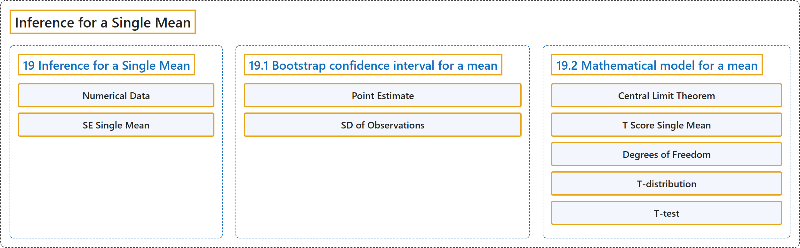

# 19 Inference for a Single Mean

## Classification

## Glossary

| Term | Definition | 中文翻译 | Source |
|---|---|---|---|
| **19 Inference for a Single Mean** 单个均值的推断 | (No definition) | （无定义） | [Çetinkaya-Rundel & Hardin, 2024, chapter 19](https://openintro-ims.netlify.app/inference-one-mean.html) |
| **Numerical Data** 数值型数据 | "The important data structure for this chapter is a **numeric response variable** (that is, the outcome is **quantitative**)." | 本章的重要数据结构是**数值型响应变量**（即结果是**定量**的）。 | [Çetinkaya-Rundel & Hardin, 2024, chapter 19 introduction](https://openintro-ims.netlify.app/inference-one-mean.html#:~:text=The%20important%20data%20structure%20for%20this) |
| **SE Single Mean** 单个均值的标准误 | "One key new idea rests in estimating how the sample mean (as opposed to the sample proportion) varies from sample to sample; the resulting value is referred to as the **standard error of the mean**." | 一个关键的新思想在于估计样本均值（相对于样本比例）如何随样本变化；由此得到的值称为**均值的标准误**。 | [Çetinkaya-Rundel & Hardin, 2024, chapter 19 introduction](https://openintro-ims.netlify.app/inference-one-mean.html#:~:text=One%20key%20new%20idea%20rests%20in) |
| **19.1 Bootstrap confidence interval for a mean** 均值的自助法置信区间 | (No definition) | （无定义） | [Çetinkaya-Rundel & Hardin, 2024, section 19.1](https://openintro-ims.netlify.app/inference-one-mean.html#sec-boot1mean) |
| **Point Estimate** 点估计 | "You may have already realized that the sample standard deviation, $s,$ will work as a good **point estimate** for the parameter of interest: the population standard deviation, $\sigma.$" | 你可能已经意识到，样本标准差 $s,$ 是目标参数（即总体标准差 $\sigma.$）的一个良好**点估计**。 | [Çetinkaya-Rundel & Hardin, 2024, section 19.1](https://openintro-ims.netlify.app/inference-one-mean.html#:~:text=You%20may%20have%20already%20realized%20that) |
| **SD of Observations** 观测值的标准差 | "The **standard error** describes how a statistic (e.g., sample mean or sample proportion) varies from sample to sample. The **standard deviation** can be thought of as a function applied to any list of numbers which measures how far those numbers vary from their own average." | **标准误**描述一个统计量（例如样本均值或样本比例）如何随样本变化。**标准差**可以看作是作用于任意一列数的函数，用来度量这些数偏离其自身平均值的程度。 | [Çetinkaya-Rundel & Hardin, 2024, section 19.1](https://openintro-ims.netlify.app/inference-one-mean.html#:~:text=The%20standard%20error%20describes%20how%20a) |
| **19.2 Mathematical model for a mean** 均值的数学模型 | (No definition) | （无定义） | [Çetinkaya-Rundel & Hardin, 2024, section 19.2](https://openintro-ims.netlify.app/inference-one-mean.html#sec-one-mean-math) |
| **Central Limit Theorem** 中心极限定理 | "**Central Limit Theorem** for the sample mean. When we collect a **sufficiently large sample** of $n$ independent observations from a population with mean $\mu$ and standard deviation $\sigma,$ the sampling distribution of $\bar{x}$ will be **nearly normal** with $$\text{Mean} = \mu \qquad \text{Standard Error }(SE) = \frac{\sigma}{\sqrt{n}}$$" | 样本均值的**中心极限定理**。当我们从均值为 $\mu$、标准差为 $\sigma,$ 的总体中收集到由 $n$ 个独立观测组成的**足够大的样本**时，$\bar{x}$ 的抽样分布将**近似正态**，且 $$\text{Mean} = \mu \qquad \text{Standard Error }(SE) = \frac{\sigma}{\sqrt{n}}$$ | [Çetinkaya-Rundel & Hardin, 2024, section 19.2](https://openintro-ims.netlify.app/inference-one-mean.html#:~:text=Central%20Limit%20Theorem%20for%20the%20sample) |
| **T Score Single Mean** 单个均值的 T 分数 | "First, we find the Z score using the observed value, null value, and standard error; however, we call it a **T score** since we use a $t$ -distribution for calculating the tail area." | 首先，我们利用观测值、零值和标准误求出 Z 分数；不过，由于我们使用 $t$ 分布来计算尾部面积，所以称之为 **T 分数**。 | [Çetinkaya-Rundel & Hardin, 2024, section 19.2](https://openintro-ims.netlify.app/inference-one-mean.html#:~:text=First%2C%20we%20find%20the%20Z%20score) |
| **Degrees of Freedom** 自由度 | "The **degrees of freedom** describes the precise form of the bell-shaped $t$ -distribution." | **自由度**描述了钟形 $t$ 分布的精确形态。 | [Çetinkaya-Rundel & Hardin, 2024, section 19.2](https://openintro-ims.netlify.app/inference-one-mean.html#:~:text=The%20degrees%20of%20freedom%20describes%20the) |
| **T-distribution** t 分布 | "We’ll find it useful to use a **new distribution for inference calculations** called the $t$ -distribution. A $t$ -distribution, shown as a solid line in Figure 19.8, has a bell shape." | 我们会发现，在推断计算中使用一种称为 $t$ 分布的**新分布**很有用。图 19.8 中实线所示的 $t$ 分布呈钟形。 | [Çetinkaya-Rundel & Hardin, 2024, section 19.2](https://openintro-ims.netlify.app/inference-one-mean.html#:~:text=We%E2%80%99ll%20find%20it%20useful%20to%20use) |
| **T-test** t 检验 | "The **test statistic for assessing a single mean** is a T. The T score is a ratio of how the sample mean differs from the hypothesized mean as compared to how the observations vary." | 评估单个均值的**检验统计量**是 T。T 分数是样本均值与假设均值之差，相对于观测值的变异程度的比值。 | [Çetinkaya-Rundel & Hardin, 2024, section 19.2](https://openintro-ims.netlify.app/inference-one-mean.html#:~:text=The%20test%20statistic%20for%20assessing%20a) |

## References

Çetinkaya-Rundel, M., & Hardin, J. (2024). *Introduction to modern statistics* (2nd ed.). OpenIntro. Retrieved October 28, 2026, from <https://openintro-ims.netlify.app/>
