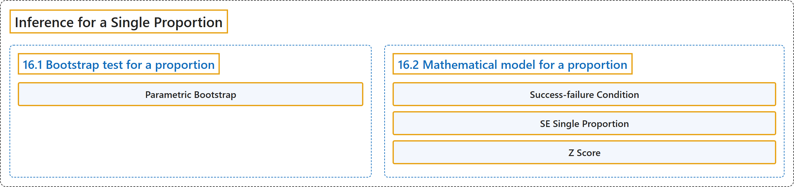

# 16 Inference for a Single Proportion

## Classification

## Glossary

| Term | Definition | 中文翻译 | Source |
|---|---|---|---|
| **16 Inference for a Single Proportion** 单个比例的推断 | (No definition) | （无定义） | [Çetinkaya-Rundel & Hardin, 2024, chapter 16](https://openintro-ims.netlify.app/inference-one-prop.html) |
| **16.1 Bootstrap test for a proportion** 比例的自助法检验 | (No definition) | （无定义） | [Çetinkaya-Rundel & Hardin, 2024, section 16.1](https://openintro-ims.netlify.app/inference-one-prop.html#sec-one-prop-null-boot) |
| **Parametric Bootstrap** 参数自助法 | "Simulating observations using a hypothesized null parameter value is often called a **parametric bootstrap** simulation, but we will refer to it descriptively as “simulating under the null hypothesis claim.”" | 使用假设的原假设参数值来模拟观测，通常称为**参数自助法**模拟，但我们将用描述性的说法称之为“在原假设声明下进行模拟”。 | [Çetinkaya-Rundel & Hardin, 2024, section 16.1](https://openintro-ims.netlify.app/inference-one-prop.html#:~:text=Simulating%20observations%20using%20a%20hypothesized%20null) |
| **16.2 Mathematical model for a proportion** 比例的数学模型 | (No definition) | （无定义） | [Çetinkaya-Rundel & Hardin, 2024, section 16.2](https://openintro-ims.netlify.app/inference-one-prop.html#sec-one-prop-norm) |
| **Success-failure Condition** 成功-失败条件 | "We expected to see **at least 10 successes and 10 failures** in the sample, i.e., $np\geq10$ and $n(1-p)\geq10.$ This is called the **success-failure condition**." | 我们预期样本中至少有 **10 次成功和 10 次失败**，即 $np\geq10$ 且 $n(1-p)\geq10.$ 这称为**成功-失败条件**。 | [Çetinkaya-Rundel & Hardin, 2024, section 16.2](https://openintro-ims.netlify.app/inference-one-prop.html#:~:text=We%20expected%20to%20see%20at%20least) |
| **SE Single Proportion** 单个比例的标准误 | "When these conditions are met, then the sampling distribution of $\hat{p}$ is **nearly normal** with mean $p$ and **standard error** of $\hat{p}$ as $SE = \sqrt{\frac{\ \hat{p}(1-\hat{p})\ }{n}}.$" | 当这些条件满足时，$\hat{p}$ 的抽样分布近似**正态**，均值为 $p$，$\hat{p}$ 的**标准误**为 $SE = \sqrt{\frac{\ \hat{p}(1-\hat{p})\ }{n}}.$ | [Çetinkaya-Rundel & Hardin, 2024, section 16.2](https://openintro-ims.netlify.app/inference-one-prop.html#:~:text=When%20these%20conditions%20are%20met%2C%20then) |
| **Z Score** Z 分数 | "The **Z score** is a ratio of how the **sample proportion differs from the hypothesized proportion** $(p_0)$ as compared to the expected variability of the $\hat{p}$ (sample proportion) values." | **Z 分数**是**样本比例与假设比例** $(p_0)$ 之差，相对于 $\hat{p}$（样本比例）取值的预期变异性的比值。 | [Çetinkaya-Rundel & Hardin, 2024, section 16.2](https://openintro-ims.netlify.app/inference-one-prop.html#:~:text=The%20Z%20score%20is%20a%20ratio) |

## References

Çetinkaya-Rundel, M., & Hardin, J. (2024). *Introduction to modern statistics* (2nd ed.). OpenIntro. Retrieved October 28, 2026, from <https://openintro-ims.netlify.app/>
