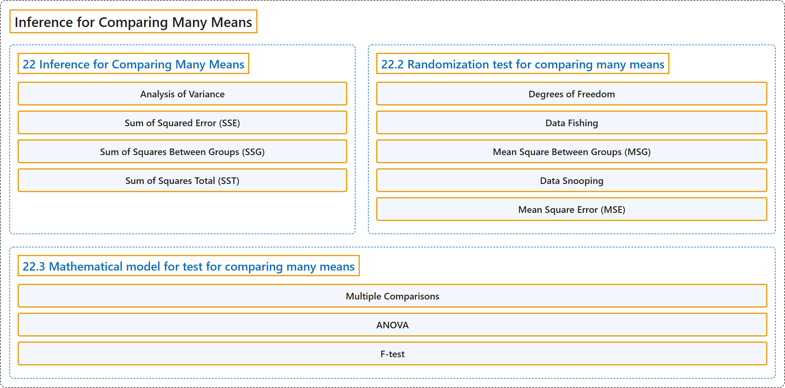

# 22 Inference for Comparing Many Means

## Classification

## Glossary

| Term | Definition | 中文翻译 | Source |
|---|---|---|---|
| **22 Inference for Comparing Many Means** 多个均值比较的推断 | (No definition) | （无定义） | [Çetinkaya-Rundel & Hardin, 2024, chapter 22](https://openintro-ims.netlify.app/inference-many-means.html) |
| **Analysis of Variance** 方差分析 | "In this section, we will learn a new method called **analysis of variance (ANOVA)** and a new test statistic called an $F$ -statistic (which we will introduce in our discussion of mathematical models)." | 在本节中，我们将学习一种称为**方差分析**（ANOVA）的新方法，以及一个称为 $F$ 统计量的新检验统计量（我们将在讨论数学模型时介绍它）。 | [Çetinkaya-Rundel & Hardin, 2024, chapter 22 introduction](https://openintro-ims.netlify.app/inference-many-means.html#:~:text=In%20this%20section%2C%20we%20will%20learn) |
| **Sum of Squared Error (SSE)** 误差平方和 | "Then we compute the **sum of squared errors** $(SSE)$ in one of two equivalent ways:" | 然后，我们用两种等价方式之一来计算**误差平方和** $(SSE)$： | [Çetinkaya-Rundel & Hardin, 2024, chapter 22 introduction](https://openintro-ims.netlify.app/inference-many-means.html#:~:text=Then%20we%20compute%20the%20sum%20of) |
| **Sum of Squares Between Groups (SSG)** 组间平方和 | "Let $\bar{x}$ represent the mean of outcomes across all groups. Then the mean square between groups is computed as $MSG = \frac{1}{df_{G}}SSG = \frac{1}{k-1}\sum_{j=1}^{k} n_{j} \left(\bar{x}_{j} - \bar{x}\right)^2$ where $SSG$ is called the **sum of squares between groups** $(SSG)$ and $n_{j}$ is the sample size of group $j.$" | 设 $\bar{x}$ 表示所有组的结果均值。则组间均方的计算公式为 $MSG = \frac{1}{df_{G}}SSG = \frac{1}{k-1}\sum_{j=1}^{k} n_{j} \left(\bar{x}_{j} - \bar{x}\right)^2$，其中 $SSG$ 称为**组间平方和** $(SSG)$，$n_{j}$ 是第 $j.$ 组的样本量。 | [Çetinkaya-Rundel & Hardin, 2024, chapter 22 introduction](https://openintro-ims.netlify.app/inference-many-means.html#:~:text=Let%20represent%20the%20mean%20of%20outcomes) |
| **Sum of Squares Total (SST)** 总平方和 | "Then the **sum of squares total** $(SST)$ is computed as $$SST = \sum_{i=1}^{n} \left(x_{i} - \bar{x}\right)^2$$ where the sum is over all observations in the dataset." | 于是**总平方和** $(SST)$ 的计算公式为 $$SST = \sum_{i=1}^{n} \left(x_{i} - \bar{x}\right)^2$$ 其中求和遍及数据集中的所有观测。 | [Çetinkaya-Rundel & Hardin, 2024, chapter 22 introduction](https://openintro-ims.netlify.app/inference-many-means.html#:~:text=Then%20the%20sum%20of%20squares%20total) |
| **22.2 Randomization test for comparing many means** 多个均值比较的随机化检验 | (No definition) | （无定义） | [Çetinkaya-Rundel & Hardin, 2024, section 22.2](https://openintro-ims.netlify.app/inference-many-means.html#sec-randANOVA) |
| **Degrees of Freedom** 自由度 | "We call this variability the mean square between groups (MSG) $(MSG)$, and it has an **associated degrees of freedom**, $df_{G} = k - 1$ when there are $k$ groups." | 我们称这种变异性为组间均方（MSG）$(MSG)$，它有一个相关联的**自由度** $df_{G} = k - 1$（当有 $k$ 个组时）。 | [Çetinkaya-Rundel & Hardin, 2024, section 22.2](https://openintro-ims.netlify.app/inference-many-means.html#:~:text=We%20call%20this%20variability%20the%20mean) |
| **Data Fishing** 数据捕捞 | "It is inappropriate to examine all data by eye (informal testing) and only afterwards decide which parts to formally test. This is called **data snooping** or **data fishing**." | 凭肉眼检查所有数据（非正式检验），然后才决定对哪些部分进行正式检验，这是不恰当的。这称为**数据窥探**或**数据捕捞**。 | [Çetinkaya-Rundel & Hardin, 2024, section 22.2](https://openintro-ims.netlify.app/inference-many-means.html#:~:text=It%20is%20inappropriate%20to%20examine%20all) |
| **Mean Square Between Groups (MSG)** 组间均方 | "We call this variability the **mean square between groups (MSG)** $(MSG)$, and it has an associated degrees of freedom, $df_{G} = k - 1$ when there are $k$ groups." | 我们称这种变异性为**组间均方**（MSG）$(MSG)$，它有相关联的自由度 $df_{G} = k - 1$（当有 $k$ 个组时）。 | [Çetinkaya-Rundel & Hardin, 2024, section 22.2](https://openintro-ims.netlify.app/inference-many-means.html#:~:text=We%20call%20this%20variability%20the%20mean) |
| **Data Snooping** 数据窥探 | "It is inappropriate to examine all data by eye (informal testing) and only afterwards decide which parts to formally test. This is called **data snooping** or **data fishing**." | 凭肉眼检查所有数据（非正式检验），然后才决定对哪些部分进行正式检验，这是不恰当的。这称为**数据窥探**或**数据捕捞**。 | [Çetinkaya-Rundel & Hardin, 2024, section 22.2](https://openintro-ims.netlify.app/inference-many-means.html#:~:text=It%20is%20inappropriate%20to%20examine%20all) |
| **Mean Square Error (MSE)** 均方误差 | "To this end, we compute a **pooled variance estimate**, often abbreviated as the **mean square error** $(MSE)$, which has an associated degrees of freedom value $df_E = n - k.$" | 为此，我们计算一个**合并方差估计**，通常简称为**均方误差** $(MSE)$，它有相关联的自由度 $df_E = n - k.$ | [Çetinkaya-Rundel & Hardin, 2024, section 22.2](https://openintro-ims.netlify.app/inference-many-means.html#:~:text=To%20this%20end%2C%20we%20compute%20a) |
| **22.3 Mathematical model for test for comparing many means** 多个均值比较检验的数学模型 | (No definition) | （无定义） | [Çetinkaya-Rundel & Hardin, 2024, section 22.3](https://openintro-ims.netlify.app/inference-many-means.html#sec-mathANOVA) |
| **Multiple Comparisons** 多重比较 | "As we saw at the end of Section 22.2, the follow-up questions surrounding individual group comparisons is called a **problem of multiple comparisons** and is outside the scope of this text." | 正如我们在第 22.2 节末尾所见，关于各个组之间比较的后续问题被称为**多重比较**问题，不在本书的讨论范围之内。 | [Çetinkaya-Rundel & Hardin, 2024, section 22.3](https://openintro-ims.netlify.app/inference-many-means.html#:~:text=As%20we%20saw%20at%20the%20end) |
| **ANOVA** 方差分析 | "**Analysis of variance (ANOVA)** is used to test whether the mean outcome differs across two or more groups. ANOVA uses a test statistic, the $F$ -statistic, which represents a **standardized ratio of variability in the sample means** relative to the variability within the groups." | **方差分析**（ANOVA）用于检验两个或多个组的平均结果是否不同。ANOVA 使用的检验统计量是 $F$ 统计量，它表示样本均值的变异性与组内变异性的**标准化比值**。 | [Çetinkaya-Rundel & Hardin, 2024, section 22.3](https://openintro-ims.netlify.app/inference-many-means.html#:~:text=Analysis%20of%20variance%20%28ANOVA%29%20is%20used) |
| **F-test** F 检验 | "We can use the $F$ -statistic to evaluate the hypotheses in what is called an **F-test**." | 我们可以用 $F$ 统计量来评估这些假设，这称为 **F 检验**。 | [Çetinkaya-Rundel & Hardin, 2024, section 22.3](https://openintro-ims.netlify.app/inference-many-means.html#:~:text=We%20can%20use%20the%20-statistic%20to) |

## References

Çetinkaya-Rundel, M., & Hardin, J. (2024). *Introduction to modern statistics* (2nd ed.). OpenIntro. Retrieved October 28, 2026, from <https://openintro-ims.netlify.app/>
