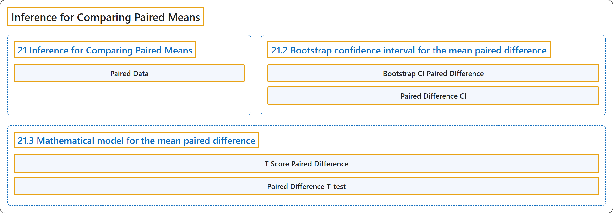

# 21 Inference for Comparing Paired Means

## Classification

## Glossary

| Term | Definition | 中文翻译 | Source |
|---|---|---|---|
| **21 Inference for Comparing Paired Means** 配对均值比较的推断 | (No definition) | （无定义） | [Çetinkaya-Rundel & Hardin, 2024, chapter 21](https://openintro-ims.netlify.app/inference-paired-means.html) |
| **Paired Data** 配对数据 | "Two sets of observations are **paired** if each observation in one set has a **special correspondence or connection with exactly one observation** in the other dataset." | 如果一组观测中的每个观测值与另一数据集中恰好一个观测值之间有**特殊的对应或联系**，则这两组观测是**成对的**。 | [Çetinkaya-Rundel & Hardin, 2024, chapter 21 introduction](https://openintro-ims.netlify.app/inference-paired-means.html#:~:text=Two%20sets%20of%20observations%20are%20paired) |
| **21.2 Bootstrap confidence interval for the mean paired difference** 平均配对差的自助法置信区间 | (No definition) | （无定义） | [Çetinkaya-Rundel & Hardin, 2024, section 21.2](https://openintro-ims.netlify.app/inference-paired-means.html#bootstrap-confidence-interval-for-the-mean-paired-difference) |
| **Bootstrap CI Paired Difference** 配对差值的自助法置信区间 | "The key to working with paired data (for **bootstrapping** and mathematical approaches) is to consider the measurement of interest to be the **difference in measured values across the pair of observations**." | 处理配对数据（无论是**自助法**还是数学方法）的关键，在于将所关注的测量视为**成对观测值测量值之差**。 | [Çetinkaya-Rundel & Hardin, 2024, section 21.2](https://openintro-ims.netlify.app/inference-paired-means.html#:~:text=The%20key%20to%20working%20with%20paired) |
| **Paired Difference CI** 配对差值的置信区间 | "For both the bootstrap and the mathematical models applied to paired data, the analysis is **virtually identical to the one-sample approach** given in Chapter 19. The key to working with paired data (for bootstrapping and mathematical approaches) is to consider the measurement of interest to be the **difference in measured values across the pair of observations**." | 无论是自助法还是应用于配对数据的数学模型，分析都**与第 19 章给出的单样本方法几乎完全相同**。处理配对数据（无论是自助法还是数学方法）的关键，在于将所关注的测量视为**成对观测值测量值之差**。 | [Çetinkaya-Rundel & Hardin, 2024, section 21.2](https://openintro-ims.netlify.app/inference-paired-means.html#:~:text=For%20both%20the%20bootstrap%20and%20the) |
| **21.3 Mathematical model for the mean paired difference** 平均配对差的数学模型 | (No definition) | （无定义） | [Çetinkaya-Rundel & Hardin, 2024, section 21.3](https://openintro-ims.netlify.app/inference-paired-means.html#sec-mathpaired) |
| **T Score Paired Difference** 配对差值的 T 分数 | "The test statistic for assessing a paired mean is a T. The **T score** is a ratio of how the **sample mean difference varies from zero** as compared to how the observations vary." | 评估配对均值的检验统计量是 T。**T 分数**是**样本均值差偏离零的程度**与观测值变异程度的比值。 | [Çetinkaya-Rundel & Hardin, 2024, section 21.3](https://openintro-ims.netlify.app/inference-paired-means.html#:~:text=The%20test%20statistic%20for%20assessing%20a) |
| **Paired Difference T-test** 配对差值的 t 检验 | "It turns out that the **paired t-test** given here is often **more powerful** than the independent t-test discussed in Section 20.3." | 事实证明，这里给出的**配对 t 检验**通常比第 20.3 节讨论的独立样本 t 检验**功效更高**。 | [Çetinkaya-Rundel & Hardin, 2024, section 21.3](https://openintro-ims.netlify.app/inference-paired-means.html#:~:text=It%20turns%20out%20that%20the%20paired) |

## References

Çetinkaya-Rundel, M., & Hardin, J. (2024). *Introduction to modern statistics* (2nd ed.). OpenIntro. Retrieved October 28, 2026, from <https://openintro-ims.netlify.app/>
