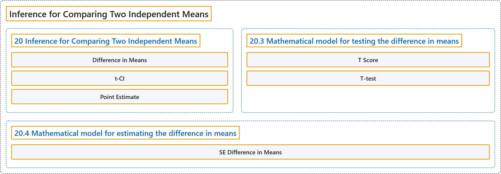

# 20 Inference for Comparing Two Independent Means

## Classification

## Glossary

| Term | Definition | 中文翻译 | Source |
|---|---|---|---|
| **20 Inference for Comparing Two Independent Means** 两个独立均值比较的推断 | (No definition) | （无定义） | [Çetinkaya-Rundel & Hardin, 2024, chapter 20](https://openintro-ims.netlify.app/inference-two-means.html) |
| **Difference in Means** 均值之差 | "In this section we consider a **difference in two population means**, $\mu_1 - \mu_2,$ under the condition that the data are **not paired**." | 在本节中，我们考虑**两个总体均值之差** $\mu_1 - \mu_2,$ 在数据**不成对**的条件下的情形。 | [Çetinkaya-Rundel & Hardin, 2024, chapter 20 introduction](https://openintro-ims.netlify.app/inference-two-means.html#:~:text=In%20this%20section%20we%20consider%20a) |
| **t-CI** t 置信区间 | "The mathematical model, here the $t$ -distribution, is able to describe both the **randomization test** and the **bootstrapping** as long as the conditions are met." | 这里的数学模型，即 $t$ 分布，只要条件满足，就能够同时描述**随机化检验**和**自助法**。 | [Çetinkaya-Rundel & Hardin, 2024, chapter 20 introduction](https://openintro-ims.netlify.app/inference-two-means.html#:~:text=The%20mathematical%20model%2C%20here%20the%20-distribution%2C) |
| **Point Estimate** 点估计 | "In our investigations, we’ll identify a reasonable **point estimate** of $\mu_1 - \mu_2$ based on the sample, and you may have already guessed its form: $\bar{x}_1 - \bar{x}_2.$" | 在我们的研究中，将确定基于样本的 $\mu_1 - \mu_2$ 的一个合理**点估计**，你可能已经猜到它的形式：$\bar{x}_1 - \bar{x}_2.$ | [Çetinkaya-Rundel & Hardin, 2024, chapter 20 introduction](https://openintro-ims.netlify.app/inference-two-means.html#:~:text=In%20our%20investigations%2C%20we%E2%80%99ll%20identify%20a) |
| **20.3 Mathematical model for testing the difference in means** 检验均值之差的数学模型 | (No definition) | （无定义） | [Çetinkaya-Rundel & Hardin, 2024, section 20.3](https://openintro-ims.netlify.app/inference-two-means.html#sec-math2samp) |
| **T Score** T 分数 | "The test statistic for comparing two means is a T. The **T score** is a **ratio of how the groups differ** as compared to how the observations within a group vary." | 比较两个均值的检验统计量是 T。**T 分数**是各组之间的差异，相对于组内观测值变异程度的**比值**。 | [Çetinkaya-Rundel & Hardin, 2024, section 20.3](https://openintro-ims.netlify.app/inference-two-means.html#:~:text=The%20test%20statistic%20for%20comparing%20two) |
| **T-test** t 检验 | "It turns out that the **independent t-test** given here is often **less powerful** than the paired t-test discussed in Section 21.3." | 事实证明，这里给出的**独立样本 t 检验**通常比第 21.3 节讨论的配对 t 检验**功效更低**。 | [Çetinkaya-Rundel & Hardin, 2024, section 20.3](https://openintro-ims.netlify.app/inference-two-means.html#:~:text=It%20turns%20out%20that%20the%20independent) |
| **20.4 Mathematical model for estimating the difference in means** 估计均值之差的数学模型 | (No definition) | （无定义） | [Çetinkaya-Rundel & Hardin, 2024, section 20.4](https://openintro-ims.netlify.app/inference-two-means.html#mathematical-model-for-estimating-the-difference-in-means) |
| **SE Difference in Means** 均值之差的标准误 | "The **standard error** may be computed as $$SE = \sqrt{\frac{\sigma_1^2}{n_1} + \frac{\sigma_2^2}{n_2}}$$" | **标准误**可按下式计算：$$SE = \sqrt{\frac{\sigma_1^2}{n_1} + \frac{\sigma_2^2}{n_2}}$$ | [Çetinkaya-Rundel & Hardin, 2024, section 20.4](https://openintro-ims.netlify.app/inference-two-means.html#:~:text=The%20standard%20error%20may%20be%20computed) |

## References

Çetinkaya-Rundel, M., & Hardin, J. (2024). *Introduction to modern statistics* (2nd ed.). OpenIntro. Retrieved October 28, 2026, from <https://openintro-ims.netlify.app/>
