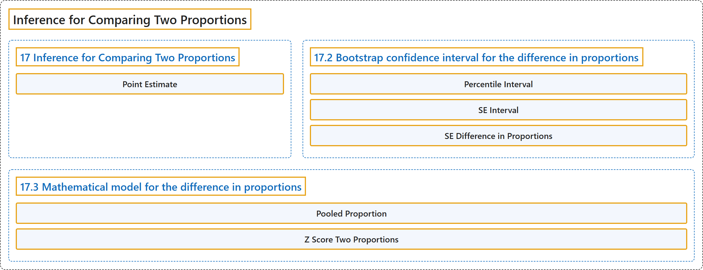

# 17 Inference for Comparing Two Proportions

## Classification

## Glossary

| Term | Definition | 中文翻译 | Source |
|---|---|---|---|
| **17 Inference for Comparing Two Proportions** 两个比例比较的推断 | (No definition) | （无定义） | [Çetinkaya-Rundel & Hardin, 2024, chapter 17](https://openintro-ims.netlify.app/inference-two-props.html) |
| **Point Estimate** 点估计 | "In our investigations, we’ll identify a reasonable **point estimate** of $p_1 - p_2$ based on the sample, and you may have already guessed its form: $\hat{p}_1 - \hat{p}_2.$" | 在我们的研究中，将确定基于样本的 $p_1 - p_2$ 的一个合理**点估计**，你可能已经猜到它的形式：$\hat{p}_1 - \hat{p}_2.$ | [Çetinkaya-Rundel & Hardin, 2024, chapter 17 introduction](https://openintro-ims.netlify.app/inference-two-props.html#:~:text=In%20our%20investigations%2C%20we%E2%80%99ll%20identify%20a) |
| **17.2 Bootstrap confidence interval for the difference in proportions** 比例之差的自助法置信区间 | (No definition) | （无定义） | [Çetinkaya-Rundel & Hardin, 2024, section 17.2](https://openintro-ims.netlify.app/inference-two-props.html#sec-two-prop-boot-ci) |
| **Percentile Interval** 百分位数区间 | "The interval created from the **percentiles of the distribution** is called the **percentile interval**." | 由分布的**百分位数**所构造的区间称为**百分位数区间**。 | [Çetinkaya-Rundel & Hardin, 2024, section 17.2](https://openintro-ims.netlify.app/inference-two-props.html#:~:text=The%20interval%20created%20from%20the%20percentiles) |
| **SE Interval** 标准误区间 | "Alternatively, we can use the variability in the bootstrapped differences to calculate a **standard error of the difference**. The resulting interval is called the **SE interval**." | 或者，我们可以利用自助差值的变异性来计算**差值的标准误**。所得区间称为 **SE 区间**。 | [Çetinkaya-Rundel & Hardin, 2024, section 17.2](https://openintro-ims.netlify.app/inference-two-props.html#:~:text=Alternatively%2C%20we%20can%20use%20the%20variability) |
| **SE Difference in Proportions** 比例之差的标准误 | "Section 17.3 details the mathematical model for the **standard error of the difference in sample proportions**, but the bootstrap distribution typically does an excellent job of estimating the variability of the sampling distribution of the sample statistic." | 第 17.3 节详细介绍了**样本比例之差的标准误**的数学模型，但自助分布通常能很好地估计样本统计量抽样分布的变异性。 | [Çetinkaya-Rundel & Hardin, 2024, section 17.2](https://openintro-ims.netlify.app/inference-two-props.html#:~:text=Section%2017.3%20details%20the%20mathematical%20model) |
| **17.3 Mathematical model for the difference in proportions** 比例之差的数学模型 | (No definition) | （无定义） | [Çetinkaya-Rundel & Hardin, 2024, section 17.3](https://openintro-ims.netlify.app/inference-two-props.html#sec-math-2prop) |
| **Pooled Proportion** 合并比例 | "However, when the null hypothesis is that $p_1 - p_2 = 0,$ we use a special proportion called the **pooled proportion** to estimate the SE and to check the success-failure condition." | 然而，当原假设为 $p_1 - p_2 = 0,$ 时，我们使用一种称为**合并比例**的特殊比例来估计 SE 并检验成功-失败条件。 | [Çetinkaya-Rundel & Hardin, 2024, section 17.3](https://openintro-ims.netlify.app/inference-two-props.html#:~:text=However%2C%20when%20the%20null%20hypothesis%20is) |
| **Z Score Two Proportions** 两个比例的 Z 分数 | "The test statistic for assessing two proportions is a Z. The **Z score** is a **ratio of how the two sample proportions differ** as compared to the expected variability of difference between the proportions." | 评估两个比例的检验统计量是 Z。**Z 分数**是两个样本比例之差，相对于比例之差的预期变异性的**比值**。 | [Çetinkaya-Rundel & Hardin, 2024, section 17.3](https://openintro-ims.netlify.app/inference-two-props.html#:~:text=The%20test%20statistic%20for%20assessing%20two) |

## References

Çetinkaya-Rundel, M., & Hardin, J. (2024). *Introduction to modern statistics* (2nd ed.). OpenIntro. Retrieved October 28, 2026, from <https://openintro-ims.netlify.app/>
