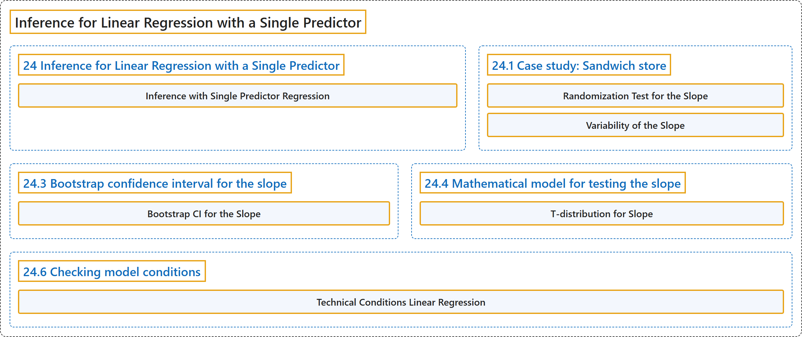

# 24 Inference for Linear Regression with a Single Predictor

## Classification

## Glossary

| Term | Definition | 中文翻译 | Source |
|---|---|---|---|
| **24 Inference for Linear Regression with a Single Predictor** 单预测变量线性回归的推断 | (No definition) | （无定义） | [Çetinkaya-Rundel & Hardin, 2024, chapter 24](https://openintro-ims.netlify.app/inf-model-slr.html) |
| **Inference with Single Predictor Regression** 单预测变量回归的推断 | "In particular, we will use the least squares regression line to **test whether there is a relationship between two continuous variables**. Additionally, we will build **confidence intervals which quantify the slope** of the linear regression line." | 特别地，我们将使用最小二乘回归直线来**检验两个连续变量之间是否存在关系**。此外，我们将构建**量化线性回归直线斜率的置信区间**。 | [Çetinkaya-Rundel & Hardin, 2024, chapter 24 introduction](https://openintro-ims.netlify.app/inf-model-slr.html#:~:text=In%20particular%2C%20we%20will%20use%20the) |
| **24.1 Case study: Sandwich store** 案例研究：三明治店 | (No definition) | （无定义） | [Çetinkaya-Rundel & Hardin, 2024, section 24.1](https://openintro-ims.netlify.app/inf-model-slr.html#case-study-sandwich-store) |
| **Randomization Test for the Slope** 斜率的随机化检验 | "First (in Section 24.2), the distribution of $b_1$ when $\beta_1 = 0$ is constructed by **randomizing** (permuting) the response variable." | 首先（在第 24.2 节中），当 $\beta_1 = 0$ 时 $b_1$ 的分布，是通过对响应变量进行**随机化**（置换）而构造的。 | [Çetinkaya-Rundel & Hardin, 2024, section 24.1](https://openintro-ims.netlify.app/inf-model-slr.html#:~:text=First%20%28in%20Section%2024.2%29%2C%20the%20distribution) |
| **Variability of the Slope** 斜率的变异性 | "That is, there is **variability in the regression line** from sample to sample. The concept of the sampling variability is something you’ve seen before, but in this lesson, you will focus on the variability of the line often measured through the **variability of a single statistic**: the slope of the line." | 也就是说，回归直线**随样本而变化**。抽样变异性的概念你以前见过，但在本节中，你将关注直线的变异性，它通常通过**单个统计量的变异性**来度量：直线的斜率。 | [Çetinkaya-Rundel & Hardin, 2024, section 24.1](https://openintro-ims.netlify.app/inf-model-slr.html#:~:text=That%20is%2C%20there%20is%20variability%20in) |
| **24.3 Bootstrap confidence interval for the slope** 斜率的自助法置信区间 | (No definition) | （无定义） | [Çetinkaya-Rundel & Hardin, 2024, section 24.3](https://openintro-ims.netlify.app/inf-model-slr.html#sec-bootbeta1) |
| **Bootstrap CI for the Slope** 斜率的自助法置信区间 | "As we have seen in previous chapters, we can use **bootstrapping** to estimate the **sampling distribution of the statistic of interest** (here, the slope) without the null assumption of no relationship (which was the condition in the randomization test)." | 正如我们在前面几章所见，我们可以用**自助法**来估计所关注统计量（此处为斜率）的**抽样分布**，而不需要“无关系”的原假设（这是随机化检验中的条件）。 | [Çetinkaya-Rundel & Hardin, 2024, section 24.3](https://openintro-ims.netlify.app/inf-model-slr.html#:~:text=As%20we%20have%20seen%20in%20previous) |
| **24.4 Mathematical model for testing the slope** 检验斜率的数学模型 | (No definition) | （无定义） | [Çetinkaya-Rundel & Hardin, 2024, section 24.4](https://openintro-ims.netlify.app/inf-model-slr.html#sec-mathslope) |
| **T-distribution for Slope** 斜率的 t 分布 | "When certain technical conditions apply, it is convenient to use **mathematical approximations** to test and estimate the slope parameter. The approximations will build on the **t-distribution** which was described in Chapter 19." | 当某些技术条件成立时，使用**数学近似**来检验和估计斜率参数很方便。这些近似建立在第 19 章所述的 **t 分布**之上。 | [Çetinkaya-Rundel & Hardin, 2024, section 24.4](https://openintro-ims.netlify.app/inf-model-slr.html#:~:text=When%20certain%20technical%20conditions%20apply%2C%20it) |
| **24.6 Checking model conditions** 模型条件的检查 | (No definition) | （无定义） | [Çetinkaya-Rundel & Hardin, 2024, section 24.6](https://openintro-ims.netlify.app/inf-model-slr.html#sec-tech-cond-linmod) |
| **Technical Conditions Linear Regression** 线性回归的技术条件 | "The technical conditions are often remembered using the **LINE mnemonic**. The linearity, normality, and equality of variance conditions usually can be assessed through **residual plots**, as seen in Figure 24.15." | 技术条件通常用 **LINE** 助记符来记忆。线性、正态性和方差相等条件通常可以通过**残差图**来评估，如图 24.15 所示。 | [Çetinkaya-Rundel & Hardin, 2024, section 24.6](https://openintro-ims.netlify.app/inf-model-slr.html#:~:text=The%20technical%20conditions%20are%20often%20remembered) |

## References

Çetinkaya-Rundel, M., & Hardin, J. (2024). *Introduction to modern statistics* (2nd ed.). OpenIntro. Retrieved October 28, 2026, from <https://openintro-ims.netlify.app/>
