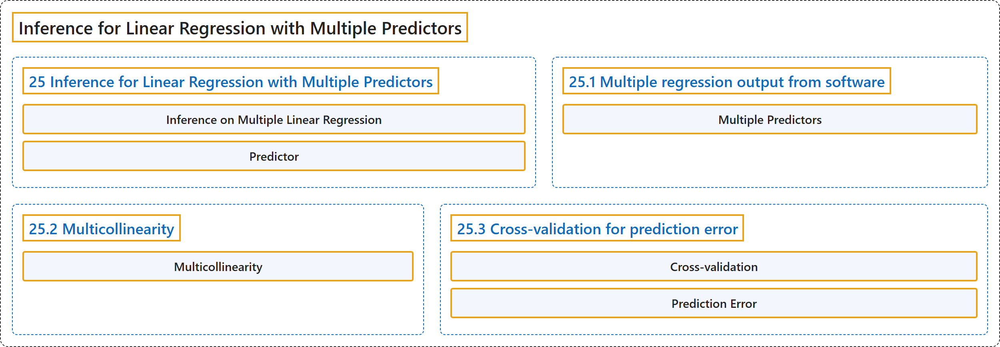

# 25 Inference for Linear Regression with Multiple Predictors

## Classification

## Glossary

| Term | Definition | 中文翻译 | Source |
|---|---|---|---|
| **25 Inference for Linear Regression with Multiple Predictors** 多预测变量线性回归的推断 | (No definition) | （无定义） | [Çetinkaya-Rundel & Hardin, 2024, chapter 25](https://openintro-ims.netlify.app/inf-model-mlr.html) |
| **Inference on Multiple Linear Regression** 多元线性回归的推断 | "Here, we discuss whether each of the variables individually is a **statistically discernible predictor** of the outcome or whether the model might be just as strong without that variable." | 在这里，我们讨论每个变量是否单独都是结果的**统计显著的预测变量**，或者没有该变量模型是否同样有效。 | [Çetinkaya-Rundel & Hardin, 2024, chapter 25 introduction](https://openintro-ims.netlify.app/inf-model-mlr.html#:~:text=Here%2C%20we%20discuss%20whether%20each%20of) |
| **Predictor** 预测变量 | "In previous sections, the term **explanatory variable** was used instead of **predictor**. The words are synonymous and are used separately in the different sections to be consistent with how most analysts use them: explanatory variable for testing, predictor for modeling." | 在前面各节中，使用的是**解释变量**这一术语而不是**预测变量**。这两个词是同义的，在不同章节中分开使用，以与大多数分析者的用法保持一致：检验时用解释变量，建模时用预测变量。 | [Çetinkaya-Rundel & Hardin, 2024, chapter 25 introduction](https://openintro-ims.netlify.app/inf-model-mlr.html#:~:text=In%20previous%20sections%2C%20the%20term%20explanatory) |
| **25.1 Multiple regression output from software** 软件输出的多元回归结果 | (No definition) | （无定义） | [Çetinkaya-Rundel & Hardin, 2024, section 25.1](https://openintro-ims.netlify.app/inf-model-mlr.html#sec-inf-mult-reg-soft) |
| **Multiple Predictors** 多个预测变量 | "With **multiple predictors**, the hypothesis is similar, however, it is now **conditioned on each of the other variables** remaining in the model." | 有**多个预测变量**时，假设是类似的，但现在它**以模型中保留的其他每个变量为条件**。 | [Çetinkaya-Rundel & Hardin, 2024, section 25.1](https://openintro-ims.netlify.app/inf-model-mlr.html#:~:text=With%20multiple%20predictors%2C%20the%20hypothesis%20is) |
| **25.2 Multicollinearity** 多重共线性 | (No definition) | （无定义） | [Çetinkaya-Rundel & Hardin, 2024, section 25.2](https://openintro-ims.netlify.app/inf-model-mlr.html#sec-inf-mult-reg-collin) |
| **Multicollinearity** 多重共线性 | "**Multicollinearity** happens when the predictor variables are correlated within themselves. When the predictor variables themselves are correlated, the coefficients in a multiple regression model can be difficult to interpret." | 当预测变量之间彼此相关时就会出现**多重共线性**。当预测变量本身彼此相关时，多元回归模型中的系数可能难以解释。 | [Çetinkaya-Rundel & Hardin, 2024, section 25.2](https://openintro-ims.netlify.app/inf-model-mlr.html#:~:text=Multicollinearity%20happens%20when%20the%20predictor%20variables) |
| **25.3 Cross-validation for prediction error** 预测误差的交叉验证 | (No definition) | （无定义） | [Çetinkaya-Rundel & Hardin, 2024, section 25.3](https://openintro-ims.netlify.app/inf-model-mlr.html#sec-inf-mult-reg-cv) |
| **Cross-validation** 交叉验证 | "In addition to model building, **cross-validation** provides a method for generating predictions that are not **overfit** to the particular dataset at hand." | 除了模型构建之外，**交叉验证**还提供了一种生成预测的方法，这些预测不会对手头的特定数据集**过拟合**。 | [Çetinkaya-Rundel & Hardin, 2024, section 25.3](https://openintro-ims.netlify.app/inf-model-mlr.html#:~:text=In%20addition%20to%20model%20building%2C%20cross-validation) |
| **Prediction Error** 预测误差 | "Here, we use **cross-validation prediction error** to focus on which variable(s) are important for predicting the response variable of interest." | 在这里，我们使用**交叉验证预测误差**来关注哪些变量对预测所关注的响应变量是重要的。 | [Çetinkaya-Rundel & Hardin, 2024, section 25.3](https://openintro-ims.netlify.app/inf-model-mlr.html#:~:text=Here%2C%20we%20use%20cross-validation%20prediction%20error) |

## References

Çetinkaya-Rundel, M., & Hardin, J. (2024). *Introduction to modern statistics* (2nd ed.). OpenIntro. Retrieved October 28, 2026, from <https://openintro-ims.netlify.app/>
