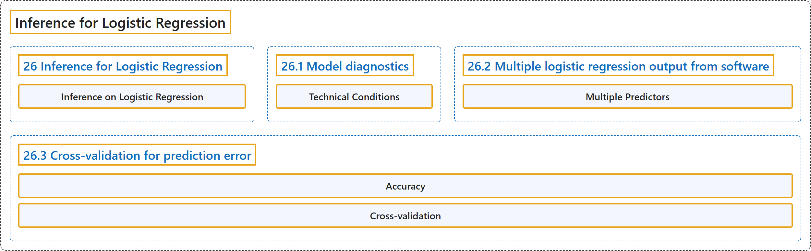

# 26 Inference for Logistic Regression

## Classification

## Glossary

| Term | Definition | 中文翻译 | Source |
|---|---|---|---|
| **26 Inference for Logistic Regression** 逻辑斯谛回归的推断 | (No definition) | （无定义） | [Çetinkaya-Rundel & Hardin, 2024, chapter 26](https://openintro-ims.netlify.app/inf-model-logistic.html) |
| **Inference on Logistic Regression** 逻辑回归的推断 | "Combining ideas from Chapter 9 on logistic regression, Chapter 13 on inference with mathematical models, and Chapter 24 and Chapter 25 which apply inferential techniques to the linear model, we wrap up the book by considering **inferential methods applied to a logistic regression model**." | 结合第 9 章的逻辑回归、第 13 章基于数学模型的推断，以及将推断技术应用于线性模型的第 24 章和第 25 章，我们将通过考虑应用于逻辑回归模型的**推断方法**来结束本书。 | [Çetinkaya-Rundel & Hardin, 2024, chapter 26 introduction](https://openintro-ims.netlify.app/inf-model-logistic.html#:~:text=Combining%20ideas%20from%20Chapter%209%20on) |
| **26.1 Model diagnostics** 模型诊断 | (No definition) | （无定义） | [Çetinkaya-Rundel & Hardin, 2024, section 26.1](https://openintro-ims.netlify.app/inf-model-logistic.html#model-diagnostics) |
| **Technical Conditions** 技术条件 | "Before looking at the hypothesis tests associated with the coefficients (turns out they are very similar to those in linear regression!), it is valuable to understand the **technical conditions** that underlie the inference applied to the logistic regression model." | 在查看与系数相关的假设检验（事实证明它们与线性回归中的非常相似！）之前，了解支撑逻辑回归模型推断的**技术条件**是有益的。 | [Çetinkaya-Rundel & Hardin, 2024, section 26.1](https://openintro-ims.netlify.app/inf-model-logistic.html#:~:text=Before%20looking%20at%20the%20hypothesis%20tests) |
| **26.2 Multiple logistic regression output from software** 软件输出的多元逻辑斯谛回归结果 | (No definition) | （无定义） | [Çetinkaya-Rundel & Hardin, 2024, section 26.2](https://openintro-ims.netlify.app/inf-model-logistic.html#sec-inf-log-reg-soft) |
| **Multiple Predictors** 多个预测变量 | "As in Chapter 25, with **multiple predictors**, each hypothesis test (for each of the explanatory variables) is **conditioned on each of the other variables** remaining in the model." | 与第 25 章一样，有**多个预测变量**时，（针对各个解释变量的）每个假设检验都**以模型中保留的其他每个变量为条件**。 | [Çetinkaya-Rundel & Hardin, 2024, section 26.2](https://openintro-ims.netlify.app/inf-model-logistic.html#:~:text=As%20in%20Chapter%2025%2C%20with%20multiple) |
| **26.3 Cross-validation for prediction error** 预测误差的交叉验证 | (No definition) | （无定义） | [Çetinkaya-Rundel & Hardin, 2024, section 26.3](https://openintro-ims.netlify.app/inf-model-logistic.html#sec-inf-log-reg-cv) |
| **Accuracy** 准确率 | "Here we present a method for using **cross-validation accuracy** to determine which variables (if any) should be used in a model which predicts whether an email is spam." | 这里我们介绍一种利用**交叉验证准确率**来确定在预测电子邮件是否为垃圾邮件的模型中应使用哪些变量（如果有的话）的方法。 | [Çetinkaya-Rundel & Hardin, 2024, section 26.3](https://openintro-ims.netlify.app/inf-model-logistic.html#:~:text=Here%20we%20present%20a%20method%20for) |
| **Cross-validation** 交叉验证 | "Using $k$ -fold **cross-validation**, we can build $k$ different models which are used to predict the observations in each of the $k$ holdout samples." | 使用 $k$ 折**交叉验证**，我们可以建立 $k$ 个不同的模型，用来预测 $k$ 个留出样本中各自的观测值。 | [Çetinkaya-Rundel & Hardin, 2024, section 26.3](https://openintro-ims.netlify.app/inf-model-logistic.html#:~:text=Using%20-fold%20cross-validation%2C%20we%20can%20build) |

## References

Çetinkaya-Rundel, M., & Hardin, J. (2024). *Introduction to modern statistics* (2nd ed.). OpenIntro. Retrieved October 28, 2026, from <https://openintro-ims.netlify.app/>
