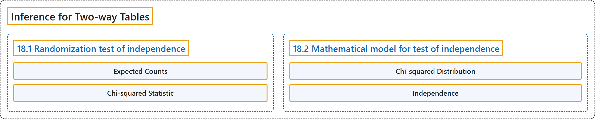

# 18 Inference for Two-way Tables

## Classification

## Glossary

| Term | Definition | 中文翻译 | Source |
|---|---|---|---|
| **18 Inference for Two-way Tables** 双向表的推断 | (No definition) | （无定义） | [Çetinkaya-Rundel & Hardin, 2024, chapter 18](https://openintro-ims.netlify.app/inference-tables.html) |
| **18.1 Randomization test of independence** 独立性的随机化检验 | (No definition) | （无定义） | [Çetinkaya-Rundel & Hardin, 2024, section 18.1](https://openintro-ims.netlify.app/inference-tables.html#randomization-test-of-independence) |
| **Expected Counts** 期望频数 | "This leads us to a general formula for computing **expected counts** in a two-way table when we would like to test whether there is strong evidence of an association between the column variable and row variable." | 这引出了在双向表中计算**期望频数**的一般公式，当我们想检验列变量与行变量之间是否存在强关联证据时使用。 | [Çetinkaya-Rundel & Hardin, 2024, section 18.1](https://openintro-ims.netlify.app/inference-tables.html#:~:text=This%20leads%20us%20to%20a%20general) |
| **Chi-squared Statistic** 卡方统计量 | "The **chi-squared test statistic** for a two-way table is found by finding the **ratio of how far the observed counts are from the expected counts**, as compared to the expected counts, for every cell in the table." | 双向表的**卡方检验统计量**，是对表中每个单元格求**观测频数偏离期望频数的程度与期望频数之比**而得到的。 | [Çetinkaya-Rundel & Hardin, 2024, section 18.1](https://openintro-ims.netlify.app/inference-tables.html#:~:text=The%20chi-squared%20test%20statistic%20for%20a) |
| **18.2 Mathematical model for test of independence** 独立性检验的数学模型 | (No definition) | （无定义） | [Çetinkaya-Rundel & Hardin, 2024, section 18.2](https://openintro-ims.netlify.app/inference-tables.html#sec-mathchisq) |
| **Chi-squared Distribution** 卡方分布 | "As it turns out, the chi-squared test statistic follows a **Chi-squared distribution** when the null hypothesis is true." | 事实证明，当原假设为真时，卡方检验统计量服从**卡方分布**。 | [Çetinkaya-Rundel & Hardin, 2024, section 18.2](https://openintro-ims.netlify.app/inference-tables.html#:~:text=As%20it%20turns%20out%2C%20the%20chi-squared) |
| **Independence** 独立性 | "The test statistic for assessing the **independence** between two categorical variables is a $X^2.$" | 评估两个分类变量之间**独立性**的检验统计量是 $X^2.$ | [Çetinkaya-Rundel & Hardin, 2024, section 18.2](https://openintro-ims.netlify.app/inference-tables.html#:~:text=The%20test%20statistic%20for%20assessing%20the) |

## References

Çetinkaya-Rundel, M., & Hardin, J. (2024). *Introduction to modern statistics* (2nd ed.). OpenIntro. Retrieved October 28, 2026, from <https://openintro-ims.netlify.app/>
