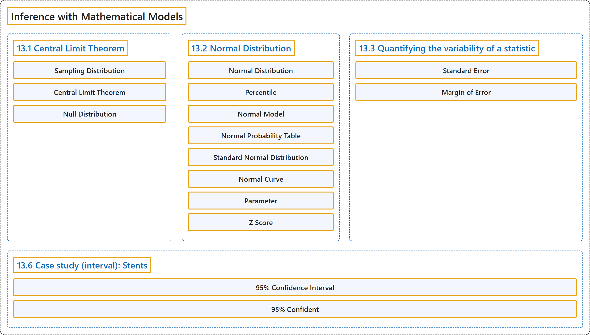

# 13 Inference with Mathematical Models

## Classification

## Glossary

| Term | Definition | 中文翻译 | Source |
|---|---|---|---|
| **13 Inference with Mathematical Models** 基于数学模型的推断 | (No definition) | （无定义） | [Çetinkaya-Rundel & Hardin, 2024, chapter 13](https://openintro-ims.netlify.app/foundations-mathematical.html) |
| **13.1 Central Limit Theorem** 中心极限定理 | (No definition) | （无定义） | [Çetinkaya-Rundel & Hardin, 2024, section 13.1](https://openintro-ims.netlify.app/foundations-mathematical.html#sec-CLTsection) |
| **Sampling Distribution** 抽样分布 | "A **sampling distribution** is the **distribution of all possible values of a sample statistic** from samples of a given sample size from a given population." | **抽样分布**是在给定总体中、给定样本量的样本所得样本统计量的**所有可能取值的分布**。 | [Çetinkaya-Rundel & Hardin, 2024, section 13.1](https://openintro-ims.netlify.app/foundations-mathematical.html#:~:text=A%20sampling%20distribution%20is%20the%20distribution) |
| **Central Limit Theorem** 中心极限定理 | "**Central Limit Theorem** for proportions. If we look at a proportion (or difference in proportions) and the scenario satisfies certain conditions, then the sample proportion (or difference in proportions) **will appear to follow a bell-shaped curve** called the normal distribution." | 比例的**中心极限定理**。如果我们考察一个比例（或比例之差），且情形满足某些条件，那么样本比例（或比例之差）**将呈现为一条钟形曲线**，称为正态分布。 | [Çetinkaya-Rundel & Hardin, 2024, section 13.1](https://openintro-ims.netlify.app/foundations-mathematical.html#:~:text=Central%20Limit%20Theorem%20for%20proportions.%20If) |
| **Null Distribution** 零分布 | "Note that the **null distribution** is the **sampling distribution of the statistic** created under the setting where the null hypothesis is true." | 注意，**零分布**是在原假设为真的情形下产生的**统计量的抽样分布**。 | [Çetinkaya-Rundel & Hardin, 2024, section 13.1](https://openintro-ims.netlify.app/foundations-mathematical.html#:~:text=Note%20that%20the%20null%20distribution%20is) |
| **13.2 Normal Distribution** 正态分布 | (No definition) | （无定义） | [Çetinkaya-Rundel & Hardin, 2024, section 13.2](https://openintro-ims.netlify.app/foundations-mathematical.html#sec-normalDist) |
| **Normal Distribution** 正态分布 | "The **symmetric, unimodal, bell curve** is ubiquitous throughout statistics. It is so common that people know it as a variety of names including the normal curve, normal model, or **normal distribution**." | **对称、单峰的钟形曲线**在统计学中无处不在。它如此常见，以至于人们用各种名称称呼它，包括正态曲线、正态模型或**正态分布**。 | [Çetinkaya-Rundel & Hardin, 2024, section 13.2](https://openintro-ims.netlify.app/foundations-mathematical.html#:~:text=The%20symmetric%2C%20unimodal%2C%20bell%20curve%20is) |
| **Percentile** 百分位数 | "Nel’s **percentile** is the **percentage of people who earned a lower SAT score** than Nel." | Nel 的**百分位数**是获得比 Nel 更低 SAT 分数的人所占的**百分比**。 | [Çetinkaya-Rundel & Hardin, 2024, section 13.2](https://openintro-ims.netlify.app/foundations-mathematical.html#:~:text=Nel%E2%80%99s%20percentile%20is%20the%20percentage%20of) |
| **Normal Model** 正态模型 | "It is so common that people know it as a variety of names including the normal curve, **normal model**, or normal distribution." | 它非常常见，人们用多种名称称呼它，包括正态曲线、**正态模型**或正态分布。 | [Çetinkaya-Rundel & Hardin, 2024, section 13.2](https://openintro-ims.netlify.app/foundations-mathematical.html#:~:text=It%20is%20so%20common%20that%20people) |
| **Normal Probability Table** 正态概率表 | "A **normal probability table**, which **lists Z scores and corresponding percentiles**, can be used to identify a percentile based on the Z score (and vice versa)." | **正态概率表**列出 **Z 分数及其对应的百分位数**，可用来根据 Z 分数确定百分位数（反之亦然）。 | [Çetinkaya-Rundel & Hardin, 2024, section 13.2](https://openintro-ims.netlify.app/foundations-mathematical.html#:~:text=A%20normal%20probability%20table%2C%20which%20lists) |
| **Standard Normal Distribution** 标准正态分布 | "Figure 13.3 (a) shows the normal distribution with mean $0$ and standard deviation $1$ (which is commonly referred to as the **standard normal distribution**)." | 图 13.3 (a) 展示了均值为 $0$、标准差为 $1$ 的正态分布（通常称为**标准正态分布**）。 | [Çetinkaya-Rundel & Hardin, 2024, section 13.2](https://openintro-ims.netlify.app/foundations-mathematical.html#:~:text=Figure%2013.3%20%28a%29%20shows%20the%20normal) |
| **Normal Curve** 正态曲线 | "It is so common that people know it as a variety of names including the **normal curve**, normal model, or normal distribution." | 它非常常见，人们用多种名称称呼它，包括**正态曲线**、正态模型或正态分布。 | [Çetinkaya-Rundel & Hardin, 2024, section 13.2](https://openintro-ims.netlify.app/foundations-mathematical.html#:~:text=It%20is%20so%20common%20that%20people) |
| **Parameter** 参数 | "Because the mean and standard deviation describe a normal distribution exactly, they are called the distribution’s **parameters**." | 由于均值和标准差能完整描述一个正态分布，它们被称为该分布的**参数**。 | [Çetinkaya-Rundel & Hardin, 2024, section 13.2](https://openintro-ims.netlify.app/foundations-mathematical.html#:~:text=Because%20the%20mean%20and%20standard%20deviation) |
| **Z Score** Z 分数 | "The **Z score** of an observation is defined as the **number of standard deviations it falls above or below the mean**." | 一个观测值的 **Z 分数**定义为它高于或低于均值的**标准差个数**。 | [Çetinkaya-Rundel & Hardin, 2024, section 13.2](https://openintro-ims.netlify.app/foundations-mathematical.html#:~:text=The%20Z%20score%20of%20an%20observation) |
| **13.3 Quantifying the variability of a statistic** 统计量变异性的量化 | (No definition) | （无定义） | [Çetinkaya-Rundel & Hardin, 2024, section 13.3](https://openintro-ims.netlify.app/foundations-mathematical.html#quantifying-the-variability-of-a-statistic) |
| **Standard Error** 标准误 | "Point estimates vary from sample to sample, and we quantify this variability with what is called the **standard error** (SE). The standard error is equal to the **standard deviation associated with the statistic**." | 点估计值随样本不同而变化，我们用所谓的**标准误**（SE）来量化这种变异性。标准误等于与该统计量相关的**标准差**。 | [Çetinkaya-Rundel & Hardin, 2024, section 13.3](https://openintro-ims.netlify.app/foundations-mathematical.html#:~:text=Point%20estimates%20vary%20from%20sample%20to) |
| **Margin of Error** 误差限 | "The **margin of error** describes **how far away observations are from their mean**." | **误差限**描述观测值**偏离其均值的程度**。 | [Çetinkaya-Rundel & Hardin, 2024, section 13.3](https://openintro-ims.netlify.app/foundations-mathematical.html#:~:text=The%20margin%20of%20error%20describes%20how) |
| **13.6 Case study (interval): Stents** 案例研究（区间）：支架 | (No definition) | （无定义） | [Çetinkaya-Rundel & Hardin, 2024, section 13.6](https://openintro-ims.netlify.app/foundations-mathematical.html#sec-casestent) |
| **95% Confidence Interval** 95%置信区间 | "When the sampling distribution of a point estimate can reasonably be modeled as normal, the point estimate we observe will be **within 1.96 standard errors** of the true value of interest about 95% of the time. Thus, a **95% confidence interval** for such a point estimate can be constructed:" | 当点估计的抽样分布可以合理地用正态分布来建模时，我们观察到的点估计大约有95%的时间落在真值的**1.96个标准误之内**。因此，可以为这样的点估计构造**95%置信区间**： | [Çetinkaya-Rundel & Hardin, 2024, section 13.6](https://openintro-ims.netlify.app/foundations-mathematical.html#:~:text=When%20the%20sampling%20distribution%20of%20a) |
| **95% Confident** 95% 置信 | "We can be **95% confident** this interval captures the true value." | 我们可以有 **95% 的把握**认为该区间包含真值。 | [Çetinkaya-Rundel & Hardin, 2024, section 13.6](https://openintro-ims.netlify.app/foundations-mathematical.html#:~:text=We%20can%20be%2095%25%20confident%20this) |

## References

Çetinkaya-Rundel, M., & Hardin, J. (2024). *Introduction to modern statistics* (2nd ed.). OpenIntro. Retrieved October 28, 2026, from <https://openintro-ims.netlify.app/>
