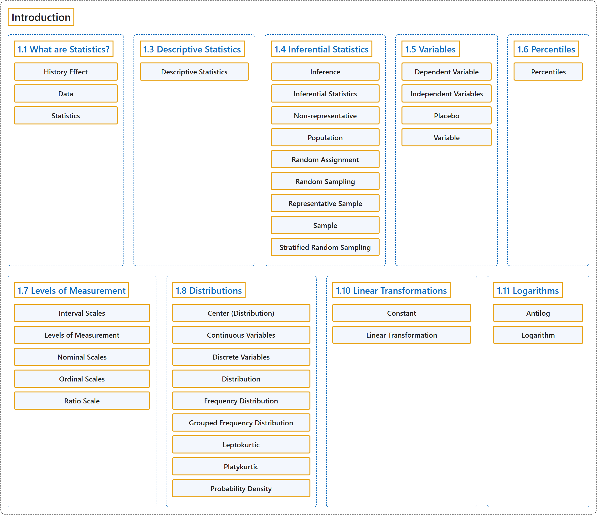

# 1 Introduction

## Classification

## Glossary

| Term | Definition | 中文翻译 | Source |
|---|---|---|---|
| **1 Introduction** 引言 | (No definition) | （无定义） | [Online Statistics Education, n.d., chapter 1](https://onlinestatbook.com/2/introduction/introduction.html) |
| **1.1 What are Statistics?** 什么是统计学 | (No definition) | （无定义） | [Online Statistics Education, n.d., section 1.1](https://onlinestatbook.com/2/introduction/what_are.html) |
| **History Effect** 历史效应 | "A problem of **confounding** where the passage of time, and not the variable of interest, is responsible for observed effects. See also: third variable problem." | 一种**混淆**问题：造成所观察到效应的是时间的推移，而不是所关注的变量。另见：第三变量问题。 | [Online Statistics Education, n.d., glossary](https://onlinestatbook.com/2/glossary/History_effect.html) |
| **Data** 数据 | "A **collection of values** to be used for statistical analysis. See also: variable." | 用于统计分析的**一组值**。另见：变量。 | [Online Statistics Education, n.d., glossary](https://onlinestatbook.com/2/glossary/data.html) |
| **Statistics** 统计学 | "(i) What you are studying right now, also known as **statistical analysis**, or statistical inference. It is a field of study concerned with summarizing data, interpreting data, and making decisions based on data. (ii) A quantity calculated in a sample to estimate a value in a population is called a "**statistic**."" | （i）你现在正在学习的内容，也称**统计分析**或统计推断。它是一个关注概括数据、解释数据以及基于数据做出决策的研究领域。（ii）在样本中计算出来用以估计总体中某个值的量称为“**统计量**”。 | [Online Statistics Education, n.d., glossary](https://onlinestatbook.com/2/glossary/statistics.html) |
| **1.3 Descriptive Statistics** 描述统计 | (No definition) | （无定义） | [Online Statistics Education, n.d., section 1.3](https://onlinestatbook.com/2/introduction/descriptive.html) |
| **Descriptive Statistics** 描述统计 | "The **branch of statistics concerned with describing and summarizing data**. A set of statistics such as the mean, standard deviation, and skew that describe a distribution." | 统计学中**研究数据的描述与概括的分支**。也指描述一个分布的一组统计量，如均值、标准差和偏度。 | [Online Statistics Education, n.d., glossary](https://onlinestatbook.com/2/glossary/descriptive_stat.html) |
| **1.4 Inferential Statistics** 推断统计 | (No definition) | （无定义） | [Online Statistics Education, n.d., section 1.4](https://onlinestatbook.com/2/introduction/inferential.html) |
| **Inference** 推断 | "The act of **drawing conclusions about a population from a sample**." | **根据样本对总体作出结论**的行为。 | [Online Statistics Education, n.d., glossary](https://onlinestatbook.com/2/glossary/inference.html) |
| **Inferential Statistics** 推断统计 | "The branch of statistics concerned with **drawing conclusions about a population from a sample**. This is generally done through random sampling, followed by inferences made about central tendency, or any of a number of other aspects of a distribution." | 统计学中关注**根据样本得出关于总体的结论**的分支。这通常通过随机抽样来完成，随后对集中趋势或分布的许多其他方面作出推断。 | [Online Statistics Education, n.d., glossary](https://onlinestatbook.com/2/glossary/inferential_statistics.html) |
| **Non-representative** 非代表性 | "A **non-representative sample** is a **sample that does not accurately reflect the population**. See bias." | **非代表性样本**是**不能准确反映总体的样本**。参见偏倚。 | [Online Statistics Education, n.d., glossary](https://onlinestatbook.com/2/glossary/nonrepresentative.html) |
| **Population** 总体 | "A **population** is the complete set of observations a researcher is interested in. Contrast this with a sample which is a subset of a population. A population can be defined in a manner convenient for a researcher. For example, one could define a population as all girls in fourth grade in Houston, Texas. Or, a different population is the set of all girls in fourth grade in the United States. Inferential statistics are computed from sample data in order to make inferences about the population." | **总体**是研究者所关注的全部观测的集合。与之相对，样本是总体的子集。总体可以按便于研究者的方式来定义。例如，可以把总体定义为得克萨斯州休斯敦所有四年级女生。或者，另一个不同的总体是美国所有四年级女生的集合。推断统计由样本数据计算得出，以便对总体作出推断。 | [Online Statistics Education, n.d., glossary](https://onlinestatbook.com/2/glossary/population.html) |
| **Random Assignment** 随机分配 | "**Random assignment** occurs when the subjects in an experiment are randomly assigned to conditions. Random assignment prevents systematic confounding of treatment effects with other variables." | 当实验中的被试被随机分配到各条件时，就发生**随机分配**。随机分配可防止处理效应与其他变量发生系统性混淆。 | [Online Statistics Education, n.d., glossary](https://onlinestatbook.com/2/glossary/random_assign.html) |
| **Random Sampling** 随机抽样 | "The process of **selecting a subset of a population for the purposes of statistical inference**. **Random sampling** means that every member of the population is equally likely to be chosen. See also: stratified random sampling." | **为统计推断的目的而从总体中选取一个子集**的过程。**随机抽样**意味着总体的每个成员被选中的可能性相等。另见：分层随机抽样。 | [Online Statistics Education, n.d., glossary](https://onlinestatbook.com/2/glossary/random_sampling.html) |
| **Representative Sample** 代表性样本 | "A **representative sample** is a sample chosen to match the qualities of the population from which it is drawn. With a large sample size, random sampling will approximate a representative sample; stratified random sampling can be used to make a small sample more representative." | **代表性样本**是为与其所抽自的总体的特征相匹配而选取的样本。在样本量较大时，随机抽样会近似得到代表性样本；分层随机抽样可用于使小样本更具代表性。 | [Online Statistics Education, n.d., glossary](https://onlinestatbook.com/2/glossary/representative_sample.html) |
| **Sample** 样本 | "A **sample** is a subset of a population, often taken for the purpose of statistical inference. Generally, one uses a random sample. See also: bias, stratified random sample." | **样本**是总体的子集，常为统计推断的目的而抽取。通常使用随机样本。另见：偏倚、分层随机样本。 | [Online Statistics Education, n.d., glossary](https://onlinestatbook.com/2/glossary/sample.html) |
| **Stratified Random Sampling** 分层随机抽样 | "In **stratified random sampling**, the population is **divided into a number of subgroups (or strata)**. Random samples are then taken from each subgroup with sample sizes proportional to the size of the subgroup in the population. For instance, if a population contained equal numbers of men and women, and the variable of interest is suspected to vary by gender, one might conduct stratified random sampling to insure a representative sample." | 在**分层随机抽样**中，总体被**划分为若干个子群**（或层）。然后从每个子群中抽取随机样本，样本量与该子群在总体中的大小成比例。例如，如果总体中男女人数相等，并且怀疑所关注的变量因性别而异，就可以进行分层随机抽样，以确保样本具有代表性。 | [Online Statistics Education, n.d., glossary](https://onlinestatbook.com/2/glossary/stratified_random_sampling.html) |
| **1.5 Variables** 变量 | (No definition) | （无定义） | [Online Statistics Education, n.d., section 1.5](https://onlinestatbook.com/2/introduction/variables.html) |
| **Dependent Variable** 因变量 | "A variable that **measures the experimental outcome**. In most experiments, the effects of the independent variable on the dependent variables are observed. For example, if a study investigated the effectiveness of an experimental treatment for depression, then the measure of depression would be the dependent variable. Synonym: dependent measure" | **测量实验结果**的变量。在大多数实验中，观察的是自变量对因变量的影响。例如，如果一项研究考察某种实验性抑郁症治疗的效果，那么抑郁程度的测量就是因变量。同义词：因变测量 | [Online Statistics Education, n.d., glossary](https://onlinestatbook.com/2/glossary/dependent_variable.html) |
| **Independent Variables** 自变量 | "Variables that are **manipulated by the experimenter**, as opposed to dependent variables. Most experiments consist of observing the effect of the independent variable(s) on the dependent variable(s)." | 与因变量相对，**由实验者操纵**的变量。大多数实验都是观察自变量对因变量的影响。 | [Online Statistics Education, n.d., glossary](https://onlinestatbook.com/2/glossary/independent_variable.html) |
| **Placebo** 安慰剂 | "A device used in clinical trials, the **placebo** is **visually indistinguishable from the study medication, but in reality has no medical effect** (often, a sugar pill). A group of subjects chosen randomly takes the placebo, the others take one or another type of medication. This is done to prevent confounding the medical and psychological effects of the drug. Even a sugar pill can lead some patients to report improvement and side effects." | 作为临床试验中使用的一种手段，**安慰剂**是**在外观上与研究用药无法区分，但实际上没有医学效果**（通常是糖丸）。随机选出的一组受试者服用安慰剂，其余受试者服用某一种药物。这样做是为了防止混淆药物的医学效应和心理效应。即使是糖丸，也会使一些患者报告病情好转和副作用。 | [Online Statistics Education, n.d., glossary](https://onlinestatbook.com/2/glossary/placebo.html) |
| **Variable** 变量 | "Something that can take on different values. For example, different subjects in an experiment weigh different amounts. Therefore "weight" is a variable in the experiment. Or, subjects may be given different doses of a drug. This would make "dosage" a variable. Variables can be dependent or independent, qualitative or quantitative, and continuous or discrete." | **可以取不同值的事物**。例如，实验中不同的被试体重不同，因此“体重”是该实验中的**变量**。又如，被试可能被给予不同剂量的药物，这就使“剂量”成为变量。变量可以是因变量或自变量，定性或定量，连续或离散的。 | [Online Statistics Education, n.d., glossary](https://onlinestatbook.com/2/glossary/variable.html) |
| **1.6 Percentiles** 百分位数 | (No definition) | （无定义） | [Online Statistics Education, n.d., section 1.6](https://onlinestatbook.com/2/introduction/percentiles.html) |
| **Percentiles** 百分位数 | "There is no universally accepted definition of a **percentile**. Using the 65th percentile as an example, some statisticians define the 65th percentile as the lowest score that is greater than 65% of the scores. Others have defined the 65th percentile as the lowest score that is greater than or equal to 65% of the scores. A more sophisticated definition is given below. The first step is to compute the rank ($R$) of the percentile in question. This is done using the following formula:" | **百分位数**没有普遍接受的定义。以第 65 百分位数为例，一些统计学家将第 65 百分位数定义为大于 65% 的分数的最低分数。另一些人则将第 65 百分位数定义为大于或等于 65% 的分数的最低分数。下面给出一个更精细的定义。第一步是计算所论百分位数的秩（$R$）。这通过以下公式完成： | [Online Statistics Education, n.d., glossary](https://onlinestatbook.com/2/glossary/percentiles.html) |
| **1.7 Levels of Measurement** 测量水平 | (No definition) | （无定义） | [Online Statistics Education, n.d., section 1.7](https://onlinestatbook.com/2/introduction/levels_of_measurement.html) |
| **Interval Scales** 定距量表 | "One of 4 Levels of Measurement, **interval scales** are **numerical scales in which intervals have the same interpretation throughout**. As an example, consider the Fahrenheit scale of temperature. The difference between 30 degrees and 40 degrees represents the same temperature difference as the difference between 80 degrees and 90 degrees. This is because each 10 degree interval has the same physical meaning (in terms of the kinetic energy. Unlike ratio scales, interval scales do not have a true zero point." | 作为 4 种测量水平之一，**定距量表**是**其间隔在整个量表中具有相同含义的数值量表**。例如，考虑华氏温标。30 度与 40 度之间的差所表示的温差，与 80 度与 90 度之间的差所表示的温差相同。这是因为每个 10 度的间隔具有相同的物理意义（就动能而言。与定比量表不同，定距量表没有真正的零点。 | [Online Statistics Education, n.d., glossary](https://onlinestatbook.com/2/glossary/Interval_scales.html) |
| **Levels of Measurement** 测量水平 | "Measurement scales differ in their **level of measurement**. There are four common levels of measurement:" | 测量量表在**测量水平**上各不相同。常见的测量水平有四种： | [Online Statistics Education, n.d., glossary](https://onlinestatbook.com/2/glossary/levels_of_measurement.html) |
| **Nominal Scales** 名义量表 | "A **nominal scale** is one of four commonly-used Levels of Measurement. No ordering is implied, and addition/subtraction and multiplication/division would be inappropriate for a variable on a nominal scale. {Female, Male} and {Buddhist, Christian, Hindu, Muslim} have no natural ordering (except alphabetic). Occasionally, numeric values are nominal: for instance, if a variable were coded as Female = 1, Male = 2, the set {1,2} is still nominal." | **名义量表**是四种常用测量水平之一。它不蕴含任何顺序，对名义量表上的变量进行加减乘除是不合适的。{女性，男性}和{佛教徒，基督徒，印度教徒，穆斯林}没有自然顺序（除字母顺序外）。有时，数值也是名义的：例如，如果把变量编码为女性 = 1，男性 = 2，则集合 {1,2} 仍然是名义的。 | [Online Statistics Education, n.d., glossary](https://onlinestatbook.com/2/glossary/nominal_scales.html) |
| **Ordinal Scales** 顺序量表 | "One of four commonly used levels of measurement, an **ordinal scale** is a set of ordered values. However, there is no set distance between scale values. For instance, for the scale: (Very Poor, Poor, Average, Good, Very Good) is an ordinal scale. You can assign numerical values to an ordinal scale: rating performance such as 1 for "Very Poor," 2 for "Poor," etc, but there is no assurance that the difference between a score of 1 and 2 means the same thing as the difference between a score of 2 and 3." | 作为四种常用测量水平之一，**顺序量表**是一组有序的值。然而，量表值之间没有固定的距离。例如，量表（很差，差，一般，好，很好）就是顺序量表。可以给顺序量表赋予数值：对表现评分，如“很差”为 1，“差”为 2，等等，但无法保证得分 1 与 2 之差和得分 2 与 3 之差意义相同。 | [Online Statistics Education, n.d., glossary](https://onlinestatbook.com/2/glossary/ordinal_scales.html) |
| **Ratio Scale** 定比量表 | "One of the four basic levels of measurement, a **ratio scale** is a **numerical scale with a true zero point and in which a given size interval has the same interpretation for the entire scale**. Weight is a ratio scale, Therefore, it is meaningful to say that a 200 pound person weighs twice as much as a 100 pound person." | 作为四种基本测量水平之一，**定比量表**是**具有真正零点，且给定大小的间隔在整个量表上具有相同含义的数值量表**。重量是定比量表，因此说一个 200 磅的人的体重是一个 100 磅的人的两倍是有意义的。 | [Online Statistics Education, n.d., glossary](https://onlinestatbook.com/2/glossary/ratio_scale.html) |
| **1.8 Distributions** 分布 | (No definition) | （无定义） | [Online Statistics Education, n.d., section 1.8](https://onlinestatbook.com/2/introduction/distributions.html) |
| **Center (Distribution)** 分布的中心 | "The **center** or middle of a distribution. There are many measures of central tendency. The most common are the mean, median, and, mode. Others include the trimean, trimmed mean, and geometric mean.)" | 分布的**中心**或中间。集中趋势的度量有很多种。最常见的是均值、中位数和众数。其他还包括三均值、截尾均值和几何平均数。） | [Online Statistics Education, n.d., glossary](https://onlinestatbook.com/2/glossary/center(distribution).html) |
| **Continuous Variables** 连续变量 | "Variables that **can take on any value in a certain range**. Time and distance are continuous; gender, SAT score and “time rounded to the nearest second” are not. Variables that are not continuous are known as **discrete variables**. No measured variable is truly continuous; however, discrete variables measured with enough precision can often be considered continuous for practical purposes." | **在一定范围内可取任意值**的变量。时间和距离是连续的；性别、SAT 分数和“四舍五入到最近一秒的时间”则不是。不连续的变量称为**离散变量**。没有任何测得的变量是真正连续的；然而，以足够精度测量的离散变量在实际应用中常可视为连续变量。 | [Online Statistics Education, n.d., glossary](https://onlinestatbook.com/2/glossary/continuous_variables.html) |
| **Discrete Variables** 离散变量 | "Variables that **can only take on a finite number of values** are called "**discrete variables**." All qualitative variables are discrete. Some quantitative variables are discrete, such as performance rated as 1,2,3,4, or 5, or temperature rounded to the nearest degree. Sometimes, a variable that takes on enough discrete values can be considered to be continuous for practical purposes. One example is time to the nearest millisecond. Variables that can take on an infinite number of possible values are called " continuous variables."" | **只能取有限个值**的变量称为“**离散变量**”。所有定性变量都是离散的。一些定量变量也是离散的，例如评为 1、2、3、4 或 5 的表现，或四舍五入到最近一度的温度。有时，取足够多离散值的变量在实际应用中可被视为连续变量。一个例子是精确到毫秒的时间。可取无限多个可能值的变量称为“连续变量”。 | [Online Statistics Education, n.d., glossary](https://onlinestatbook.com/2/glossary/discrete_variables.html) |
| **Distribution** 分布 | "The **distribution** of empirical data is called a **frequency distribution** and consists of a count of the number of occurrences of each value. If the data are continuous, then a grouped frequency distribution is used. Typically, a distribution is portrayed using a frequency polygon or a histogram." | 经验数据的**分布**称为**频数分布**，由每个值出现次数的计数构成。如果数据是连续的，则使用分组频数分布。通常，分布用频数多边形或直方图来表示。 | [Online Statistics Education, n.d., glossary](https://onlinestatbook.com/2/glossary/distribution.html) |
| **Frequency Distribution** 频数分布 | "For a discrete variable, a **frequency distribution** consists of the distribution of the number of occurrences for each value of the variable. For a continuous variable, it is the number of occurrences for a variety of ranges of variables. See also: relative frequency distribution, frequency table, frequency polygon." | 对于离散变量，**频数分布**由变量每个取值出现次数的分布构成。对于连续变量，它是变量各个取值范围的出现次数。另见：相对频数分布、频数表、频数多边形。 | [Online Statistics Education, n.d., glossary](https://onlinestatbook.com/2/glossary/frequency_dist.html) |
| **Grouped Frequency Distribution** 分组频数分布 | "A **grouped frequency distribution** is a **frequency distribution in which frequencies are displayed for ranges of data rather than for individual values**. For example, the distribution of heights might be calculated by defining one-inch ranges. The frequency of individuals with various heights rounded off to the nearest inch would then be tabulated. See also: histogram." | **分组频数分布**是**按数据范围而非单个值显示频数的频数分布**。例如，可以通过定义一英寸的范围来计算身高的分布，然后列出身高四舍五入到最近一英寸的各类个体的频数。另见：直方图。 | [Online Statistics Education, n.d., glossary](https://onlinestatbook.com/2/glossary/grouped_frequncey_distn.html) |
| **Leptokurtic** 尖峰态 | "A distribution with **long tails relative to a normal distribution** is **leptokurtic**. See also kurtosis." | 相对于正态分布具有**长尾**的分布是**尖峰态**的。另见峰度。 | [Online Statistics Education, n.d., glossary](https://onlinestatbook.com/2/glossary/leptokurtic.html) |
| **Platykurtic** 低峰态 | "A distribution with **short tails relative to a normal distribution** is **platykurtic**. See also kurtosis." | 相对于正态分布**尾部较短**的分布是**低峰态**的。另见峰度。 | [Online Statistics Education, n.d., glossary](https://onlinestatbook.com/2/glossary/platykurtic.html) |
| **Probability Density** 概率密度 | "For a discrete random variable, a probability distribution contains the probability of each possible outcome. However, for a continuous random variable, the probability of any one outcome is zero (if you specify it to enough decimal places). A **probability density function** is a **formula that can be used to compute probabilities of a range of outcomes for a continuous random variable**. The sum of all densities is always 1.0 and the value of the function is always greater or equal to zero." | 对于离散随机变量，概率分布包含每个可能结果的概率。然而，对于连续随机变量，任何单一结果的概率都为零（如果将其精确到足够多的小数位）。**概率密度函数**是**可用于计算连续随机变量某一范围结果的概率的公式**。所有密度之和始终为 1.0，且该函数的值始终大于或等于零。 | [Online Statistics Education, n.d., glossary](https://onlinestatbook.com/2/glossary/probability_density.html) |
| **1.10 Linear Transformations** 线性变换 | (No definition) | （无定义） | [Online Statistics Education, n.d., section 1.10](https://onlinestatbook.com/2/introduction/linear_transforms.html) |
| **Constant** 常数 | "A **value that does not change**. Values such as pi, or the mass of the Earth are constants. Compare with variables." | **不变的值**。例如圆周率或地球的质量都是常数。与变量相比较。 | [Online Statistics Education, n.d., glossary](https://onlinestatbook.com/2/glossary/constant.html) |
| **Linear Transformation** 线性变换 | "A **linear transformation** is any transformation of a variable that can be achieved by **multiplying it by a constant, and then adding a second constant**. If $Y$ is the transformed value of $X$, then $Y = aX + b$. The transformation from degrees Fahrenheit to degrees Centigrade is linear and is done using the formula: $C = 0.55556F - 17.7778$." | **线性变换**是指任何可以通过**将变量乘以一个常数，再加上第二个常数**来实现的变换。若 $Y$ 是 $X$ 变换后的值，则 $Y = aX + b$。从华氏度到摄氏度的变换是线性的，使用如下公式完成：$C = 0.55556F - 17.7778$。 | [Online Statistics Education, n.d., glossary](https://onlinestatbook.com/2/glossary/linear_transformation.html) |
| **1.11 Logarithms** 对数 | (No definition) | （无定义） | [Online Statistics Education, n.d., section 1.11](https://onlinestatbook.com/2/introduction/logarithms.html) |
| **Antilog** 反对数 | "Taking the **anti-log** of a number **undoes the operation of taking the log**. Therefore, since $\log_{10}(1000) = 3$, the $\text{antilog}_{10}$ of 3 is 1,000." | 对一个数取**反对数**会**撤销取对数的运算**。因此，由于 $\log_{10}(1000) = 3$，3 的 $\text{antilog}_{10}$ 为 1,000。 | [Online Statistics Education, n.d., glossary](https://onlinestatbook.com/2/glossary/anti_log.html) |
| **Logarithm** 对数 | "The **logarithm** of a number is the power the base of the logarithm has to be raised to in order to equal the number. If the base of the logarithm is 10 and the number is 1,000 then the log is 3 since 10 has to be raised to the 3rd power to equal 1,000." | 一个数的**对数**是为使该数等于对数的底数所必须施加的幂。如果对数的底数是 10，数是 1,000，则对数为 3，因为 10 必须取 3 次幂才等于 1,000。 | [Online Statistics Education, n.d., glossary](https://onlinestatbook.com/2/glossary/log.html) |

## References

*Online statistics education: An interactive multimedia course of study*. (n.d.). Rice University, University of Houston Clear Lake, and Tufts University. Retrieved October 29, 2026, from <https://onlinestatbook.com/2/>
