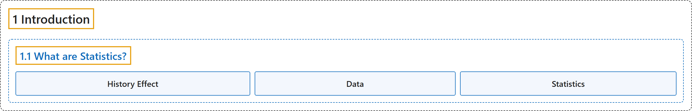

# 1.1 What are Statistics?

## Classification

## Glossary

| Term | Definition | 中文翻译 | Source |
|---|---|---|---|
| **1.1 What are Statistics?** 什么是统计学 | (No definition) | （无定义） | [Online Statistics Education, n.d., section 1.1](https://onlinestatbook.com/2/introduction/what_are.html) |
| **History Effect** 历史效应 | "A problem of **confounding** where the passage of time, and not the variable of interest, is responsible for observed effects. See also: third variable problem." | 一种**混淆**问题：造成所观察到效应的是时间的推移，而不是所关注的变量。另见：第三变量问题。 | [Online Statistics Education, n.d., glossary](https://onlinestatbook.com/2/glossary/History_effect.html) |
| **Data** 数据 | "A **collection of values** to be used for statistical analysis. See also: variable." | 用于统计分析的**一组值**。另见：变量。 | [Online Statistics Education, n.d., glossary](https://onlinestatbook.com/2/glossary/data.html) |
| **Statistics** 统计学 | "(i) What you are studying right now, also known as **statistical analysis**, or statistical inference. It is a field of study concerned with summarizing data, interpreting data, and making decisions based on data. (ii) A quantity calculated in a sample to estimate a value in a population is called a "**statistic**."" | （i）你现在正在学习的内容，也称**统计分析**或统计推断。它是一个关注概括数据、解释数据以及基于数据做出决策的研究领域。（ii）在样本中计算出来用以估计总体中某个值的量称为“**统计量**”。 | [Online Statistics Education, n.d., glossary](https://onlinestatbook.com/2/glossary/statistics.html) |

## References

*Online statistics education: An interactive multimedia course of study*. (n.d.). Rice University, University of Houston Clear Lake, and Tufts University. Retrieved October 29, 2026, from <https://onlinestatbook.com/2/>
