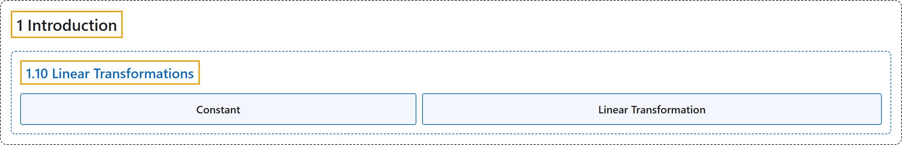

# 1.10 Linear Transformations

## Classification

## Glossary

| Term | Definition | 中文翻译 | Source |
|---|---|---|---|
| **1.10 Linear Transformations** 线性变换 | (No definition) | （无定义） | [Online Statistics Education, n.d., section 1.10](https://onlinestatbook.com/2/introduction/linear_transforms.html) |
| **Constant** 常数 | "A **value that does not change**. Values such as pi, or the mass of the Earth are constants. Compare with variables." | **不变的值**。例如圆周率或地球的质量都是常数。与变量相比较。 | [Online Statistics Education, n.d., glossary](https://onlinestatbook.com/2/glossary/constant.html) |
| **Linear Transformation** 线性变换 | "A **linear transformation** is any transformation of a variable that can be achieved by **multiplying it by a constant, and then adding a second constant**. If $Y$ is the transformed value of $X$, then $Y = aX + b$. The transformation from degrees Fahrenheit to degrees Centigrade is linear and is done using the formula: $C = 0.55556F - 17.7778$." | **线性变换**是指任何可以通过**将变量乘以一个常数，再加上第二个常数**来实现的变换。若 $Y$ 是 $X$ 变换后的值，则 $Y = aX + b$。从华氏度到摄氏度的变换是线性的，使用如下公式完成：$C = 0.55556F - 17.7778$。 | [Online Statistics Education, n.d., glossary](https://onlinestatbook.com/2/glossary/linear_transformation.html) |

## References

*Online statistics education: An interactive multimedia course of study*. (n.d.). Rice University, University of Houston Clear Lake, and Tufts University. Retrieved October 29, 2026, from <https://onlinestatbook.com/2/>
