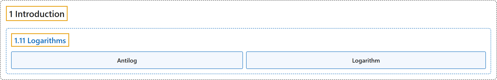

# 1.11 Logarithms

## Classification

## Glossary

| Term | Definition | 中文翻译 | Source |
|---|---|---|---|
| **1.11 Logarithms** 对数 | (No definition) | （无定义） | [Online Statistics Education, n.d., section 1.11](https://onlinestatbook.com/2/introduction/logarithms.html) |
| **Antilog** 反对数 | "Taking the **anti-log** of a number **undoes the operation of taking the log**. Therefore, since $\log_{10}(1000) = 3$, the $\text{antilog}_{10}$ of 3 is 1,000." | 对一个数取**反对数**会**撤销取对数的运算**。因此，由于 $\log_{10}(1000) = 3$，3 的 $\text{antilog}_{10}$ 为 1,000。 | [Online Statistics Education, n.d., glossary](https://onlinestatbook.com/2/glossary/anti_log.html) |
| **Logarithm** 对数 | "The **logarithm** of a number is the power the base of the logarithm has to be raised to in order to equal the number. If the base of the logarithm is 10 and the number is 1,000 then the log is 3 since 10 has to be raised to the 3rd power to equal 1,000." | 一个数的**对数**是为使该数等于对数的底数所必须施加的幂。如果对数的底数是 10，数是 1,000，则对数为 3，因为 10 必须取 3 次幂才等于 1,000。 | [Online Statistics Education, n.d., glossary](https://onlinestatbook.com/2/glossary/log.html) |

## References

*Online statistics education: An interactive multimedia course of study*. (n.d.). Rice University, University of Houston Clear Lake, and Tufts University. Retrieved October 29, 2026, from <https://onlinestatbook.com/2/>
