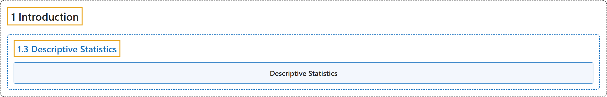

# 1.3 Descriptive Statistics

## Classification

## Glossary

| Term | Definition | 中文翻译 | Source |
|---|---|---|---|
| **1.3 Descriptive Statistics** 描述统计 | (No definition) | （无定义） | [Online Statistics Education, n.d., section 1.3](https://onlinestatbook.com/2/introduction/descriptive.html) |
| **Descriptive Statistics** 描述统计 | "The **branch of statistics concerned with describing and summarizing data**. A set of statistics such as the mean, standard deviation, and skew that describe a distribution." | 统计学中**研究数据的描述与概括的分支**。也指描述一个分布的一组统计量，如均值、标准差和偏度。 | [Online Statistics Education, n.d., glossary](https://onlinestatbook.com/2/glossary/descriptive_stat.html) |

## References

*Online statistics education: An interactive multimedia course of study*. (n.d.). Rice University, University of Houston Clear Lake, and Tufts University. Retrieved October 29, 2026, from <https://onlinestatbook.com/2/>
