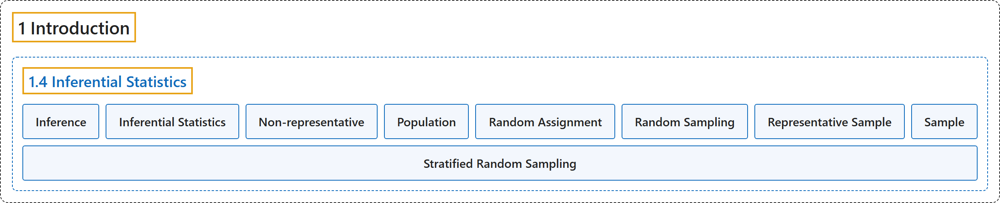

# 1.4 Inferential Statistics

## Classification

## Glossary

| Term | Definition | 中文翻译 | Source |
|---|---|---|---|
| **1.4 Inferential Statistics** 推断统计 | (No definition) | （无定义） | [Online Statistics Education, n.d., section 1.4](https://onlinestatbook.com/2/introduction/inferential.html) |
| **Inference** 推断 | "The act of **drawing conclusions about a population from a sample**." | **根据样本对总体作出结论**的行为。 | [Online Statistics Education, n.d., glossary](https://onlinestatbook.com/2/glossary/inference.html) |
| **Inferential Statistics** 推断统计 | "The branch of statistics concerned with **drawing conclusions about a population from a sample**. This is generally done through random sampling, followed by inferences made about central tendency, or any of a number of other aspects of a distribution." | 统计学中关注**根据样本得出关于总体的结论**的分支。这通常通过随机抽样来完成，随后对集中趋势或分布的许多其他方面作出推断。 | [Online Statistics Education, n.d., glossary](https://onlinestatbook.com/2/glossary/inferential_statistics.html) |
| **Non-representative** 非代表性 | "A **non-representative sample** is a **sample that does not accurately reflect the population**. See bias." | **非代表性样本**是**不能准确反映总体的样本**。参见偏倚。 | [Online Statistics Education, n.d., glossary](https://onlinestatbook.com/2/glossary/nonrepresentative.html) |
| **Population** 总体 | "A **population** is the complete set of observations a researcher is interested in. Contrast this with a sample which is a subset of a population. A population can be defined in a manner convenient for a researcher. For example, one could define a population as all girls in fourth grade in Houston, Texas. Or, a different population is the set of all girls in fourth grade in the United States. Inferential statistics are computed from sample data in order to make inferences about the population." | **总体**是研究者所关注的全部观测的集合。与之相对，样本是总体的子集。总体可以按便于研究者的方式来定义。例如，可以把总体定义为得克萨斯州休斯敦所有四年级女生。或者，另一个不同的总体是美国所有四年级女生的集合。推断统计由样本数据计算得出，以便对总体作出推断。 | [Online Statistics Education, n.d., glossary](https://onlinestatbook.com/2/glossary/population.html) |
| **Random Assignment** 随机分配 | "**Random assignment** occurs when the subjects in an experiment are randomly assigned to conditions. Random assignment prevents systematic confounding of treatment effects with other variables." | 当实验中的被试被随机分配到各条件时，就发生**随机分配**。随机分配可防止处理效应与其他变量发生系统性混淆。 | [Online Statistics Education, n.d., glossary](https://onlinestatbook.com/2/glossary/random_assign.html) |
| **Random Sampling** 随机抽样 | "The process of **selecting a subset of a population for the purposes of statistical inference**. **Random sampling** means that every member of the population is equally likely to be chosen. See also: stratified random sampling." | **为统计推断的目的而从总体中选取一个子集**的过程。**随机抽样**意味着总体的每个成员被选中的可能性相等。另见：分层随机抽样。 | [Online Statistics Education, n.d., glossary](https://onlinestatbook.com/2/glossary/random_sampling.html) |
| **Representative Sample** 代表性样本 | "A **representative sample** is a sample chosen to match the qualities of the population from which it is drawn. With a large sample size, random sampling will approximate a representative sample; stratified random sampling can be used to make a small sample more representative." | **代表性样本**是为与其所抽自的总体的特征相匹配而选取的样本。在样本量较大时，随机抽样会近似得到代表性样本；分层随机抽样可用于使小样本更具代表性。 | [Online Statistics Education, n.d., glossary](https://onlinestatbook.com/2/glossary/representative_sample.html) |
| **Sample** 样本 | "A **sample** is a subset of a population, often taken for the purpose of statistical inference. Generally, one uses a random sample. See also: bias, stratified random sample." | **样本**是总体的子集，常为统计推断的目的而抽取。通常使用随机样本。另见：偏倚、分层随机样本。 | [Online Statistics Education, n.d., glossary](https://onlinestatbook.com/2/glossary/sample.html) |
| **Stratified Random Sampling** 分层随机抽样 | "In **stratified random sampling**, the population is **divided into a number of subgroups (or strata)**. Random samples are then taken from each subgroup with sample sizes proportional to the size of the subgroup in the population. For instance, if a population contained equal numbers of men and women, and the variable of interest is suspected to vary by gender, one might conduct stratified random sampling to insure a representative sample." | 在**分层随机抽样**中，总体被**划分为若干个子群**（或层）。然后从每个子群中抽取随机样本，样本量与该子群在总体中的大小成比例。例如，如果总体中男女人数相等，并且怀疑所关注的变量因性别而异，就可以进行分层随机抽样，以确保样本具有代表性。 | [Online Statistics Education, n.d., glossary](https://onlinestatbook.com/2/glossary/stratified_random_sampling.html) |

## References

*Online statistics education: An interactive multimedia course of study*. (n.d.). Rice University, University of Houston Clear Lake, and Tufts University. Retrieved October 29, 2026, from <https://onlinestatbook.com/2/>
