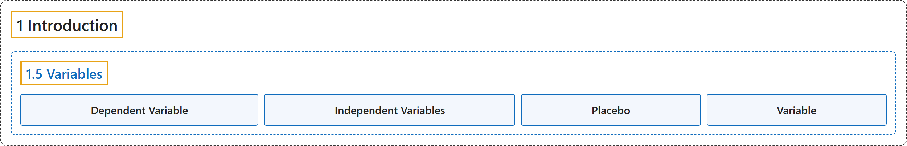

# 1.5 Variables

## Classification

## Glossary

| Term | Definition | 中文翻译 | Source |
|---|---|---|---|
| **1.5 Variables** 变量 | (No definition) | （无定义） | [Online Statistics Education, n.d., section 1.5](https://onlinestatbook.com/2/introduction/variables.html) |
| **Dependent Variable** 因变量 | "A variable that **measures the experimental outcome**. In most experiments, the effects of the independent variable on the dependent variables are observed. For example, if a study investigated the effectiveness of an experimental treatment for depression, then the measure of depression would be the dependent variable. Synonym: dependent measure" | **测量实验结果**的变量。在大多数实验中，观察的是自变量对因变量的影响。例如，如果一项研究考察某种实验性抑郁症治疗的效果，那么抑郁程度的测量就是因变量。同义词：因变测量 | [Online Statistics Education, n.d., glossary](https://onlinestatbook.com/2/glossary/dependent_variable.html) |
| **Independent Variables** 自变量 | "Variables that are **manipulated by the experimenter**, as opposed to dependent variables. Most experiments consist of observing the effect of the independent variable(s) on the dependent variable(s)." | 与因变量相对，**由实验者操纵**的变量。大多数实验都是观察自变量对因变量的影响。 | [Online Statistics Education, n.d., glossary](https://onlinestatbook.com/2/glossary/independent_variable.html) |
| **Placebo** 安慰剂 | "A device used in clinical trials, the **placebo** is **visually indistinguishable from the study medication, but in reality has no medical effect** (often, a sugar pill). A group of subjects chosen randomly takes the placebo, the others take one or another type of medication. This is done to prevent confounding the medical and psychological effects of the drug. Even a sugar pill can lead some patients to report improvement and side effects." | 作为临床试验中使用的一种手段，**安慰剂**是**在外观上与研究用药无法区分，但实际上没有医学效果**（通常是糖丸）。随机选出的一组受试者服用安慰剂，其余受试者服用某一种药物。这样做是为了防止混淆药物的医学效应和心理效应。即使是糖丸，也会使一些患者报告病情好转和副作用。 | [Online Statistics Education, n.d., glossary](https://onlinestatbook.com/2/glossary/placebo.html) |
| **Variable** 变量 | "Something that can take on different values. For example, different subjects in an experiment weigh different amounts. Therefore "weight" is a variable in the experiment. Or, subjects may be given different doses of a drug. This would make "dosage" a variable. Variables can be dependent or independent, qualitative or quantitative, and continuous or discrete." | **可以取不同值的事物**。例如，实验中不同的被试体重不同，因此“体重”是该实验中的**变量**。又如，被试可能被给予不同剂量的药物，这就使“剂量”成为变量。变量可以是因变量或自变量，定性或定量，连续或离散的。 | [Online Statistics Education, n.d., glossary](https://onlinestatbook.com/2/glossary/variable.html) |

## References

*Online statistics education: An interactive multimedia course of study*. (n.d.). Rice University, University of Houston Clear Lake, and Tufts University. Retrieved October 29, 2026, from <https://onlinestatbook.com/2/>
