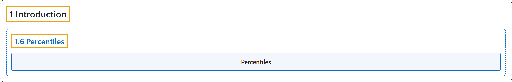

# 1.6 Percentiles

## Classification

## Glossary

| Term | Definition | 中文翻译 | Source |
|---|---|---|---|
| **1.6 Percentiles** 百分位数 | (No definition) | （无定义） | [Online Statistics Education, n.d., section 1.6](https://onlinestatbook.com/2/introduction/percentiles.html) |
| **Percentiles** 百分位数 | "There is no universally accepted definition of a **percentile**. Using the 65th percentile as an example, some statisticians define the 65th percentile as the lowest score that is greater than 65% of the scores. Others have defined the 65th percentile as the lowest score that is greater than or equal to 65% of the scores. A more sophisticated definition is given below. The first step is to compute the rank ($R$) of the percentile in question. This is done using the following formula:" | **百分位数**没有普遍接受的定义。以第 65 百分位数为例，一些统计学家将第 65 百分位数定义为大于 65% 的分数的最低分数。另一些人则将第 65 百分位数定义为大于或等于 65% 的分数的最低分数。下面给出一个更精细的定义。第一步是计算所论百分位数的秩（$R$）。这通过以下公式完成： | [Online Statistics Education, n.d., glossary](https://onlinestatbook.com/2/glossary/percentiles.html) |

## References

*Online statistics education: An interactive multimedia course of study*. (n.d.). Rice University, University of Houston Clear Lake, and Tufts University. Retrieved October 29, 2026, from <https://onlinestatbook.com/2/>
